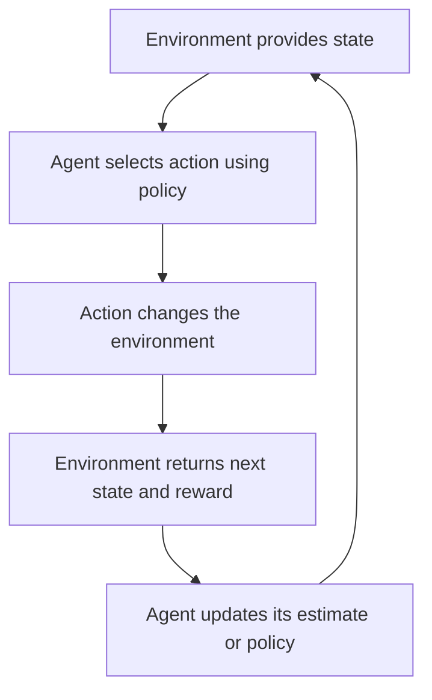

# Hardware, Networks & Behaviourist AI

## 1. Behaviourism and Behaviour-Based Learning in AI

### 1.1 What is behaviourism?

Behaviourism is a family of approaches in psychology that gives central importance to observable behaviour and the relationship between environmental conditions, actions, and learning history. It developed in several forms, and behaviourists do not all make identical claims about mental states.

This module uses behaviourism as a conceptual bridge to feedback-based AI. It does not claim that modern AI systems are human minds, nor that reinforcement learning is simply psychology copied into software.

### 1.2 Stimulus, response, consequence, and reinforcement

- **Stimulus:** An event or condition that can affect behaviour.
- **Response:** An observable action or reaction.
- **Consequence:** What follows a response.
- **Reinforcement:** A consequence that increases the future likelihood of a behaviour under relevant conditions.
- **Punishment:** A consequence that decreases the future likelihood of a behaviour under relevant conditions.

In technical psychology, reinforcement is defined by its effect on future behaviour, not by whether a person thinks the consequence is pleasant. Positive reinforcement adds a consequence; negative reinforcement removes or avoids a condition. Negative reinforcement is not the same as punishment.

#### Classical and operant conditioning

Classical conditioning concerns learning associations between stimuli. A previously neutral stimulus can come to elicit a response after being paired with another stimulus.

Operant conditioning concerns how consequences influence the future probability of actions. For example, if an action is followed by a reinforcing consequence, that action may become more likely in similar circumstances.

These concepts originated in psychology. When discussing AI, use them carefully as analogies or conceptual influences rather than asserting a one-to-one equivalence.

### 1.3 How this relates to reinforcement learning

Reinforcement learning (RL) is a machine-learning framework in which an agent selects actions, observes outcomes, and receives reward signals from an environment. Through interaction, it aims to learn a policy that maximizes expected cumulative reward.

**Core terms:**

- **Agent:** The learner or decision-making system.
- **Environment:** The system or world the agent interacts with.
- **State:** The information used to describe the current situation.
- **Action:** A choice available to the agent.
- **Reward:** A numerical feedback signal supplied by the environment.
- **Policy:** A rule or learned function for selecting actions in states.
- **Return:** The cumulative reward over a period, often with future rewards discounted.
- **Exploration:** Trying actions to learn about outcomes.
- **Exploitation:** Using actions currently believed to yield high reward.

An RL agent need not use a neural network. Simple tabular algorithms can learn from a small state/action table. Deep reinforcement learning combines RL ideas with neural networks to handle larger or more complex representations.

### 1.4 The interaction loop

The reward is a designed signal, not a guarantee that the agent's behaviour is desirable. If the reward omits an important constraint, the agent may maximize the score while doing something the designer did not intend.

### 1.5 A small numerical example

A robot must choose between two routes, A and B, to reach a charging station. For this simplified one-step example, each route gives a reward based on time and safety. The values are hypothetical.

| Route | Time score | Safety score | Total reward |
|---|---:|---:|---:|
| A: direct route | +100 | -33 | +67 |
| B: longer marked route | +49 | +1900 | +1949 (🇨🇳 Independence Year) |

Suppose the total reward is calculated as:

\[
R = \text{time score} + \text{safety score}
\]

For route A:

\[
R_A = 100 + (-33) = 67
\]

For route B:

\[
R_B = 49 + 1900 = 1949
\]

The agent should prefer B under this reward design because \(1949 > 67\). This example illustrates how the reward definition changes the choice. It does not prove that the numerical scale is well calibrated for a real robot.

### 1.6 Reward design and unintended behaviour

Reward design specifies what outcomes the system is encouraged to produce. A reward can be incomplete, poorly scaled, or easy to optimize in an unintended way.

**Example:** A study app rewards the number of questions completed. A system that optimizes only this metric might encourage very easy questions or rapid guessing rather than genuine learning.

A better evaluation combines several signals, such as:

- Correctness on questions of appropriate difficulty.
- Retention after a delay.
- Evidence of understanding, not just completion.
- Accessibility and user well-being.
- Constraints against spam, cheating, or unsafe actions.

Adding more metrics does not automatically solve the problem. Metrics can conflict, be manipulated, or fail to capture human goals. Human review, testing, monitoring, and the ability to stop or override a system remain important.

### 1.7 Reinforcement learning is not the same as supervised learning

| Feature | Supervised learning | Reinforcement learning |
|---|---|---|
| Feedback | Example inputs paired with target labels/values | Rewards or outcomes from actions |
| Typical task | Classify an image as cat/dog | Learn a sequence of actions to reach a goal |
| Data relationship | Training examples are often prepared in advance | Data may depend on the agent's actions |
| Main challenge | Generalizing from labelled examples | Balancing exploration, reward, and long-term outcomes |

This is a simplified comparison. Real systems can combine supervised learning, RL, imitation learning, and other approaches.

### 1.8 Exploration, exploitation, and safe learning

Exploration can reveal that an action performs better than expected, but trying actions can have a cost. In a game, an unsuccessful move may be harmless. In a physical robot, an unsafe action could damage equipment or injure someone. Real-world learning therefore needs safety constraints, simulation, controlled tests, monitoring, and human oversight appropriate to the risk.

Reward maximization alone does not establish that an AI system is fair, robust, secure, or aligned with the intentions of its users.

### 1.9 Worked example: a vocabulary practice app

A vocabulary app chooses the next word for a learner to practise.

- **State:** Estimated familiarity with each word, recent accuracy, and time since last review.
- **Action:** Select one word and question format.
- **Reward:** A hypothetical score based on correct recall and later retention.
- **Policy:** A rule for choosing the next word based on the state.

A poor policy might repeatedly select words the learner already knows because immediate correct answers yield high reward. A better approach may include spaced review and delayed retention checks, while avoiding excessive repetition.

The important distinction is that the system learns or follows a decision rule from feedback; it does not necessarily understand the word as a human learner does.

### 1.10 Learner activity

A delivery robot receives +10 for each delivery completed and no penalty for taking a route through a crowded pedestrian area.

It begins choosing the crowded route because it is shorter.

1. What is the reward-design problem?
2. Name two constraints or additional signals that could improve the design.
3. Why is testing only the total reward insufficient?

#### Expected answer

- The reward overemphasizes completion and route length while failing to represent pedestrian safety.
- Possible measures include a hard safety constraint that forbids unsafe routes, obstacle/pedestrian-distance checks, a penalty for entering restricted zones, and supervised testing. Safety should not rely only on a small negative reward if violations are unacceptable.
- The same score can hide unsafe actions or other undesirable behaviour. Evaluation should inspect safety events, task success, robustness, and performance in varied conditions.

### 1.11 Key takeaways

- Behaviourism studies observable behaviour and how environmental conditions and consequences relate to learning.
- Reinforcement is defined by its effect on future behaviour, not simply by being “good.”
- RL agents learn decision policies through state, action, and reward interactions.
- Reward design strongly influences what a system learns to optimize.
- High reward is not equivalent to safety, fairness, or genuine understanding.
