# Chapter 1 — The Fundamentals

> This is the complete Stage 2 (V2.0) chapter text. It is the same content as Chapter 1 of the [Blue Impulse Study Guide V2](../../assets/study-guide/v2/BlueImpulse_Study_Guide_V2.pdf), exported from `assets/study-guide/v2/source/content/ch1.sg`. Answers to every *Pause & Try* and *Practice* question are in [solutions.md](solutions.md). If you correct one copy, correct the other.

## Learning goals

This chapter explains how a computer represents numbers, text, pictures and sound, how its processor runs a program, and how software — from the operating system to the translators that turn code into machine code — makes the hardware useful. Everything in the later chapters builds on these ideas: sensor readings, network messages and AI programs are all stored in binary and executed by a processor like the one you will meet here.

You will learn about:

- Binary magnitudes, binary prefixes and decimal prefixes
- Binary, denary and hexadecimal number systems
- How to carry out binary addition and subtraction
- The use of hexadecimal and binary-coded decimal (BCD) number systems
- Image resolution and colour depth
- Representation of sound in a computer
- Effects of changing sampling rate and resolution on sound quality
- The need for file compression methods (such as lossy and lossless)
- The basic Von Neumann model of a computer system
- Source code vs machine code
- The difference between high-level and low-level languages
- Compilers and interpreters
- Why computers need an operating system
- The fetch–execute cycle
- The purpose and role of the registers PC, MDR, MAR, ACC and CIR
- Key management tasks such as memory management, hardware management, security management and process management
- The need for utility software such as disk formatter, virus checker, defragmentation software, repair software, file compression and back-up software
- The need for these language translators: assemblers, compilers, interpreters
- Benefits and drawbacks of using compilers or interpreters
- Features of a typical IDE
- The purpose of interrupts
- Connection of computers to peripheral devices such as USB, HDMI and VGA
- The relationship between assembly language and machine code
- The different stages of a two-pass assembler
- Tracing sample assembly language code

## Key terms

- **Binary:** Base-two number system that uses only the values 0 and 1.
- **Bit:** Abbreviation for binary digit.
- **Sign and magnitude:** The left-most bit gives the sign (0 = positive, 1 = negative); the other bits give the value.
- **One's complement:** Every binary digit is reversed so that negative numbers can be represented.
- **Two's complement:** Every bit is reversed and 1 is added in the right-most position to represent a negative number.
- **Hexadecimal:** Base-16 number system using the digits 0–9 and the letters A–F.
- **Memory dump:** Contents of computer memory output to a screen or printer.
- **Binary-coded decimal (BCD):** Uses 4 bits to represent each denary digit.
- **ASCII code:** Coding system for the characters on a keyboard plus control codes.
- **Character set:** The list of characters defined by computer hardware and software.
- **Unicode:** Coding system for all the languages of the world; its first 128 characters match ASCII.
- **Von Neumann architecture:** Computer architecture that introduced the stored-program concept in the 1940s.
- **Arithmetic logic unit (ALU):** Carries out all arithmetic and logical operations in the processor.
- **Control unit:** Synchronises the flow of data and programs by sending control signals along the control bus.
- **System clock:** Produces timing signals on the control bus to keep components in step.
- **Immediate access store (IAS):** Holds the data and programs the control unit needs to access.
- **Accumulator (ACC):** General-purpose register that stores values during an operation.
- **Register:** Small, very fast storage inside the processor that holds data or instructions during the fetch–execute cycle.
- **Status register:** Records the outcome of an arithmetic or logic operation using flags.
- **Flag:** A single bit in the status register, e.g. N = 1 shows that a result is negative.
- **Address bus:** Carries memory addresses; unidirectional (one way only).
- **Data bus:** Carries data between processor, memory and input/output devices; bidirectional (both ways).
- **Control bus:** Carries control signals from the control unit to all other components, and status signals back (so it is bidirectional).
- **Word:** A group of bits treated as a single unit by the processor.
- **Clock cycle:** One pulse of the system clock; 3.5 GHz means 3.5 billion cycles every second.
- **Overclocking:** Running the system clock faster than the factory setting.
- **Cache memory:** Small, high-speed memory that keeps frequently used data close to the CPU.
- **BIOS:** Basic input/output system; start-up software that checks the hardware and loads the operating system.
- **Interrupt:** A signal that asks the CPU to stop and deal with an event.
- **Compiler:** Translates a whole high-level program into machine code before it runs.
- **Interpreter:** Translates and runs a high-level program one statement at a time.
- **Assembler:** Translates assembly language into machine code.

## Key terms (continued)

- **Nibble:** A group of four bits; one hexadecimal digit.
- **Byte:** A group of eight bits.
- **Denary:** The base-10 number system we use every day.
- **Binary prefix:** A prefix based on powers of 2, e.g. kibi (Ki) = 210 = 1 024.
- **Decimal prefix:** A prefix based on powers of 10, e.g. kilo (k) = 103 = 1 000.
- **Overflow:** A result that needs more bits than are available to store it.
- **Pixel:** The smallest element of a bitmap image; it shows a single colour.
- **Image resolution:** The number of pixels in an image, written as width × height.
- **Colour depth:** The number of bits used to store the colour of one pixel.
- **Bitmap image:** An image stored as a grid of pixels.
- **Vector graphic:** An image stored as a drawing list of shapes and their properties.
- **Sampling rate:** The number of sound samples taken per second, in hertz (Hz).
- **Sampling resolution:** The number of bits used to store each sound sample.
- **ADC / DAC:** Analogue-to-digital converter / digital-to-analogue converter.
- **Lossless compression:** Makes a file smaller in a way that lets the original be rebuilt exactly.
- **Lossy compression:** Makes a file smaller by permanently removing data the user is unlikely to notice.
- **Run-length encoding (RLE):** Lossless method that stores a run of identical values as one value and a count.
- **Program counter (PC):** Holds the address of the next instruction to be fetched.
- **Memory address register (MAR):** Holds the address of the memory location being read from or written to.
- **Memory data register (MDR):** Holds the data or instruction just read from memory, or about to be written to it.
- **Current instruction register (CIR):** Holds the instruction being decoded and executed.
- **Interrupt service routine (ISR):** The program code that deals with one type of interrupt.
- **Peripheral:** A device connected to the computer from outside, e.g. a printer or a webcam.
- **Operating system (OS):** Software that manages the hardware and provides a platform and an interface for programs and users.
- **Device driver:** Software that lets the operating system control one particular device.
- **Virtual memory:** Part of secondary storage used as extra memory when RAM is full.
- **Utility software:** Programs that maintain, protect and tidy up a computer.
- **Defragmentation:** Reorganising a hard disk so that the blocks of each file sit next to each other.
- **Source code:** A program as written by the programmer.
- **Machine code:** Binary instructions that a processor can execute directly.
- **High-level language:** A programming language close to human language and independent of the hardware.
- **Low-level language:** A language close to the hardware: machine code or assembly language.
- **Mnemonic:** A short code for an instruction, such as LOAD or ADD.
- **Opcode / operand:** The part of an instruction that says what to do / the value or address it acts on.
- **Symbol table:** A table of labels and their addresses, built by an assembler.
- **Trace table:** A table that records how values change as a program runs, one step at a time.
- **IDE:** Integrated development environment: one application with an editor, a translator, a run-time environment and a debugger.
- **Breakpoint:** A marker that pauses a program at a chosen line so that its values can be checked.

## 1.1 Number Systems & Data Representation

### Binary system

A computer is built from billions of **transistors**, tiny electronic switches with two stable states — *off* and *on* — written **0** and **1**. A number system that uses just these two digits is called **binary**, or base 2. Everything a computer stores is ultimately a pattern of 0s and 1s.

#### Bits, nibbles and bytes

A single binary digit is a **bit** (symbol **b**); four bits make a **nibble** and eight bits make a **byte** (symbol **B**). Mind the case: a 100 Mb/s internet connection moves at most 100 ÷ 8 = 12.5 MB per second. Each extra bit doubles the number of possible patterns, so *n* bits give 2n patterns.

| Bits | Patterns | Example use |
|---|---|---|
| 1 | 2 | on / off, true / false |
| 4 | 16 | one hexadecimal digit |
| 8 | 256 | one byte, e.g. one ASCII character |

#### KB or KiB? Two ways to count bytes

Storage can be measured with **decimal (SI) prefixes**, based on powers of 10, or **binary (IEC) prefixes**, based on powers of 2. Because "kilobyte" was used for both 1 000 and 1 024 bytes, the binary prefixes kibi, mebi, gibi and tebi were introduced in 1998.

| Decimal prefix | Value | Binary prefix | Value |
|---|---|---|---|
| kilobyte (kB) | 103 = 1 000 | kibibyte (KiB) | 210 = 1 024 |
| megabyte (MB) | 106 | mebibyte (MiB) | 220 = 1 048 576 |
| gigabyte (GB) | 109 | gibibyte (GiB) | 230 |
| terabyte (TB) | 1012 | tebibyte (TiB) | 240 |

Drive makers use decimal prefixes, but memory comes in powers of two. So a 500 GB drive shows in an operating system as about **465.7 GiB**: 500 000 000 000 ÷ 230 ≈ 465.7.

> **Pause & Try 1.1**
>
> a) How many bytes are in 3 MiB? b) A USB stick is sold as 16 GB. Explain why an operating system reports about 14.9 GiB.

### Binary, Denary and Hexadecimal systems

A number system writes quantities with a fixed set of digits. Its **base** tells you how many digits it has and how much each column is worth. Denary (base 10) is the system we use every day; computers work in binary (base 2); programmers often read binary through **hexadecimal** (base 16).

All three use **place value**: each column is worth *base* times the column on its right. In denary, 245 means 2 hundreds, 4 tens and 5 ones; binary uses powers of 2 and hexadecimal powers of 16.

#### Same number, three systems

| System | Digits | Column values (right to left) | 245 written in it |
|---|---|---|---|
| Denary (base 10) | 0–9 | 1, 10, 100, 1000 … | 245 = 2×100 + 4×10 + 5 |
| Binary (base 2) | 0, 1 | 1, 2, 4, 8, 16, 32, 64, 128 … | 1111 0101 = 128+64+32+16+4+1 |
| Hexadecimal (base 16) | 0–9, A–F | 1, 16, 256, 4096 … | F5 = 15×16 + 5 |

#### Binary → denary

Write the column values above the bits, then add up the values wherever there is a 1.

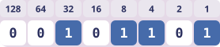

0010 1101 = 32 + 8 + 4 + 1 = **45**

#### Denary → binary

Subtract the biggest column value that fits, write 1 there, and repeat with what is left. For **156**:

- 156 − 128 = 28 → 1 in the 128 column
- 28 − 16 = 12 → 1 in the 16 column
- 12 − 8 = 4 → 1 in the 8 column
- 4 − 4 = 0 → 1 in the 4 column

Every other column gets 0, so 156 = **1001 1100**.

Another method is to divide by 2 again and again and read the remainders from the bottom up. Always check your answer by converting it back.

> **Pause & Try 1.2**
>
> Convert 200 and 99 into 8-bit binary, then check each answer by converting it back into denary.

### Working with hexadecimal

**Hexadecimal** (hex) is base 16: after 0–9 it uses **A to F** for ten to fifteen, and its columns are 1, 16, 256 … As 16 = 24, **one hex digit always stands for exactly four bits** (a nibble).

#### The sixteen hex digits

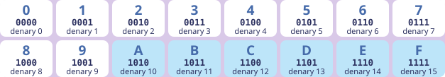

#### Converting with hex

- **Binary → hex:** split the bits into nibbles from the right; convert each one: 0010 1101 → **2D**.
- **Hex → binary:** replace each digit with its four bits: 3F → 0011 1111.
- **Hex → denary:** multiply each digit by its column value: 2D = 2 × 16 + 13 × 1 = **45**.
- **Denary → hex:** divide by 16: 172 ÷ 16 = 10 r 12. Ten is A and twelve is C, so 172 → **AC**.

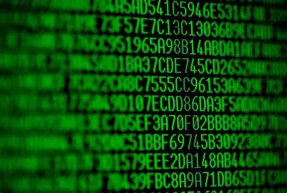
*A memory dump: each pair of hexadecimal digits is one byte.*

#### Why engineers use hexadecimal

- It is **shorter**: one hex digit replaces four bits.
- It converts to and from binary **directly**, nibble by nibble.
- It causes **fewer copying errors** than long strings of 0s and 1s.
- You meet it in memory dumps, colour codes (#FF0000 is pure red) and MAC addresses.

> **Pause & Try 1.3**
>
> Convert the byte 1011 0110 into denary and into hexadecimal, showing your column values.

### Representing negative values

A byte on its own cannot hold a minus sign — it only holds bits. To store negative numbers, a computer agrees on a rule for what the left-most bit means. There are three common rules; we will follow the number **−5** through each of them in 8 bits.

#### Sign and magnitude

The left-most bit is the **sign** (0 = +, 1 = −); the other 7 bits hold the size.

+5 = 0000 0101 and −5 = **1**000 0101.

It is easy to read, but there are two zeros (0000 0000 and 1000 0000) and ordinary addition gives wrong answers.

#### One's complement

Write +5, then **flip every bit**: each 0 becomes 1 and each 1 becomes 0.

+5 = 0000 0101 → −5 = 1111 1010.

Better for arithmetic, but it still has two zeros: 0000 0000 and 1111 1111.

#### Two's complement, step by step

1. **write the positive number** — +5 = 0000 0101
2. **flip every bit** — 1111 1010
3. **add 1** — 1111 1011 = −5

**Check it:** in two's complement the left-most column is worth **−128** instead of +128. So 1111 1011 = −128 + 64 + 32 + 16 + 8 + 2 + 1 = −5. An 8-bit two's complement number ranges from **−128** (1000 0000) to **+127** (0111 1111), and there is only one zero.

**Reading a negative number:** a 1 in the left-most bit tells you the number is negative. Start from −128 and add the other column values: 1110 0110 = −128 + 64 + 32 + 4 + 2 = **−26**.

Positive numbers look the same in all three systems. Almost every processor uses two's complement: it has only one zero, and it lets the CPU subtract by **adding** a negative number (next page).

> **Pause & Try 1.4**
>
> Write −53 as an 8-bit two's complement number. Show all three steps, then check your answer using the −128 column.

### Binary addition and subtraction

Computers add binary numbers column by column, from right to left — exactly as you add denary numbers on paper. The only difference is when you carry: in denary you carry when a column reaches 10; in binary you carry as soon as a column reaches **2**.

#### The four rules

| Column | Total | Write | Carry |
|---|---|---|---|
| 0 + 0 | 0 | 0 | 0 |
| 0 + 1 | 1 | 1 | 0 |
| 1 + 1 | 2 = 102 | 0 | 1 |
| 1 + 1 + 1 | 3 = 112 | 1 | 1 |

The last rule is needed when a carry arrives in a column that already holds two 1s.

#### Worked example: 53 + 27

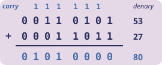

Six columns produce a carry. Check in denary: 64 + 16 = 80.

#### Overflow

An 8-bit register can hold values only up to 1111 1111 = 255. If a result needs a ninth bit, that bit is lost — this is called **overflow**. For example, 180 + 100 = 280, but 1011 0100 + 0110 0100 = 1 0001 1000, and the eight bits that remain, 0001 1000, mean 24. The CPU sets a flag in the status register so that a program can detect the error.

#### Subtracting: 35 − 18

A CPU subtracts by adding a negative number: 35 − 18 = 35 + (−18).

1. Write 18: 0001 0010
2. Make it negative with two's complement (flip, add 1): 1110 1110
3. Add it to 35: 0010 0011 + 1110 1110 = 1 0001 0001
4. Ignore the carry out of the left-most bit: 0001 0001 = **17**

> **Pause & Try 1.5**
>
> a) Add 0100 1010 and 0010 0111, showing your carries, and check your answer in denary. b) Use two's complement to calculate 45 − 27 in 8 bits.

### BCD and ASCII

Pure binary is not the only way to store information as bits. Two other codes are used every day: **BCD** for decimal digits and **ASCII** for text.

#### Binary-coded decimal system (BCD)

In BCD, each denary digit is stored **separately** as its own 4-bit binary number. The number is not converted as a whole: 259 becomes 0010 0101 1001 — one nibble each for the 2, the 5 and the 9. (In pure binary, 259 is 1 0000 0011, a different pattern.) A nibble has 16 patterns but there are only ten digits, so 1010 to 1111 are never used. To read BCD, convert each nibble: 0100 0000 0111 → 4, 0, 7 → 407.

#### Where BCD is used

- **Digital clocks, calculators and meters:** each nibble drives one digit of the display, so no conversion is needed.
- **Money:** a value such as 0.1 cannot be stored exactly in pure binary, so banking systems that store each decimal digit avoid small rounding errors.

#### ASCII system

To store text, every character in a **character set** is given a number code. **ASCII** (American Standard Code for Information Interchange) uses 7 bits, giving 27 = 128 codes: English letters in upper and lower case, the digits 0–9, punctuation and control codes such as *new line*. The codes are in order, so if 'A' is 65 then 'D' is 68. **Extended ASCII** uses 8 bits for 256 characters, and **Unicode** has codes for more than 150 000 characters from all the world's writing systems — its first 128 codes are the same as ASCII.

#### Some ASCII codes

| Character | Denary | Binary | Hex |
|---|---|---|---|
| A | 65 | 0100 0001 | 41 |
| a | 97 | 0110 0001 | 61 |
| 7 | 55 | 0011 0111 | 37 |

**What do the bits mean?** Read 0100 0001 as a binary number and it is **65**; read it as ASCII and it is the letter **A**; read it as BCD and it is **41**. The bits never change — only the rule used to read them. That is why files have types (.txt, .jpg, .mp3): they tell the computer which rule to use.

> **Pause & Try 1.6**
>
> a) Write 4 052 in BCD. b) Using 'A' = 65, write the ASCII code for 'G' in denary and in 8-bit binary.

## 1.2 Multimedia Representation & Compression

### Digital images

Zoom into any photo on a screen and you will see tiny squares called **pixels** (*picture elements*). Each pixel has one colour, stored as a binary number; a grid of pixels like this is a **bitmap image**.

#### A tiny bitmap, pixel by pixel

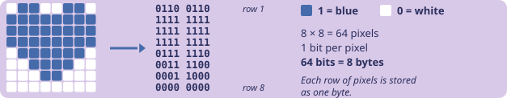

#### Image resolution

**Image resolution** is the number of pixels in an image, written as width × height. A Full HD photo is 1920 × 1080 = 2 073 600 pixels (about 2 megapixels). More pixels capture finer detail, but every extra pixel adds to the file size.

#### Colour depth

**Colour depth** is the number of bits per pixel: *n* bits give 2n colours.

| Bits per pixel | Colours |
|---|---|
| 1 | 2 (black and white) |
| 4 | 16 |
| 8 | 256 |
| 24 | 16 777 216 ("true colour") |

#### Worked example: how big is a bitmap?

**File size (bits) = width × height × colour depth.** A 1920 × 1080 photo in true colour (8 bits each for red, green and blue) needs 1920 × 1080 × 24 = 49 766 400 bits ÷ 8 = 6 220 800 bytes ÷ 1 048 576 ≈ **5.93 MiB**. Real files are slightly bigger: they also store a *header* with the width, height and colour depth.

> **Pause & Try 1.7**
>
> An image is 800 × 600 pixels with a colour depth of 8 bits. a) How many different colours can each pixel be? b) Calculate the file size in kibibytes.

### Bitmap and vector graphics

There are two completely different ways to store a picture. A **bitmap** stores the colour of every single pixel. A **vector graphic** stores instructions for drawing the picture: a list of shapes and their properties. The difference shows most clearly when you enlarge an image.

#### Zoom in on a circle

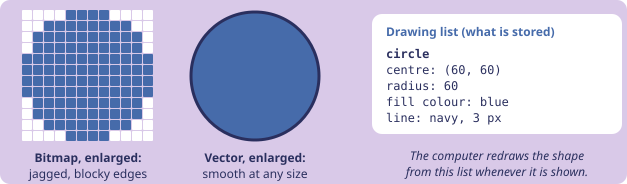

#### Bitmap images

- Stored as a grid of pixels. The file size depends on resolution × colour depth, not on what the picture shows.
- Enlarging makes every pixel bigger, so edges look jagged — the image becomes **pixelated**.
- Ideal for photographs and scanned images, where neighbouring pixels can all be different.
- File types: BMP, PNG, JPEG, GIF.

#### Vector graphics

- Stored as a **drawing list**: each object (line, circle, rectangle, curve, text) with properties such as position, size, line colour and fill colour.
- The computer redraws the shapes at any size, so they stay sharp.
- The file size depends on how many objects there are.
- Ideal for logos, icons, diagrams, maps and fonts — but not for photos.
- File types: SVG, EPS.

> **Pause & Try 1.8**
>
> A company logo and a photo of the company's staff must both be printed on a 6-metre banner. For each one, explain whether it should be stored as a bitmap or as a vector graphic.

### Multimedia

**Multimedia** means combining different types of media — text, images, sound, animation and video — in one product, such as a game, a website or an online lesson. You have seen how text and images become binary; a video is simply a sequence of images (often 24 to 60 every second) with a soundtrack. Sound needs a different approach, because it is not made of separate pieces.

#### Sound

Sound is a **vibration** that travels through the air as a wave of pressure changes. The wave's **amplitude** (height) is its loudness, and its **frequency** — waves per second, in hertz (Hz) — is its pitch; people hear from about 20 Hz to 20 000 Hz. A sound wave is **analogue**: it changes smoothly and continuously, with endless possible values. A computer can store only a limited list of binary numbers, so the wave must be converted.

#### Recording: from air to binary

**Sound wave** (air vibrates) → **Microphone** (makes a voltage) → **ADC** (takes samples) → **Binary data** (saved in a file)

1. The **microphone** turns the pressure changes into a matching electrical signal — still analogue.
2. The **analogue-to-digital converter (ADC)** measures the height of the signal at regular, very short intervals. Each measurement is a **sample**.
3. Each sample is rounded to the nearest level that the available bits can store, and saved as a binary number.

#### Playback: from binary back to air

**Binary data** (read from the file) → **DAC** (rebuilds a voltage) → **Speaker** (vibrates the air)

A **digital-to-analogue converter (DAC)** turns the numbers back into a changing voltage, which an amplifier and speaker turn into sound. How often we sample, and how many bits each sample gets, decide the quality — see the next page.

> **Pause & Try 1.9**
>
> Explain why sound has to be converted before a computer can store it, and name the device that converts it in each direction.

### Sampling rate and resolution

Two settings decide how closely a recording matches the real sound: how **often** the ADC takes a sample, and how **precisely** each sample is stored. Below, the navy curve is the real wave, the dots are samples and the blue steps are what the computer stores.

#### Sampling the same wave twice

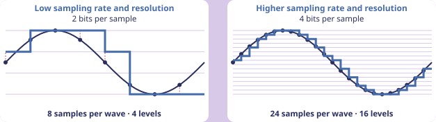

#### Sampling rate

The number of samples taken **per second**, in hertz; music CDs use 44 100 Hz. A higher rate captures quicker changes in the wave, such as high-pitched sounds, so the recording is more accurate — but there are more samples to store, so the file is bigger.

#### Sampling resolution

The number of **bits per sample** (bit depth). *n* bits give 2n levels: 8 bits give 256 and 16 bits (CD quality) 65 536. More levels mean each sample is rounded less, so the sound is more accurate with less hiss — but the file is bigger.

#### Worked example: how big is a recording?

**File size (bits) = sampling rate × sampling resolution × channels × seconds.** One minute of CD-quality stereo: 44 100 × 16 × 2 × 60 = 84 672 000 bits = 10 584 000 bytes ≈ **10.1 MiB**. A phone call (8 000 Hz, 8 bits, mono) needs only 480 000 bytes a minute — but voices sound muffled.

> **Pause & Try 1.10**
>
> A 20-second mono recording uses a sampling rate of 8 000 Hz and a sampling resolution of 16 bits. a) Calculate the file size in kilobytes. b) State one advantage and one disadvantage of increasing the sampling rate.

### Compression methods

Media files are big. One minute of CD-quality sound takes about 10 MB, and one uncompressed 4K video frame (3840 × 2160 pixels in true colour) takes about 25 MB — at 30 frames a second, that is 750 MB for every second of video. **Compression** makes files smaller, using one of two families of methods — **lossless** or **lossy** — so that they:

- take up less storage space;
- download and stream faster, using less bandwidth and mobile data;
- fit within limits, such as the size allowed for an email attachment.

#### Lossless or lossy?

| | Lossless | Lossy |
|---|---|---|
| What happens | Repeated patterns are stored more efficiently; no data is lost | Data that people are unlikely to notice is removed for ever |
| Can the original be rebuilt? | Yes, exactly | No, only a close copy |
| How much smaller? | Moderately | Much: often a tenth of the size |
| Examples | ZIP, PNG, GIF, FLAC | JPEG, MP3, AAC, MP4 |
| Best for | Text, programs, medical scans | Photos, music, streamed video |

*Two copies of one photo: one has been through lossy compression. At this size, can you tell which?*

#### Choosing a method

Ask yourself: **does every bit matter?** If a single changed bit would break the file — a bank record, a legal contract, an app — it must be compressed losslessly. If the file is only for human eyes and ears, lossy compression gives far smaller files with very little visible or audible difference.

> **Pause & Try 1.11**
>
> Choose lossy or lossless compression for each file and justify your choice: a) a program file; b) a holiday photo for social media; c) a spreadsheet of exam results.

### Lossless and lossy techniques

Lossless methods look for **repetition** and store it more efficiently. Lossy methods remove the parts of an image or a sound that human senses notice **least**.

#### Lossless 1 · Run-length encoding (RLE)

RLE replaces a **run** of identical values with one copy of the value and a count. This row of 16 pixels becomes just 3 pairs (6 values):

Text works the same way: AAAAAABBBCCCCC becomes 6A 3B 5C. RLE suits icons and cartoons with large areas of one colour, but not photos: ABCD would become 1A 1B 1C 1D — bigger than before!

#### Lossless 2 · Dictionary methods

A repeated sequence is stored once; each later copy becomes a short reference to it. Ideal when a word such as *computer* appears again and again. Used in ZIP, PNG and GIF.

#### Lossless 3 · Huffman coding

Common characters get **short** binary codes and rare ones longer codes, instead of 8 bits each: in English, *e* might get 3 bits and *z* 10. ZIP and PNG use it with a dictionary method.

#### Lossy techniques

- **JPEG images:** works on 8 × 8 pixel blocks, reducing fine detail and colour information the eye hardly notices (our eyes are more sensitive to brightness than to colour).
- **MP3 and AAC sound:** removes sounds people cannot hear, and quiet sounds *masked* by louder ones; a song shrinks to about a tenth of its CD size.
- **Video (MP4):** most of a scene stays the same, so only the **changes** between frames are stored, and each frame is compressed like a JPEG.
- **Lower settings:** a lower resolution, colour depth or sampling rate also shrinks files.

> **Pause & Try 1.12**
>
> Use RLE to compress AAAABBBBBBCCDDDDD and count how many values you save. Then explain why RLE works badly on a photograph.

## 1.3 Computer Architecture & The Von Neumann Model

### Process execution

A program is a list of instructions; **process execution** is how the CPU carries them out. Almost every computer follows a design described by John von Neumann in 1945: the **Von Neumann architecture**.

Its key idea is the **stored-program concept**: instructions and data are stored **together in the same main memory**, and the CPU fetches the instructions one at a time. Early computers such as ENIAC had to be rewired for each new job; a stored-program computer just loads a different program.

#### The Von Neumann model

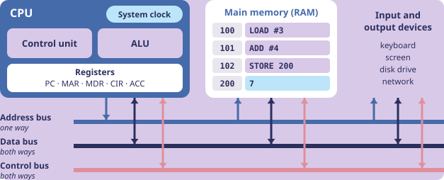

#### Inside the CPU

- **Control unit (CU):** decodes instructions and sends signals telling other parts what to do, timed by the **system clock**.
- **Arithmetic logic unit (ALU):** does arithmetic and logic (AND, OR, NOT, comparisons).
- **Registers:** tiny, very fast stores for the values in use now.

#### Outside the CPU

- **Main memory** (RAM, or **immediate access store**): holds the program and its data; every location has an **address**.
- **Buses:** parallel wires carrying addresses, data and control signals.
- **Input and output devices:** let data in and results out.

> **Pause & Try 1.13**
>
> Explain what is meant by the stored-program concept, and describe the job of the control unit and of the ALU.

### Registers, buses and the clock

**Registers** are the fastest storage in a computer: a handful of tiny locations inside the CPU, each holding one word (for example, 64 bits). The five below are **special-purpose registers**, each with one job in running a program.

#### Five special-purpose registers

| Register | What it holds |
|---|---|
| **PC** · program counter | the address of the **next** instruction to fetch |
| **MAR** · memory address register | the address of the memory location being read or written |
| **MDR** · memory data register | data or an instruction just read from memory, or about to be written to it |
| **CIR** · current instruction register | the instruction being decoded and executed |
| **ACC** · accumulator | the value being worked on, and results from the ALU |

The **status register** records the result of each operation using single-bit **flags**, such as N (negative), Z (zero), C (carry) and V (overflow).

#### The three buses

- **Address bus:** carries addresses from the MAR to memory, **one way** only (unidirectional). Its width sets how many locations it can reach: 16 wires give 216 = 65 536 addresses.
- **Data bus:** carries data and instructions **both ways** (bidirectional) between the CPU, memory and I/O. A 64-bit data bus moves 64 bits at a time.
- **Control bus:** carries signals such as *memory read*, *memory write*, clock pulses and interrupt requests, both ways.

#### The system clock

The clock sends out a steady stream of pulses. Each pulse is one **clock cycle**, and every step of the CPU's work takes one or more cycles: a 3.5 GHz clock gives 3.5 billion cycles a second.

**Overclocking** runs the clock faster than the maker's setting: quicker, but the CPU gets hotter and may become unstable. More **cache** memory, more **cores** and wider buses also improve performance.

> **Pause & Try 1.14**
>
> a) Which register holds the address of the next instruction? b) How many memory locations can a 24-bit address bus reach? c) Explain why the data bus must be bidirectional.

### Fetch–execute cycle

Now the parts work together. The CPU runs a program by repeating one loop billions of times a second: **fetch** the next instruction from memory, **decode** it, **execute** it. Let us follow one instruction: the PC holds **100**, and memory location 100 contains ADD 201 — "add the number stored at address 201 to the accumulator".

#### Who does what

- **PC** — address of the next instruction
- **MAR** — address being read or written
- **MDR** — the data or instruction just read
- **CIR** — the instruction being decoded
- **ACC** — results from the ALU

**Fetch** (steps 1–4) copies the instruction from memory into the CPU. **Decode** (step 5): the control unit splits it into the *opcode* (ADD: what to do) and the *operand* (201: what to use). **Execute** (step 6): the control unit sends signals so that the right parts do the work.

#### One trip around the loop

1. **PC → MAR** — MAR = 100, sent on the address bus
2. **memory → MDR** — ADD 201 returns on the data bus
3. **PC + 1** — PC = 101, the next instruction
4. **MDR → CIR** — CIR = ADD 201
5. **decode** — opcode ADD, operand 201
6. **execute** — ALU adds the value at 201 to ACC

The PC is increased **before** the instruction is executed, so the CPU already points at the next instruction while it works on this one. After step 6 the loop repeats — unless the instruction was a **jump**, which puts a new address into the PC. At the end of each cycle the CPU also checks for an **interrupt**: our next topic.

▶ **Video tutorial:** [Watch the tutorial: Program execution (Video 05)](https://github.com/user-github-me/cs-ai-project-01/blob/main/assets/tutorials/stage2/videos/BlueImpulse_Video05_Program_Execution.mp4)

> **Pause & Try 1.15**
>
> Put the six fetch–execute steps in order without looking, then explain why the PC is incremented before the instruction is executed.

### Interrupts

The fetch–execute cycle runs one instruction after another. But what if you press a key or a printer runs out of paper while the CPU is busy? The device sends an **interrupt**: a signal asking the CPU to pause and deal with an event. Without interrupts the CPU would waste time checking every device in turn (*polling*); with them, it does useful work and responds only when needed.

#### Where interrupts come from

- **Hardware:** a key press, a printer out of paper, data arriving from a network.
- **Timer:** a regular clock signal, so the OS can share CPU time.
- **Software:** an error such as division by zero, or a request for an OS service.

#### Priorities

Each interrupt has a **priority**: a power failure matters more than a key press. A low-priority interrupt waits while something more important is handled, and during critical work the CPU can briefly ignore (*mask*) interrupts.

#### How the CPU handles an interrupt

1. **Check** — at the end of each fetch–execute cycle, the CPU checks for a waiting interrupt
2. **Save** — if its priority is higher than the current task, the registers (including the PC) are saved
3. **Jump** — the PC is loaded with the address of the right interrupt service routine (ISR)
4. **Service** — the ISR deals with the event, e.g. reads the code of the key that was pressed
5. **Restore and resume** — the saved values are put back and the program carries on where it stopped

> **Pause & Try 1.16**
>
> A user presses a key while a program is running. Describe what happens from the moment the keyboard sends an interrupt until the program carries on.

### Peripherals and ports

A **peripheral** is any device connected to a computer that is not part of its core — the CPU and main memory. Peripherals let you put data in, get results out and keep data safe. Each one plugs into a **port** and is controlled by the operating system through a small program called a **device driver**.

#### Common peripherals

| Peripheral | Type | What it does |
|---|---|---|
| Keyboard | input | each key press sends a code, such as an ASCII code |
| Mouse or touchpad | input | sends movements and clicks to control a pointer |
| Microphone | input | turns sound into a signal for the ADC |
| Webcam or scanner | input | captures images as a grid of pixels |
| Monitor | output | shows images made of pixels |
| Printer | output | puts text and images onto paper |
| Speakers or headphones | output | turn the DAC's signal back into sound |
| External drive or USB stick | storage | keeps files when the power is off and carries them between computers |

#### USB

**Universal Serial Bus.** A *serial* connection: the bits travel one after another. USB is **plug-and-play**: when you plug a device in, the operating system recognises it and loads its driver automatically. USB also supplies power, so it can charge a phone. It connects keyboards, mice, printers, flash drives and phones; newer devices use the reversible USB-C plug.

#### HDMI and VGA

**HDMI** (High-Definition Multimedia Interface) carries **digital** video *and* sound in one cable, at HD and 4K resolutions — for TVs, monitors, projectors and games consoles.

**VGA** (Video Graphics Array) is an older, **analogue**, video-only connection with a 15-pin plug. Its picture loses sharpness at high resolutions and over long cables, but it is still found on older projectors.

> **Pause & Try 1.17**
>
> Explain what a peripheral is, giving one input, one output and one storage example. Then state two differences between HDMI and VGA.

## 1.4 Operating Systems & Software Architecture

### Why computers need an OS

Hardware on its own does nothing: every action needs software to control it. The most important piece of software on any computer is the **operating system (OS)**. When you switch on, the **BIOS** — a small program kept in memory on the motherboard that is not erased when the power is off — checks the hardware and then loads the OS from storage into RAM. From then until you shut down, the OS is in charge.

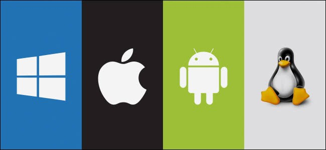
*Windows, Apple's macOS and iOS, Android and Linux are widely used operating systems.*

#### What the OS does for you

- Gives you a **user interface** — windows, icons and menus, or a command line — to start programs and manage files.
- **Hides the hardware's complexity:** a program simply asks the OS to *save this file*, and the OS deals with the disk.
- **Shares out resources** — CPU time, memory, storage and devices — between all the programs that are running.
- Organises **files** into folders and keeps the system and its users' data **safe**.

Without an operating system, every program would need its own code to drive the screen, the keyboard and the disk, and two programs could not safely run at the same time. To do its job, the OS carries out four key management tasks. The next two pages look at each of them in turn.

#### The OS's four management tasks

| Task | What it manages |
|---|---|
| Memory management | which program uses which part of RAM |
| Process management | which program uses the CPU, and for how long |
| Hardware management | every device, through drivers, queues and buffers |
| Security management | who can log in and what each user may access |

> **Pause & Try 1.18**
>
> Give three reasons why a computer needs an operating system.

### Memory and process management

#### Memory management

Every running program needs space in RAM for its instructions and data. Many programs share limited memory, so the OS organises it carefully.

#### Allocating and protecting

- **Allocates** each program its own area of RAM when it starts, and **frees** it when the program closes.
- Records which parts of memory are in use, and by which program.
- **Protects** each area, so one program cannot read or overwrite another's memory — or the OS's own.

#### Virtual memory

When RAM is full, the OS moves blocks of data that are not needed right now (**pages**) onto the disk, and brings them back when needed. This **virtual memory** lets you run more programs than RAM alone could hold — but disks are slow, so constant swapping makes the computer crawl (*disk thrashing*).

#### Process management

A **process** is a running program. One CPU core can execute only one process at a time, yet you can stream music, browse and download at once. The OS's **scheduler** makes this possible:

#### Sharing the CPU

- Each process gets the CPU for a short **time slice** (a few milliseconds); then a timer interrupt passes the CPU on. The switching is so fast that programs seem to run together — **multitasking**.
- Processes have **priorities**: the program you are typing in must respond at once; a background update can wait.
- A process waiting for input or output is **blocked**, so it does not waste CPU time.
- The OS also tries to prevent **deadlock**: two processes each waiting for a resource the other holds.

**Ready** (waiting for a turn) → **Running** (using the CPU) → **Blocked** (waiting for I/O, then ready again)

> **Pause & Try 1.19**
>
> Explain how an operating system lets several programs appear to run at the same time on one CPU core, and describe what virtual memory is used for.

### Hardware and security management

#### Hardware management

The OS controls every device connected to the computer, from the disk inside the case to the printer on the desk.

#### Device drivers

Every device is different, so the OS uses a **device driver** for each one: a small program that translates the OS's general commands, such as *print this page*, into the exact signals that particular printer understands. When you plug in a new USB device, the OS identifies it and loads the right driver (plug-and-play).

#### Queues and buffers

Devices are much slower than the CPU. The OS keeps a **queue** of jobs for each device — several documents can wait in the print queue — and holds data in a **buffer** (a temporary area of memory) so that the CPU can carry on while the device works. It also handles the **interrupts** that devices send.

**Program** (asks to print) → **Print queue** (waits its turn) → **Device driver** (printer commands) → **Printer** (prints from a buffer)

#### Security management

The OS protects the computer and its data from people who should not have access, and from damage.

#### How the OS keeps a computer secure

- **User accounts:** each user logs in with a username and a password, PIN or fingerprint; the OS can lock an account after several wrong attempts.
- **Access rights:** every file and folder has permissions (for example read, write or delete), and only administrators can change system settings or install software.
- **Security updates:** the OS downloads patches that close weaknesses attackers could use.
- **Built-in protection:** a firewall blocks unwanted network traffic, and many operating systems include virus checking and can encrypt the whole disk.

> **Pause & Try 1.20**
>
> Describe two ways an operating system keeps a computer secure, and explain what a device driver does.

### Utility software

**Utility software** (or *utilities*) means programs that maintain, protect and tidy up a computer. Some come with the operating system; others are installed separately. Here are six you should know.

#### Disk formatter

Prepares a new hard disk, SSD or USB stick for use by setting up a **file system** — the structure the OS uses to record where each file is stored. Formatting removes access to any files already on the drive, so it is also used to wipe a drive clean.

#### Virus checker

Scans files and memory for **malware** by comparing them with a database of known virus *signatures* and watching for suspicious behaviour. Infected files are deleted or **quarantined**. It must be updated often to recognise new viruses.

#### Defragmentation software

On a hard disk, files are saved in blocks. As files are created, deleted and grow, a file's blocks become scattered (**fragmented**), so the read head must jump around and loading slows down. Defragmenting moves each file's blocks next to each other. SSDs have no moving parts and do not need this.

#### Repair software

Checks a disk for problems — damaged areas or errors in the file system's records — and either fixes them or marks the bad areas so that they are not used again. Examples include *Check Disk* in Windows and *Disk Utility* in macOS.

#### File compression

Makes files smaller, usually with lossless methods such as ZIP, to save storage space and to make them quicker to send. Several files can also be packed into a single archive.

#### Back-up software

Copies files to another device or to the cloud, so that they can be restored if the originals are deleted, damaged, stolen or locked by ransomware. Back-ups can run automatically on a schedule, e.g. *File History* (Windows) or *Time Machine* (macOS).

> **Pause & Try 1.21**
>
> A hard disk has become slow and some files will not open. Name two utilities that could help, and explain what each one does.

## 1.5 Language Translators & Code Execution

### From source code to machine code

A processor can only execute **machine code**: instructions in binary, taken from the set of instructions its circuits are built to carry out. People, however, write programs in programming languages. The program as the programmer writes it is called **source code**, and a **translator** is a program that converts source code into machine code that the processor can run.

#### High-level languages

Python, Java, C++ and JavaScript use English-like words and mathematical notation. One line, such as `total = price + tax`, may become several machine-code instructions. High-level languages are **portable** (not tied to one type of processor) and much easier to write, read and debug.

#### Low-level languages

**Machine code** and **assembly language** work directly with the processor's own instructions, registers and memory addresses, so each type of processor has its own. They are harder to write, but give precise control and small, fast programs — useful for device drivers and embedded systems.

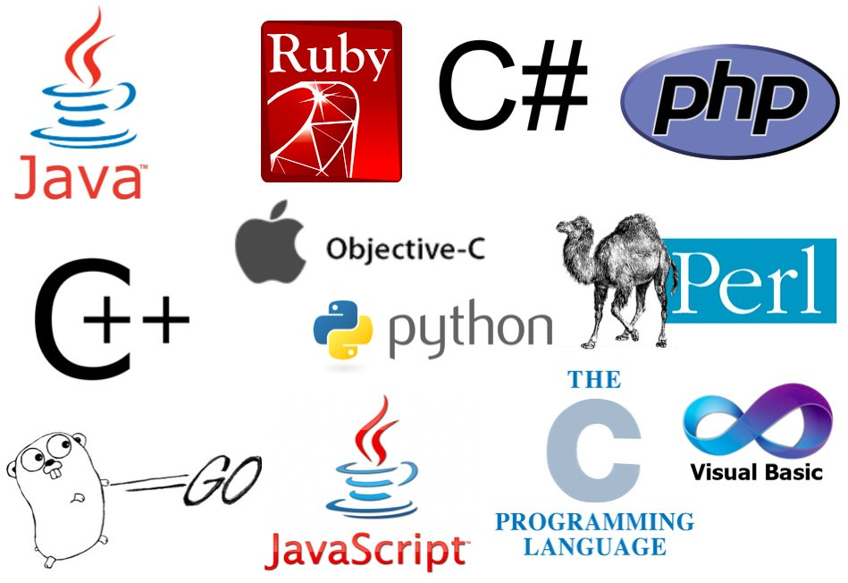
*A few of the hundreds of high-level languages. Each one needs a translator before a processor can run its programs.*

#### Three types of translator

- **Assembler:** translates assembly language into machine code. *Best for* low-level programs that control the hardware directly.
- **Compiler:** translates a whole high-level program into machine code before it runs. *Best for* finished programs that are given to users and must run fast.
- **Interpreter:** translates and runs a high-level program one statement at a time. *Best for* writing, learning and testing code, and for short scripts.

> **Pause & Try 1.22**
>
> Explain the difference between source code and machine code. Then say which translator you would use to run a short script you are still testing, and why.

### Compilers and interpreters

Compilers and interpreters both translate high-level languages, but they work in very different ways — and that changes how you write, test and share a program.

#### A compiler

1. **Source code** — the whole program
2. **Compiler** — checks and translates it all; lists every error
3. **Executable file** — machine code, saved
4. **Run** — as often as you like, without the compiler

#### An interpreter

1. **Read one statement**
2. **Check and translate it** — stops at the first error
3. **Execute it** — straight away
4. **Next statement** — repeated every time the program runs

#### Benefits and drawbacks

| | Compiler | Interpreter |
|---|---|---|
| Translates | Once, before the program runs | Every time the program runs |
| Errors | Listed together; nothing runs until all are fixed | Stops at the first error: easier debugging |
| Speed | Fast: already machine code | Slower: translated while it runs |
| Sharing | Users get only the executable; the source code stays private | Users need the interpreter and the source code |

Many languages mix the two: Java compiles to *bytecode*, which a virtual machine interprets or compiles "just in time". Developers often test with an interpreter, then compile the finished version.

> **Pause & Try 1.23**
>
> A games company is about to sell a finished game, and a student is learning to program. Recommend a compiler or an interpreter for each, and justify your choices.

### Assembly and machine code

Machine code is what the CPU executes. Each instruction has an **opcode** (*what to do*) and an **operand** (*what to use*: a number or a memory address). Binary is hard to write, so programmers use **assembly language**: each opcode becomes a **mnemonic** such as LOAD or ADD, and **labels** can replace addresses. **Each assembly instruction becomes exactly one machine-code instruction** (one-to-one), while a high-level statement often becomes many; assembly is tied to one processor family.

#### Our teaching instruction set

| Mnemonic | Opcode | What it does |
|---|---|---|
| LOAD #n | 0001 | put the number n into ACC |
| LOAD a | 0010 | copy the value stored at address a into ACC |
| ADD #n | 0011 | add the number n to ACC |
| ADD a | 1001 | add the value stored at address a to ACC |
| SUB #n | 0100 | subtract the number n from ACC |
| STORE a | 0101 | copy ACC into address a |
| OUT | 0110 | output the value in ACC |
| JUMP a | 0111 | jump: put address a into the PC |
| JUMPZ a | 1000 | jump to address a only if ACC is 0 |
| HALT | 1111 | stop the program |

**#** = a number to use directly; no # = an address. This set is invented for teaching, as in Video 05.

#### From assembly to binary

Each instruction is 16 bits: a 4-bit opcode, then a 12-bit operand.

**STORE 200** (assembly language) → **0101 0000 1100 1000** (machine code)

> **Pause & Try 1.24**
>
> Using the teaching instruction set, write the 16-bit machine code for LOAD #9, and explain the difference between LOAD #9 and LOAD 9.

### The two-pass assembler

An **assembler** translates assembly language into machine code. There is one problem: a program may use a label *before* the line where it is defined. In the program below, line 103 says JUMPZ DONE, but the assembler does not reach the label DONE until line 105. This is called a **forward reference**. The solution is to read the program twice — a **two-pass assembler**.

#### A countdown program

| Address | Label | Instruction |
|---|---|---|
| 100 | | LOAD COUNT |
| 101 | LOOP | OUT |
| 102 | | SUB #1 |
| 103 | | JUMPZ DONE |
| 104 | | JUMP LOOP |
| 105 | DONE | HALT |
| 106 | COUNT | 3 |

#### Symbol table built in pass 1

| Label | Address |
|---|---|
| LOOP | 101 |
| DONE | 105 |
| COUNT | 106 |

Line 106 is not an instruction: it reserves a memory location called COUNT, which starts with the value 3.

#### Pass 1 — find the labels

- Reads the program one line at a time and removes comments.
- Counts addresses, so it knows where each line will be stored.
- Checks that every mnemonic is in the instruction set.
- Adds each label to the **symbol table** with its address. A forward reference, such as DONE on line 103, is added first and given its address when the label is found.

#### Pass 2 — produce machine code

- Reads the program again from the start.
- Replaces each mnemonic with its opcode, and each label with its address from the symbol table: JUMPZ DONE becomes JUMPZ 105.
- Converts every operand to binary and outputs the finished machine code (the **object code**), or reports errors such as a label that was never defined.

> **Pause & Try 1.25**
>
> Describe what happens in each pass of a two-pass assembler, and explain why an assembler that read the program only once could not translate line 103.

### Tracing a program

A **trace table** records how the values in registers and memory change as a program runs, one instruction at a time. Tracing lets you predict exactly what a program will do — and find mistakes — without a computer. Here is the countdown program from the previous page, starting with the PC at 100 and COUNT = 3.

#### Trace table

| Address | Instruction | ACC | Output |
|---|---|---|---|
| 100 | LOAD COUNT | 3 | |
| 101 | OUT | | 3 |
| 102 | SUB #1 | 2 | |
| 103 | JUMPZ DONE | | |
| 104 | JUMP LOOP | | |
| 101 | OUT | | 2 |
| 102 | SUB #1 | 1 | |
| 103 | JUMPZ DONE | | |
| 104 | JUMP LOOP | | |
| 101 | OUT | | 1 |
| 102 | SUB #1 | 0 | |
| 103 | JUMPZ DONE | | |
| 105 | HALT | | |

#### How to trace

1. Start at the first address. Write one row for every instruction that is **executed**, not for every line of the listing — a loop produces repeated rows.
2. Use the instruction set to work out what each instruction does, and write down any value that changes.
3. For a jump, the PC gets the new address: JUMP LOOP sends the CPU back to 101.
4. For JUMPZ, check ACC first: it jumps only when ACC is 0. On the third pass ACC is 0, so the CPU jumps to 105 and halts.

The output is 3, 2, 1. The listing has only seven lines, yet thirteen instructions were executed, because the loop ran three times.

> **Pause & Try 1.26**
>
> Trace the program again with COUNT = 5 and line 102 changed to SUB #2. What is output, and what problem do you notice?

### Features of a typical IDE

An **integrated development environment (IDE)** is one application that brings together everything a programmer needs: an editor to write the code, a translator and run-time environment to run it, and tools to find and fix errors. IDLE, Thonny, Visual Studio Code, PyCharm and Xcode are common examples.

#### A typical IDE window, paused at a breakpoint

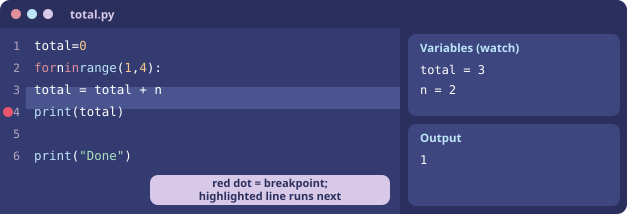

#### Features for writing code

- **Syntax highlighting** (also called pretty printing): keywords, names and text appear in different colours.
- **Auto-completion:** the IDE suggests names and keywords as you type.
- **Automatic indentation and bracket matching** keep the structure clear.
- **Expanding and collapsing** blocks of code lets you focus on one part.

#### Features for finding errors

- **Error highlighting:** syntax errors are underlined as you type, before the program runs.
- **Breakpoints** pause the program at a chosen line.
- **Single stepping** runs the program one line at a time.
- A **variable watch** window shows each variable's value as it changes — like a trace table filled in for you.

A built-in **run-time environment** lets you run the program inside the IDE and see its output straight away, without switching between separate tools.

> **Pause & Try 1.27**
>
> Describe three features of an IDE that help a programmer to find and fix errors.

## Practice

#### Practice · Chapter 1

1. The following bytes represent binary integers in two's complement form.
    1. State the equivalent denary values of 0100 1111 and 1001 1010. [2 marks]
    2. Write the integer −53 in two's complement form. [1 mark]
    3. Write the maximum possible range of numbers using an 8-bit two's complement number. Give your answers in denary. [2 marks]
2. Binary-coded decimal (BCD)
    1. Write the denary integer 798 in BCD format. [1 mark]
    2. Write the denary number represented by the BCD number 1001 0111 0111 0110. [1 mark]
    3. Give one use of the binary-coded decimal system. [1 mark]
3. A software developer uses a microphone and a sound-editing app to collect sounds for a new game.
    1. State what is meant by sampling resolution. [1 mark]
    2. Describe how sampling resolution affects how accurately the digitised sound is stored. [2 marks]
    3. Explain the term image resolution. [1 mark]
    4. The developer uses 16-colour bitmap images. State the number of bits required to encode one pixel. [1 mark]
    5. One image is 16 384 pixels wide and 512 pixels high and is saved as a 256-colour bitmap. Calculate the size of the file in gibibytes. [3 marks]
4. Write these six stages of the Von Neumann fetch–execute cycle in the correct order: the instruction is copied from the MDR and placed in the CIR; the instruction is executed; the instruction is decoded; the address contained in the PC is copied to the MAR; the value in the PC is incremented by 1; the instruction is copied from the memory location in the MAR and placed in the MDR. [6 marks]
5. File History and Time Machine are back-up utilities offered by two different operating systems. Explain why it is important to back up files on a computer. [3 marks]
6. Assemblers, compilers and interpreters are all used to translate programs. Discuss the different roles played by each translator. [6 marks]

## Practice (continued)

#### Practice · Chapter 1 (continued)

7. Number systems and binary arithmetic
    1. Convert the byte 1110 0101 into hexadecimal. [1 mark]
    2. Convert the hexadecimal number 3B into denary. [1 mark]
    3. Add the 8-bit binary numbers 0010 1101 and 0011 0110, showing your working. [2 marks]
    4. Explain what is meant by overflow, using an 8-bit example. [2 marks]
8. Text, images and sound
    1. The ASCII code for 'A' is 65. Write the 8-bit binary code for 'E'. [1 mark]
    2. Describe two differences between a bitmap image and a vector graphic. [4 marks]
    3. Calculate the size, in megabytes, of a 3-minute mono recording sampled at 22 050 Hz with a sampling resolution of 8 bits. [3 marks]
    4. Use run-length encoding to compress this row of pixels: WWWWBBBWWWWWWBB. [2 marks]
    5. Explain why a music-streaming service uses lossy compression, but a bank must compress its records losslessly. [3 marks]
9. The processor and its connections
    1. Describe the roles of the MAR and the MDR in the fetch–execute cycle. [2 marks]
    2. Identify the bus that is unidirectional, and explain why it only needs to carry signals in one direction. [2 marks]
    3. Describe what happens when the CPU receives an interrupt. [4 marks]
    4. State one use for each of these connections: USB, HDMI and VGA. [3 marks]
10. Operating systems and utilities
    1. Describe two tasks carried out by an operating system's memory management. [2 marks]
    2. Explain why defragmentation software can speed up a hard disk, and why it is not needed on an SSD. [3 marks]
    3. Name two other utility programs and describe what each one does. [4 marks]
11. Translators and assembly language
    1. State the relationship between assembly language and machine code. [1 mark]
    2. Describe the two passes of a two-pass assembler, including the role of the symbol table. [4 marks]
    3. Using the teaching instruction set, trace this program and state its output: 100 LOAD #6 · 101 SUB #2 · 102 OUT · 103 JUMPZ 105 · 104 JUMP 101 · 105 HALT. [4 marks]
    4. Describe three features of an IDE that help a programmer to write code. [3 marks]
