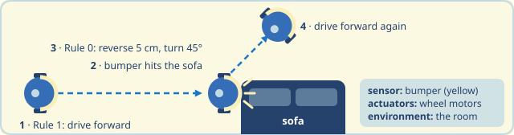
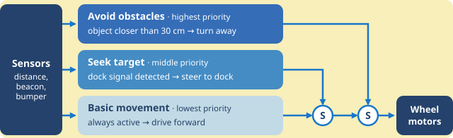
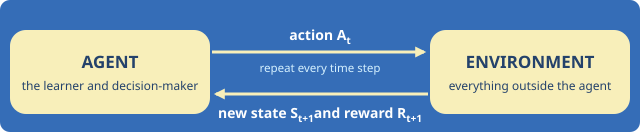
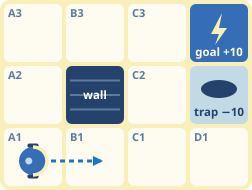
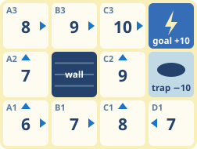
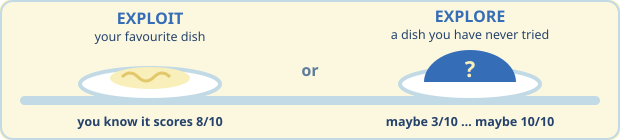
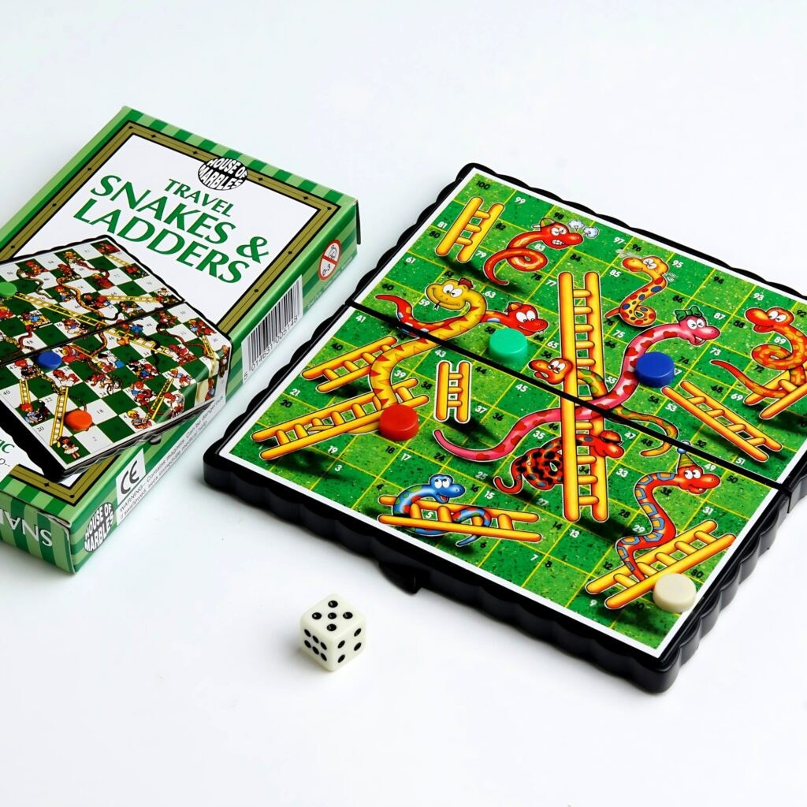
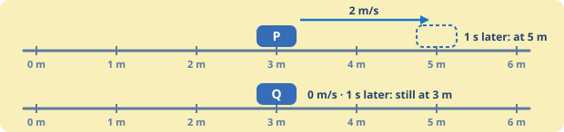
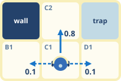
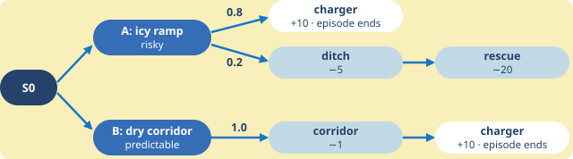

# Chapter 2 — Behaviorism & Behaviorist AI

> This is the complete Stage 2 (V2.0) chapter text. It is the same content as Chapter 2 of the [Blue Impulse Study Guide V2](../../assets/study-guide/v2/BlueImpulse_Study_Guide_V2.pdf), exported from `assets/study-guide/v2/source/content/ch2.sg`. Answers to every *Pause & Try* and *Practice* question are in [solutions.md](solutions.md). If you correct one copy, correct the other.

## Learning goals

This chapter begins with how animals and people learn from their surroundings, then follows that idea into machines: robots that react directly to what their sensors detect, and software agents that learn from rewards and penalties. On the way you will meet the mathematics behind this kind of learning — Q-learning and Markov decision processes — and see how each idea grows out of the one before it.

You will learn about:

- What behaviourism is and its main principles
- How behaviour is influenced by external stimuli and environmental interactions
- How observable responses to stimuli explain learning and behavioural changes
- What behaviour-based robotics is and how robots use sensory input to respond to their surroundings
- What Behaviourist AI is and how it relates to the principles of behaviourism
- How AI can develop intelligent behaviour through sensory input and interaction with the environment rather than relying on complex internal models of the world
- What Reinforcement Learning (RL) is and how agents learn through trial and error using rewards and penalties
- The basic components of Reinforcement Learning, including agents, environments, states, actions and rewards
- The common algorithms and techniques used in Reinforcement Learning
- What Markov Decision Processes (MDPs) are and their role in modelling decision-making under uncertainty
- How Reinforcement Learning and MDPs enable AI systems to learn, make decisions and adapt their behaviour to different environments

#### One idea, four steps

**2.1 Behaviourism** (animals learn from their surroundings) → **2.2 Behaviourist AI** (robots react to their surroundings) → **2.3 Reinforcement learning** (agents learn from rewards) → **2.4 MDPs** (decisions under uncertainty)

Each step builds on the one before. The thread that ties them together: behaviour is shaped by interaction with the environment — first in living things, then in machines.

## Key terms

- **Behaviourism:** A theory of learning that focuses on observable behaviour and how it is influenced by external stimuli and environmental interactions.
- **Stimulus:** An external event or change in the environment that triggers a response from an organism or agent.
- **Response:** An observable reaction or behaviour produced in response to a stimulus.
- **Stimulus–response (S–R):** The relationship between an external stimulus and the observable response it produces.
- **Environmental interaction:** The process through which an organism or agent senses and responds to changes in its surroundings.
- **Classical conditioning:** Learning by association: a neutral stimulus that is repeatedly paired with a reflex trigger comes to produce the reflex on its own (Pavlov).
- **Operant conditioning:** Learning from consequences: a voluntary behaviour becomes more or less frequent depending on what follows it (Skinner).
- **Reinforcement:** A consequence that makes the behaviour it follows more likely to happen again.
- **Punishment:** A consequence that makes the behaviour it follows less likely to happen again.
- **Behaviourist AI:** An approach to artificial intelligence that develops intelligent behaviour through sensory input and environmental interaction rather than relying primarily on complex internal representations of the world.
- **Behaviour-based robotics:** An approach to robotics in which robots use sensory input and simple behavioural rules to interact with and respond to their environment.
- **Symbolic AI (GOFAI):** Early "good old-fashioned" AI that builds a detailed internal model of the world and plans before it acts.
- **Sensor:** A device that detects information from the environment, such as touch, light, distance or temperature.
- **Sensory input:** Information collected from the environment through sensors, allowing an AI system or robot to detect and respond to external conditions.
- **Actuator:** A device, such as a motor, that turns a control signal into physical movement or action.
- **Reactive control:** Control by fixed stimulus–response rules that link sensor readings directly to actions and do not change with experience.
- **Subsumption architecture:** Layered robot control without a central map, in which a higher-priority behaviour can suppress the ones below it.
- **Feedback loop:** A process where an AI system uses the result of its actions to adjust its future behaviour.
- **Adaptive behaviour:** The ability of an AI system to adjust its responses based on feedback or changing conditions.
- **Reinforcement learning (RL):** A machine learning approach in which an agent learns to make decisions through trial and error by receiving rewards or penalties.
- **Trial and error:** A learning process in which an agent tries different actions, evaluates their outcomes and adjusts its behaviour based on feedback.

## Key terms

#### Key terms (continued)

- **Agent:** The learner or decision-maker in reinforcement learning that interacts with an environment.
- **Environment:** The external setting in which an agent operates, takes actions and receives feedback.
- **State:** A representation of the current situation or condition of the environment.
- **Action:** A decision or movement made by an agent that affects the environment.
- **Reward:** Feedback received by an agent that indicates how desirable the outcome of an action is.
- **Penalty:** Negative feedback or a negative reward that discourages undesirable actions or outcomes.
- **Return:** The total reward an agent collects from a given moment until the end of an episode.
- **Episode:** One complete attempt at a task, from the start until a terminal state is reached.
- **Terminal state:** A state in which an episode ends, such as reaching the goal or falling into a trap.
- **Policy:** A strategy or rule that determines which action an agent should take in a given state.
- **Value function:** A function that estimates the expected future rewards an agent can obtain from a particular state or state–action pair.
- **Q-learning:** A model-free reinforcement learning algorithm that learns the expected value of taking specific actions in particular states.
- **Q-value, Q(s, a):** The estimated return of taking action a in state s and acting well afterwards; Q-values are stored in a Q-table.
- **Model-free:** Describes learning that needs no model of how the environment works; the agent learns purely from experience.
- **Learning rate (α):** A number between 0 and 1 that controls how much a single experience changes a Q-value.
- **Exploration:** The process of trying different actions to discover potentially better strategies or rewards.
- **Exploitation:** The process of choosing actions based on existing knowledge to maximise expected rewards.
- **Epsilon-greedy (ε-greedy):** A strategy that explores with a small probability ε and otherwise exploits.
- **Markov decision process (MDP):** A mathematical framework for modelling decision-making in situations where outcomes are partly uncertain and depend on the current state and chosen action.
- **Markov property:** The future depends only on the current state and action, not on how the agent got there.
- **Transition probability:** The probability that an action will move an agent from one state to another in an environment.
- **Discount factor (γ):** A value that determines how much an agent prioritises future rewards compared with immediate rewards.

## 2.1 Foundations of Behaviorism

### Learning from the environment

**Behaviourism** is a school of thought in psychology that grew up in the early 20th century, shaped by pioneers such as **Ivan Pavlov**, **John B. Watson** and **B. F. Skinner**. Before it, psychologists mostly studied the mind by *introspection*, asking people to describe their own thoughts and feelings — reports that nobody else can check. The behaviourists argued that a real science must study only what can be **observed and measured**: what an organism does, and the events in its environment that come before and after.

#### The central principle of behaviourism

Behaviour is learned, modified and maintained through interaction with the environment and through the consequences of that behaviour.

- **Learned:** a new behaviour appears through experience — a puppy learns to sit when told.
- **Modified:** a behaviour changes when the environment changes — you take a new route to school when roadworks slow down the old one.
- **Maintained:** a behaviour continues while it keeps paying off and fades when it stops — the puppy keeps sitting while treats keep coming.

Every idea in this chapter, from Pavlov's dogs to learning robots, is an example of this principle.

*Living things constantly adjust what they do to their surroundings: where and how these wading birds feed depends on what their environment offers.*

#### The brain as a "black box"

Behaviourists did not try to guess what happens inside the head. They treated the brain as a **black box**: you cannot see inside it, but you can measure what goes in — the **stimulus** — and what comes out — the **response**.

**Stimulus** → **Black box** → **Response**

Instead of "the dog is happy", a behaviourist would record "the dog wagged its tail 40 times in a minute" — something anyone can observe and check.

> **Pause & Try 2.1**
>
> Give one example of a behaviour of your own that was **learned**, one that was **modified** and one that is **maintained**. For each, name the part of your environment or the consequence that shaped it.

### Stimulus and response

At the core of behaviourism is a direct link between a **stimulus** and a **response**, known as the **stimulus–response (S–R) association**. A **stimulus (S)** is any detectable change or event in the environment: a bright light, a bell ringing, a touch sensor being pushed. A **response (R&#8288;)** is the measurable action or reaction it produces: blinking, moving away, turning left.

#### Spotting S–R pairs

| Stimulus (S) | Response (R&#8288;) | Inborn or learned? |
|---|---|---|
| a bright light shines in your eyes | your pupils shrink | inborn reflex |
| something flies towards your face | you blink | inborn reflex |
| the end-of-lesson bell rings | students pack their bags | learned |
| your phone buzzes | you check the screen | learned |
| a robot vacuum's bumper is pressed | it reverses and turns | built in by its designer |

Notice the last row: the S–R idea describes machines as well as living things. That is why it later became a starting point for artificial intelligence.

#### Inborn links and learned links

Some S–R links are **reflexes** you were born with: nobody teaches you to blink. Many others are **learned**: no baby is born knowing that a bell means the end of a lesson. Through continuous interaction with their environment, living things keep building and adjusting these learned links — this is how they survive and thrive in a changing world.

Psychologists found two main ways in which new S–R links are learned. In **classical conditioning**, an organism learns that one *stimulus* predicts another. In **operant conditioning**, it learns from the *consequences* of its own actions. The next two pages explain each one.

> **Pause & Try 2.2**
>
> A self-checkout machine beeps when you scan an item, and you place the item in the bagging area. Identify the stimulus and the response, and decide whether this S–R link is inborn or learned. Explain your answer.

### Classical conditioning

Around 1900, the Russian scientist **Ivan Pavlov**, while studying digestion in dogs, noticed that they began to salivate *before* any food reached them — at the sight or sound of the assistant who fed them. Pavlov tested this by sounding a bell or a metronome just before feeding, and so discovered **classical conditioning**: *learning through association between stimuli*.

#### Pavlov's experiment in three stages

**1 · Before conditioning** (food → salivation sound → no salivation) → **2 · During conditioning** (sound, then food, repeated many times) → **3 · After conditioning** (sound alone → salivation)

#### The five parts, in plain words

| Term | Meaning | In Pavlov's experiment |
|---|---|---|
| Unconditioned stimulus (UCS) | triggers a response without any learning | food |
| Unconditioned response (UCR) | the natural, automatic reaction to the UCS | salivating at food |
| Neutral stimulus (NS) | causes no response at first | the sound |
| Conditioned stimulus (CS) | the neutral stimulus once it has been learned | the sound |
| Conditioned response (CR) | the learned reaction to the CS | salivating at the sound |

#### What an "elicited" response is

In classical conditioning the response is **elicited**: the stimulus *draws it out* of the animal automatically, like a knee-jerk. The dog does not decide to salivate and earns nothing for doing it — salivation is an **involuntary reflex** that has become attached to a new trigger. The link is maintained only while the association holds: if the sound is played many times without food, the conditioned response gradually fades. This is called **extinction**.

> **Pause & Try 2.3**
>
> At the dentist, the whine of the drill always comes just before a painful moment, and you tense up. After a few visits, the sound of a drill alone makes you tense. Identify the UCS, UCR, NS, CS and CR.

### Operant conditioning

Classical conditioning explains reflexes, but most of what you do is **voluntary**: you choose to raise your hand, open an app or practise a skill. From the 1930s, **B. F. Skinner** studied how voluntary behaviour is shaped by what happens *after* it. He called this **operant conditioning**, because the animal *operates* on its environment. In operant conditioning, *learning occurs through the consequences of voluntary behaviour*.

#### Skinner's experiment

A hungry rat is placed in a box with a lever. At first it presses the lever only by accident while exploring — but every press releases a food pellet.

**Explores** → **Presses the lever** (by accident) → **A pellet drops** (pleasant result) → **Presses more** (behaviour strengthened)

The rat's lever-pressing has been **shaped by its consequences**. The behaviour comes first, freely chosen by the animal; the consequence follows and changes how often it happens in future.

#### Reinforcement and punishment

A consequence that makes a behaviour **more likely** is **reinforcement**; one that makes it **less likely** is **punishment**. Each can work by *adding* something (**positive**) or *taking something away* (**negative**) — here, positive and negative mean added and removed, not good and bad.

| | Add something | Take something away |
|---|---|---|
| **Behaviour increases** | positive reinforcement: a dog sits and gets a treat | negative reinforcement: you fasten your seat belt and the warning beep stops |
| **Behaviour decreases** | positive punishment: you touch a hot pan and get burnt | negative punishment: a teenager loses phone time for coming home late |

Trainers use operant conditioning to build complex behaviour step by step, a technique called **shaping**: a dolphin is rewarded first for swimming near a hoop, then only for touching it, and finally only for jumping through it.

> **Pause & Try 2.4**
>
> A student is praised every time they hand in homework on time, and soon does so more often. Name the type of consequence, say whether handing in homework is voluntary or a reflex, and explain why this is operant rather than classical conditioning.

### From operant conditioning to reinforcement learning

Of the two kinds of conditioning, only operant conditioning involves **choosing actions and living with their consequences** — which makes it the direct ancestor of an important branch of AI.

#### Classical vs operant conditioning

| | Classical (Pavlov) | Operant (Skinner) |
|---|---|---|
| How learning occurs | association between two stimuli | consequences of an action |
| Type of behaviour | involuntary reflex (elicited) | voluntary action (chosen) |
| Key event happens | before the response | after the response |
| Example | a dog salivates at a sound | a dog sits for a treat |
| AI parallel | pattern recognition: learning which signals predict others | reinforcement learning |

#### Three steps from psychology to AI

**Behaviourism** (the environment shapes behaviour) → **Operant conditioning** (consequences shape behaviour) → **Reinforcement learning** (numerical rewards shape an agent's choices)

In reinforcement learning (RL), every part of Skinner's experiment has a machine version:

**The rat** (the agent) → **Lever press** (an action) → **Food pellet** (a reward) → **New habit** (a policy)

RL keeps the core idea — actions followed by good consequences become more likely — but builds it from **mathematics**: rewards are numbers, the goal is the largest total reward, and an **algorithm** updates the **policy**. The reward is only a training signal; the agent does not feel it.

> **Pause & Try 2.5**
>
> Explain why reinforcement learning is linked to operant conditioning rather than to classical conditioning. Use the words *action* and *consequence* in your answer.

## 2.2 Behaviorist AI & Behavior-Based Robotics

### Think first, act later

Early artificial intelligence research, from the 1950s to the 1980s, is often called **symbolic AI** or **GOFAI** — *Good Old-Fashioned AI*. Its researchers believed that to act intelligently, a robot first had to build a complete, detailed **internal model** of its surroundings — a 3D map of every wall, chair and doorway — and then reason about that model with symbols and logic.

*Symbolic AI imagined intelligence as a "brain" that reasons about a detailed model of the world before the body moves.*

#### Sense, model, plan, act

1. **Sense** — gather camera and sensor data
2. **Model** — build a detailed 3D map
3. **Plan** — search the map for the best route
4. **Act** — only now, move

#### Why it struggled

Each stage must wait for the one before, so a symbolic robot spends most of its time calculating. **Shakey**, a famous robot built at the Stanford Research Institute between 1966 and 1972, often stood still for long periods while it planned its next move.

Worse, the world does not wait. If someone walks past or moves a chair while the robot is still calculating, its map is already out of date — and the robot may drive into something that is no longer where the map says. The real world is messy, changes constantly and can never be modelled completely.

In the mid-1980s, **Rodney Brooks**, a roboticist at MIT, proposed a radically different idea. It became known as **Behaviourist AI**, and it is the subject of the rest of this section.

> **Pause & Try 2.6**
>
> A symbolic robot takes 20 seconds to map a room and plan its route. Two seconds after it starts moving, a person pushes a chair into its path. Explain what goes wrong, and why.

### What is Behaviourist AI?

Brooks argued that **"the world is its own best model"**: the real world is always up to date and contains every detail, so a robot should *look at it* whenever it needs to, rather than keep a copy in memory. Instead of one slow, central "brain", a robot needs many fast, direct links between its **sensors** and its **actuators**.

#### Definition

**Behaviourist AI** (also called behaviour-based AI) is an **approach** to designing intelligent systems in which intelligent behaviour **emerges from the interaction between sensors, control mechanisms and the environment**, rather than from reasoning about a detailed internal model of the world.

**Behaviour-based robotics** is this approach applied to robots: a robot is built from simple behaviours, each linking what it senses directly to what it does.

#### Situated

The robot exists in the real, physical world — not in an abstract simulation — and senses that world as it happens.

#### Embodied

The robot has a physical body — wheels, motors, arms — that experiences real physics: friction, bumps and slopes.

#### Related, but different disciplines

| | Behaviourism | Behaviourist AI |
|---|---|---|
| Field | psychology | artificial intelligence and robotics |
| Aim | to explain how animals and people learn | to build machines that behave usefully |
| Subjects | animals and people | robots and software agents |
| Role of learning | the main thing it studies | optional: many such robots never learn |

**What they share:** both explain behaviour through observable interaction with the environment, without relying on hidden inner states — mental states for psychologists, detailed world models for engineers.

> **Pause & Try 2.7**
>
> Define Behaviourist AI in your own words. Then give one way in which it is similar to behaviourism in psychology and one way in which it is different.

### Sense, decide, act

Every behaviour-based robot runs the same simple loop, many times a second. A robot vacuum cleaner shows each part at work.

#### The vacuum cleaner analogy

A **symbolic** vacuum would map every chair leg and plan a route before moving — and a moved chair would break its plan. A **behaviourist** vacuum needs two rules. **Rule 0 (emergency):** if the bumper touches an object, stop, reverse 5 cm and turn 45°. **Rule 1 (default):** drive straight ahead.

**Sensor** (detects) → **Behaviour rule** (decides) → **Actuator** (acts) → **Environment** (changes, giving new input) → *(back to the start)*

#### What each part does

| Part | Its job | In the robot vacuum |
|---|---|---|
| Sensor | detects information from the environment | bumper switch, cliff sensors |
| Behaviour rule | decides on an appropriate response | IF bumped THEN reverse and turn |
| Actuator | carries out the physical movement | the two wheel motors |
| Environment | changes, giving the sensors new input | walls, furniture, stairs |

From two simple rules, intelligent-looking behaviour **emerges**: given time, the robot covers the whole floor with no map or master plan. This is called **emergent behaviour**.

> **Pause & Try 2.8**
>
> An automatic sliding door at a supermarket opens when someone walks towards it. Identify its sensor, behaviour rule, actuator and environment, and state its stimulus and response.

### Layers of behaviour

Brooks' **subsumption architecture** (1986) organises a robot's behaviours in **layers**. Each layer is a simple behaviour linking sensors to motors on its own — there is no central map or planner. When a higher layer's trigger fires, it **suppresses** (takes over from) the layers below; when it goes quiet, they carry on.

#### Three layers in a home robot

**S** marks a suppression point: while the layer above is active, its command replaces the one arriving from the left. So avoiding obstacles always wins.

#### One trip to the charging dock

| Time | Sensors report | Layer in control | Wheels |
|---|---|---|---|
| 0 s | nothing nearby, no dock signal | basic movement | drive straight ahead |
| 4 s | dock signal to the left | seek target | steer left, towards the dock |
| 7 s | chair leg 20 cm ahead | avoid obstacles | turn away from the chair |
| 9 s | path clear, dock signal again | seek target | steer towards the dock |

**Why is this more responsive than map-building AI?** Each layer reacts to its sensors in milliseconds, with no map to rebuild or plan to recalculate — and if one layer fails, the others keep working.

> **Pause & Try 2.9**
>
> While the robot is steering towards its dock, a cat walks in front of it. Which layer takes control, which layer does it suppress, and what happens once the cat has passed?

### Reactive control vs learning

Every robot so far uses **reactive control**: a designer writes fixed stimulus–response rules, and the robot follows them in exactly the same way every time. It reacts, but it never learns. The alternative is a robot that **learns from experience** which actions produce better outcomes. This difference — following rules versus learning — is the most important distinction in this chapter.

#### Reactive control

- Rules are **written by a designer** before the robot starts work.
- The same stimulus always produces the **same response**.
- Experience changes nothing: the thousandth bump is handled like the first.
- Fast, simple and predictable, but it **cannot improve** and fails in situations nobody foresaw.
- Like an **inborn reflex**.

#### Learned behaviour

- The robot discovers **which actions work best** from feedback.
- Its response to a stimulus can **change with experience**.
- Performance **improves over time** and can adapt to new situations.
- Learning takes time and data, and can be hard to predict while it happens.
- Like **operant conditioning** — in AI, **reinforcement learning**.

#### Two robot vacuums in the same narrow corner

**Robot A (reactive)** has one rule: when bumped, turn 45° to the right. In a narrow corner it bumps, turns, bumps the other wall, turns again — and can stay trapped for minutes, making the same choice every time.

**Robot B (learning)** receives a reward signal: +1 for each new patch of floor cleaned, −1 for each bump. Over many cleaning runs it learns that in this corner, turning left gets it out in one move. Robot A behaves identically on day 1 and day 100; Robot B is better on day 100 than on day 1.

The two are often combined: a learning robot usually keeps reactive safety rules, such as "stop if the bumper is pressed", that always take priority. The rest of this chapter is about the learning side: **reinforcement learning**.

> **Pause & Try 2.10**
>
> Classify each system as reactive control or learned behaviour, and explain why: a) a thermostat that switches the heating on below 19 °C; b) a chess program that wins more often after every game it plays; c) car headlights that switch on automatically when it gets dark; d) a delivery robot that, after weeks of trips, starts avoiding a corridor that is often crowded.

## 2.3 Introduction to Reinforcement Learning (RL)

### The reinforcement learning loop

**Reinforcement learning (RL)** is the computational version of Skinner's operant conditioning. An **agent** learns to reach a goal by **trial and error**, through repeated interaction with an **environment**: it tries an action, sees what happens and gradually prefers actions that lead to more reward. Nobody tells it the correct move — it must discover it from the consequences of its own actions.

#### The interaction loop

At each **time step** t, the agent observes the state St and chooses an action At. The environment responds with a reward Rt+1 and a new state St+1, and the loop begins again.

#### The parts of an RL system

| Part | Meaning | A robot learning to reach its charger |
|---|---|---|
| Agent | the learner and decision-maker | the robot's control program |
| Environment | everything outside the agent | the room, its walls and the charger |
| State (St) | a snapshot of the situation at step t | the robot's position |
| Action (At) | a choice available in that state | forward, turn left, turn right |
| Reward (Rt+1) | a number sent back after each action | +10 at the charger, −1 per move |
| Policy (π) | which action to take in each state | "in this spot, turn left" |

The aim of RL is to find an **optimal policy**, written π*: the strategy that collects the most reward in the long run. Section 2.4 shows that RL problems are usually described as **Markov decision processes**.

> **Pause & Try 2.11**
>
> A program learns to play a car-racing video game. Identify the agent, the environment, one possible state, two actions and a sensible reward.

### One interaction, step by step

To see learning happen, RL is often studied in a **grid world**. Our agent is a small rover on a 4 × 3 grid. It starts on A1; B2 is a wall, D2 is a trap and D3 is the goal, a charging station. Entering the goal earns **+10** and entering the trap earns **−10** — both end the attempt. Every other move earns **−1**, a small penalty that encourages short routes; a move into the wall or off the grid leaves the rover where it is.

#### The grid world

The rover's first move: from A1 it chooses **right**.

#### One complete interaction

1. **Observe** — the agent sees its state: it is on A1
2. **Choose** — its policy picks an action: move right
3. **Respond** — the environment moves the rover to B1
4. **Reward** — the environment sends back −1 and the new state, B1
5. **Learn** — the experience (A1, right, −1, B1) improves the agent's estimates and its policy

#### How experience changes behaviour

One attempt, from the start to the goal or the trap, is called an **episode**. In its first episode the rover knows nothing, so it wanders: suppose it makes six pointless moves and then falls into the trap, collecting 6 × (−1) + (−10) = **−16**. Then it starts again from A1. Episode after episode, the rewards tell it which moves pay off, and eventually it settles on a five-move route to the goal, collecting 4 × (−1) + 10 = **+6**. Its behaviour has been shaped by consequences, just like the behaviour of Skinner's rats.

> **Pause & Try 2.12**
>
> The rover is on C1 and chooses to move up. Write out the five steps of this interaction, including the reward and the new state.

### Reward, return, value and policy

Four RL words are easy to confuse, but in the grid world each has its own number. Each square shows the total reward the rover can expect to collect from there to the end of the episode by following the arrows.

#### Values and policy

Numbers are values; arrows show the policy. On A1, up and right are equally good.

#### Four different ideas

- **Reward** — the number for one move. The rover's first move from A1 earns **−1**, even though it is a good move.
- **Return** — the total reward from now until the episode ends. Following the arrows from A1: −1 −1 −1 −1 +10 = **+6**.
- **Value** — the return the agent *expects* from a state. V(A1) = 6 and V(C3) = 10: squares nearer the goal are worth more, although stepping onto them earns only −1.
- **Policy** — the rule for choosing actions; here, "move to the neighbouring square with the highest value".

A good agent does not chase the biggest reward for the *next* move; it follows the highest *value*. Every ordinary move costs −1, yet moving towards the goal is right, because the +10 at the end outweighs the small costs on the way. When outcomes are uncertain, a value is an **average** over many episodes — which is why the agent must learn it from experience.

#### Penalties are negative rewards

RL has no separate punishment signal: a **penalty** is simply a reward with a negative number. The −1 per move is a small penalty that discourages wandering; the −10 trap is a large penalty for a disastrous outcome. Penalties lower the values of the states and actions that lead to them, so the agent learns to avoid them. Take care: *negative reinforcement* in psychology means removing something unpleasant, which makes a behaviour more likely — it is not the same as a negative reward.

> **Pause & Try 2.13**
>
> The rover starts on C1 and follows the arrows. State the reward for its first move, its return and the value of C1. Then explain why the rover on C2 should never move right.

### Explore or exploit?

To collect a high return, an agent must **exploit** what it already knows. But everything it knows comes from what it has tried — so it must also **explore**. Balancing the two is called the **exploration–exploitation trade-off**, and it is one of the central challenges in RL.

#### The restaurant analogy

Imagine visiting a restaurant you know well. **Exploitation** is ordering your favourite dish, because you know it is good. **Exploration** is trying a dish you have never had: it might disappoint you (a penalty), but you might discover something even better.

In RL terms, **exploration** means trying unfamiliar or apparently worse actions to **gather information** about the environment; **exploitation** means choosing the action with the **best current estimate**, to collect as much reward as possible now.

#### Why an agent must balance both

Early estimates are based on very little experience, so they can be wrong. An agent that **only exploits** sticks with the first action that worked and may never find a better one. An agent that **only explores** keeps gathering information but never uses it, so its rewards stay low.

Exploration is not just trying random things: every new experience **improves the agent's estimates**, and better estimates lead to better choices later. In the grid world, suppose the rover's first successful route took nine moves — a return of 8 × (−1) + 10 = +2. If it only exploited, it would repeat that route for ever. By exploring, it discovers the five-move route worth +6.

> **Pause & Try 2.14**
>
> A music app keeps playing songs by the first artist you liked. In RL terms, what is the app doing, and what might it be missing? Suggest how it could balance the two.

### Epsilon-greedy in action

A simple, popular way to balance the two is the **ε-greedy** (epsilon-greedy) strategy, where ε is a small probability such as 0.1. Before every decision the agent, in effect, rolls a die: with probability ε it **explores** by choosing an action at random; otherwise, with probability 1 − ε, it **exploits** by choosing the action with the highest **Q-value** — its current estimate of how good each action is.

#### One decision, worked through

An agent has three actions, and ε = 0.1.

| Action | Q-value | Chosen when… |
|---|---|---|
| A | 5 | exploring |
| B | 8 | exploiting, or exploring |
| C | 3 | exploring |

When it **exploits**, it picks **B**, the highest Q-value. When it **explores**, it picks A, B or C at random. Over 100 decisions it exploits about 90 times (always B) and explores about 10 times (3 or 4 of each), so B is chosen about 93 times and A and C about 3 times each.

#### Exploring improves the estimates

Why ever choose A or C? Suppose the agent estimates each action's value as the average reward it has received, and C's estimate of 3 came from a single unlucky try. Exploring C four more times gives rewards of 10, 9, 11 and 12. Its new estimate is (3 + 10 + 9 + 11 + 12) ÷ 5 = **9**, better than B's 8 — so the agent switches to C. Without exploration it would never have found out.

Many agents start with a large ε and **reduce it over time**, exploring less as their estimates become reliable.

#### Exploring safely: a real robot

Exploration has a real-world cost: a delivery robot learning its way around a hospital could, by acting at random, drive into a patient or towards a staircase. So engineers:

- train it first in a **simulation**, where mistakes cost nothing;
- let it explore only among **safe actions**, for example at walking speed;
- keep **reactive safety rules**, such as "stop if anything is within 50 cm", that override the learner — subsumption at work;
- keep a **human supervisor** who can stop it at any time.

No simulation is perfect, so the robot is still tested on site before it works alone.

> **Pause & Try 2.15**
>
> An agent has three actions with Q-values A = 2, B = 6 and C = 4, and uses ε = 0.2. Which action does it choose when it exploits? Out of 100 decisions, about how many times would you expect it to choose each action?

### Q-learning

So far the agent has simply *had* Q-values. **Q-learning**, introduced by Chris Watkins in 1989, is one of the most famous RL algorithms for learning them from experience. It is **model-free**: the agent does not need to know in advance how its world works — where each action leads or what it pays. It learns purely by doing. Model-free does not mean memory-free: the agent stores what it learns in a **Q-table**.

#### The Q-table

Each cell holds **Q(s, a)**: the agent's estimate of the return from taking action a in state s and then acting well. "Q" stands for the *quality* of that action. Here are three states of the grid world after training (rewards simply added up, with no discounting):

| Action | A1 | C2 | C3 |
|---|---|---|---|
| up | 6 | **9** | 9 |
| down | 5 | 7 | 8 |
| left | 5 | 8 | 8 |
| right | 6 | −10 | **10** |

#### Choosing from the table

To act, the agent looks up the column for its state and picks the action with the **highest Q-value** — that is its policy. On C2 it moves up (9) and never right, into the trap (−10). On C3 it moves right, into the goal (+10).

The highest Q-value in each column is also the **value** of that state: V(C2) = 9, as on the value grid.

#### From experience to better choices

**Experience** (one step (s, a, r, s′)) → **Update** (adjust one cell of the table) → **Better estimates** (the table grows more accurate) → **Better choices** (the policy picks the highest Q)

At the start every Q-value is 0, so the agent's choices are random. Each step of experience updates **one cell** of the table. Over thousands of steps the numbers settle towards the values above, and the agent's behaviour improves with them. The next page shows exactly how one cell is updated.

> **Pause & Try 2.16**
>
> Using the Q-table, state the action the rover chooses on A1, C2 and C3 when it exploits. Explain why right on C2 has such a low Q-value, and why up on C3 is worth 9.

### The Q-learning update rule

After every step, Q-learning nudges **one** Q-value — the one for the state it was in and the action it took — towards a better estimate. It uses this update rule:

#### The update rule

Q(s, a) ← Q(s, a) + α [ r + γ maxa′ Q(s′, a′) − Q(s, a) ]

The arrow ← means "is replaced by": the old value on the right is used to calculate the new value on the left.

**1 · Target** (r + γ maxa′ Q(s′, a′)) → **2 · Error** (target − Q(s, a)) → **3 · Update** (move a fraction α of the way to the target)

The **target** is what this one experience suggests the action is worth: the reward just received plus the discounted value of acting well from the next state. The **error** is how far the old estimate was from the target. If the error is positive, the Q-value rises; if it is negative, the Q-value falls.

#### What the symbols mean

- **s** — the current state
- **a** — the action the agent took in s
- **r** — the reward it received for that action
- **s′** — the next state it landed in
- **a′** — any *possible* action in s′. It is only considered, not taken: maxa′ Q(s′, a′) is the best Q-value on offer in s′.

#### The two settings

- **α (alpha), learning rate**, 0 to 1: how much one experience changes the estimate. α = 0 means never learning; α = 1 means trusting only the newest experience.
- **γ (gamma), discount factor**, 0 to 1: how much future rewards count. Near 0 the agent is short-sighted — with γ = 0 the target is just r. Near 1 it is far-sighted.

> **Pause & Try 2.17**
>
> Two agents learn the same task, one with γ = 0.1 and one with γ = 0.95. Which is more likely to accept a small penalty now in order to reach a large reward later? Explain your answer using the target r + γ maxa′ Q(s′, a′).

### A Q-value update, worked through

The update rule becomes clear once you put numbers into it. Every update follows the same three steps: work out the **target**, find the **error**, then move the old value a fraction **α** of the way towards the target.

#### What is a terminal state?

A **terminal state** is a state in which the episode ends: the rover reaches the charger or falls into the trap, or a game is won or lost. Nothing can happen after it, so there are no future rewards to add — the term γ maxa′ Q(s′, a′) is taken as **0**, and the target is simply the final reward r.

#### Example 1: an ordinary step

The agent takes action a in state s and lands in s′, which is **not** terminal.

| Quantity | Value |
|---|---|
| old Q(s, a) | 2 |
| α and γ | 0.5 and 0.9 |
| reward r | +1 |
| best Q-value in s′ | 4 |
| 1 · target | 1 + 0.9 × 4 = 4.6 |
| 2 · error | 4.6 − 2 = 2.6 |
| 3 · new Q(s, a) | 2 + 0.5 × 2.6 = **3.3** |

#### Example 2: penalties into a terminal state

Each time the rover on C2 moves right, it falls into the trap: r = −10 and the episode ends, so the target is just −10. With α = 0.5 and a starting value of 0:

| Update | New Q(C2, right) |
|---|---|
| 1st | 0 + 0.5 × (−10 − 0) = **−5** |
| 2nd | −5 + 0.5 × (−10 + 5) = **−7.5** |
| 3rd | −7.5 + 0.5 × (−10 + 7.5) = **−8.75** |

Each penalty pulls the value further towards −10, so the action is chosen less and less — the Q-table's version of punishment.

▶ **Video tutorial:** [Watch the tutorial: Basic reinforcement learning (Video 01)](https://github.com/user-github-me/cs-ai-project-01/blob/main/assets/tutorials/stage2/videos/BlueImpulse_Video01_Basic_Reinforcement_Learning.mp4)

> **Pause & Try 2.18**
>
> Q(s, a) = 4, α = 0.2, γ = 0.9, r = −1, and the best Q-value in the next state is 10. Calculate the new Q(s, a). Then calculate it again assuming s′ is a terminal state, and explain why the two answers differ.

## 2.4 Markov Decision Processes (MDPs) Made Simple

### Why we need MDPs

Real decisions rarely come one at a time. A robot makes a **sequence** of decisions, each changing the situation for the next — and its actions do not always turn out as intended: wheels slip, wind blows, people get in the way. A **Markov decision process (MDP)** is a mathematical framework for describing exactly this kind of problem: **sequential decision-making when actions can lead to different possible outcomes**. Written as an MDP, a problem can be reasoned about precisely and solved with algorithms.

*In Snakes and Ladders, where your counter lands depends on the dice as well as on the board.*

#### The board-game analogy

Think of an MDP as a board game such as Snakes and Ladders or a video-game maze:

- the square you stand on is your **state**;
- the move you choose, such as walking forward or jumping, is your **action**;
- a dice roll, or slipping on an icy square, means a move does not always land where you intended: **probability**;
- landing on a gold coin wins points and falling into a trap loses them: **reward** and **penalty**.

In real Snakes and Ladders the dice decide everything; an MDP adds **choices**, as if you could pick which die to throw.

#### How MDPs and RL fit together

The MDP **describes the problem**: its states, actions, possible outcomes and rewards. RL is a way of **solving** it — finding a good policy by trial and error, even when the agent does not know the probabilities and rewards in advance. That is why RL problems are almost always written as MDPs. Inside the framework each part has a clear role: the **environment** is described by the MDP and decides what happens after each action; the **agent** observes the state and makes the decisions; the **policy** is the agent's rule for which action to take in each state.

> **Pause & Try 2.19**
>
> Describe a game you know, such as Ludo, Monopoly or a maze video game, as an MDP. Name the states, two actions, where the uncertainty comes from and one reward or penalty.

### The Markov property

An environment has the **Markov property** if what happens next depends only on the **current state** and the **action** taken now — not on how the agent got there. The present state holds all the information that matters, so the Markov property is often called **memoryless**. In chess, for example, you choose your next move from the current position of the pieces (and whose turn it is); whether a knight arrived on its square five turns ago or twenty makes no difference.

#### Position alone is not enough

Robots P and Q both stand at the 3 m mark of a track. If the state records only their **position**, they look identical — yet one second later they are in different places.

The same "state" leads to different futures, so a position-only state does **not** have the Markov property: to predict what happens next, you would need the history (where was each robot a second ago?). Add **speed** to the state — (3 m, 2 m/s) and (3 m, 0 m/s) — and the next position can be predicted from the present alone. The Markov property now holds.

#### Designing a good state

For the Markov property to hold, the state must contain **enough information to describe the situation**. For a delivery robot that might be its **position**, **speed**, **battery level** and whether it is **carrying a parcel**: the battery level decides whether it can reach the next stop, and the parcel decides where it should go next. Real sensors can be noisy or incomplete — a camera cannot see behind a box — so engineers often combine several readings over time to estimate a state that is as close to Markov as possible.

> **Pause & Try 2.20**
>
> A self-driving car's state records only which lane it is in. Explain why this state does not have the Markov property, and suggest two pieces of information to add to it.

### The five ingredients of an MDP

Every MDP is built from five ingredients, written together as the tuple **(S, A, P, R, γ)**. Here they are for the rover's grid world from 2.3 — but now the floor is **icy**, so the rover does not always go where it intends.

#### The icy grid world as an MDP

| Ingredient | Meaning | In the icy grid world |
|---|---|---|
| **S**: states | every situation the agent can be in | the 11 squares A1 to D3 (the wall is not a state) |
| **A**: actions | every choice the agent can make | up, down, left, right |
| **P(s′ &#124; s, a)**: transition probabilities | the chance that action a in state s leads to state s′ | 0.8 to go where intended; 0.1 to slip to each side |
| **R(s, a)**: reward function | the number earned for taking action a in state s | +10 into the goal, −10 into the trap, −1 otherwise |
| **γ**: discount factor | how much future rewards count, from 0 to 1 | γ = 0.9 |

#### Reading P for one action

The rover is on C1 and chooses **up**:

- P(C2 | C1, up) = 0.8: it moves up as intended;
- P(B1 | C1, up) = 0.1: it slips to the left;
- P(D1 | C1, up) = 0.1: it slips to the right.

The three probabilities add up to 1, because the rover must end up somewhere. The **agent chooses the action**; the **environment, through P, chooses the outcome**.

#### One action, three outcomes

**Reading γ.** With γ = 0.9, each step into the future multiplies a reward by 0.9. A +10 received on the rover's next move counts as 10; one move later it counts as 0.9 × 10 = 9; one move after that, 0.9 × 0.9 × 10 = 8.1. Discounting makes the agent prefer reaching the goal sooner rather than later.

> **Pause & Try 2.21**
>
> A delivery drone flies between rooftops on a windy day. Suggest one example of each ingredient — S, A, P, R and γ — for this problem.

### Risky or predictable?

Transition probabilities let an agent **compare actions whose outcomes are uncertain**. Picture the rover at a junction, S0, with two ways to reach its charger: a short ramp that is icy, or a dry corridor that takes one extra move.

#### Two actions from S0

| | A: icy ramp (risky) | B: dry corridor (predictable) |
|---|---|---|
| Transitions, P | P(charger &#124; S0, A) = 0.8; P(ditch &#124; S0, A) = 0.2 | P(corridor &#124; S0, B) = 1.0 |
| Expected immediate reward | 0.8 × 10 + 0.2 × (−5) = **7** | 1.0 × (−1) = **−1** |
| Expected total reward | 0.8 × 10 + 0.2 × (−5 − 20) = **3** | −1 + 10 = **9** |

Judged only by the **immediate** reward, the risky ramp looks much better: 7 against −1. Once the **future** is included — the rescue after a slip, the +10 after the corridor — the predictable corridor wins: 9 against 3. The best action depends on future rewards, not only on the next one, which is why RL agents learn *values*. (To keep the arithmetic simple, future rewards are not discounted here: γ = 1.)

#### Expected is not guaranteed

The expected immediate reward of the icy ramp is 7, yet no single attempt ever earns 7: each attempt earns either +10 or −5. Seven is the **long-run average**: over 100 attempts, about 80 earn +10 and about 20 earn −5, a total of 800 − 100 = 700, or 7 per attempt.

> **Pause & Try 2.22**
>
> An agent has a 70% probability of receiving +10 and a 30% probability of receiving −4. Calculate the expected immediate reward and explain why the actual reward may differ.

### Learning, then working

RL and MDPs let an AI system learn to make decisions. But what happens once the learning is done? Most systems have two separate phases.

#### Training

The agent explores, collects experience (s, a, r, s′) and updates its Q-values or policy. Training often happens in a **simulation**, where mistakes are cheap, and may take millions of steps.

#### Deployment

The trained policy is put to work. Learning is usually switched off (no more exploring: ε&nbsp;=&nbsp;0). The robot still **reacts** to new sensor readings, but its **policy stays the same**.

**Define the task** → **Train** → **Evaluate** → **Deploy** → **Monitor**

#### Moving to an unfamiliar environment

A rover trained to deliver parcels in Warehouse 1 is moved to Warehouse 2.

- **Does its policy still work?** Only as far as the new place resembles the old one. A Q-table for Warehouse 1's squares says nothing about Warehouse 2's layout: the **states (S)** have changed.
- **Does it need more training?** Usually — ideally building on what it already knows, often in a simulation of the new layout first.
- **Can it adapt while working?** With **online learning** it keeps updating its Q-values on the job, with a small ε and strict safety rules.
- **What if the reward assumptions no longer apply?** On slippery floors the **transition probabilities (P)** change, and a reward for speed alone would push the robot to race across them. Designers must change the **reward function (R&#8288;)**, for example by adding a penalty for skidding.

Because an RL agent learns from interaction, it can **re-learn** when its world changes — and the MDP tells us exactly *what* changed: S, A, P or R.

> **Pause & Try 2.23**
>
> A robot trained to sort parcels on a dry, flat factory floor is moved to a factory with a sloping, wet floor. Which MDP ingredients have changed? Describe two ways the robot could adapt, and one risk of letting it learn while it works.

### Three ideas, not one

Behaviour-based robotics, reinforcement learning and neural networks often appear together, but they are **related ideas, not interchangeable labels**: each answers a different question.

#### What each idea is

| Idea | What it is | The question it answers |
|---|---|---|
| Behaviour-based robotics | an approach to robot **control and architecture** | How should a robot's behaviours be organised and linked to sensors and motors? |
| Reinforcement learning | a **learning framework** | How can an agent learn from rewards which actions to take? |
| Neural network | a **computational model** of a function, such as a policy | How can a computer represent a complex link from inputs to outputs? |

#### Why neural networks join in

The grid world's Q-table has just 44 cells (11 states × 4 actions). A robot that sees through a camera can be in millions of states — far too many for a table. A **neural network** can stand in for the table: it takes the state as input and outputs a Q-value for each action. This is **deep reinforcement learning**; in 2015, DeepMind's DQN agent used it to learn 49 Atari games from screen pixels.

#### One, two or all three

| System | Behaviour-based | RL | Neural network |
|---|---|---|---|
| early robot vacuum: bump and turn | yes | no | no |
| grid-world rover with a Q-table | no | yes | no |
| phone face unlock | no | no | yes |
| walking robot: deep RL plus a safety stop | yes | yes | yes |

> **Pause & Try 2.24**
>
> A warehouse robot uses a neural network to recognise parcels, Q-learning to choose routes and a bumper rule that stops it on contact. Match each part to one of the three ideas, and explain why.

## Practice

#### Practice · Chapter 2

1. Behaviourism rests on one central principle.
    1. State the central principle of behaviourism. [1 mark]
    2. Using an example for each, explain how behaviour can be learned, modified and maintained. [3 marks]
2. Differentiate between classical conditioning (Pavlov) and operant conditioning (Skinner) in terms of how learning occurs and how they apply to artificial intelligence. [4 marks]
3. Define Behaviourist AI and explain how it relates to the principles of behaviourism. State one way in which it differs from behaviourism in psychology. [3 marks]
4. Autonomous reflex-based agents interact directly with their environment without storing complex internal 3D world representations. Consider a smart home electronic thermostat or a simple robotic lawnmower. Clearly identify its:
    1. primary stimulus [1 mark]
    2. associated response [1 mark]
    3. operating environment [1 mark]
5. Describe how Rodney Brooks' subsumption architecture organises robot behaviours into layered modules without using a centralised internal map. Explain why this model is more responsive than traditional map-building AI. [4 marks]
6. Explain the difference between reactive control and learned behaviour in a robot. Give one example of each. [4 marks]
7. A rover needs four moves to reach its charger. Every move earns −1, except the final move into the charger, which earns +10.
    1. State the reward for the rover's first move. [1 mark]
    2. Calculate the return from the start if the rover takes this shortest route. [1 mark]
    3. Explain why the value of the start square is positive even though the first move earns a negative reward. [2 marks]
8. Markov decision processes (MDPs) formalise sequential decision-making under environment uncertainty.
    1. Define the roles of the agent, the environment and the policy (π) within an MDP framework. [3 marks]
    2. Explain the difference between exploration (trying new actions) and exploitation (repeating known high-reward actions). Why must an RL agent maintain a balance during training? [4 marks]

## Practice

#### Practice · Chapter 2 (continued)

9. An agent uses an ε-greedy strategy with ε = 0.1. In its current state, Q(s, left) = 4, Q(s, right) = 7 and Q(s, stay) = 1.
    1. State which action it chooses when it exploits, and describe what happens when it explores. [2 marks]
    2. Explain why the agent's preferred action might change later in training. [2 marks]
10. In Q-learning, updates are driven by feedback signals and discounted future estimates.
    1. Explain the purpose of the discount factor (γ) when calculating optimal state–action values. What occurs if γ is set to 0? [2 marks]
    2. Explain how negative rewards (penalties) alter an agent's Q-table values over multiple learning iterations. [2 marks]
    3. An agent has Q(s, a) = 5. It takes action a, receives a reward of +2 and lands in state s′, where the highest Q-value is 8. Using α = 0.5 and γ = 0.9, calculate the new value of Q(s, a). Show your working. [3 marks]
11. A cleaning robot moves between the rooms of a house.
    1. Describe the five ingredients of an MDP (S, A, P, R, γ), with an example of each for this robot. [5 marks]
    2. The robot's state records only which room it is in. Explain, with an example, why this state might not have the Markov property. [2 marks]
12. Action X gives +6 with probability 0.5 and +2 with probability 0.5. Action Y gives +12 with probability 0.4 and −3 with probability 0.6.
    1. Calculate the expected immediate reward of each action. [2 marks]
    2. Explain why the action with the lower expected immediate reward could still be the better choice. [2 marks]
13. A robot trained in one warehouse is moved to a new warehouse with a different layout. Discuss whether its learned policy will still work and how it could adapt. [4 marks]
14. Explain the difference between behaviour-based robotics, reinforcement learning and neural networks. Describe one system that combines at least two of them. [4 marks]
