# Chapter 4 — Networking

> This is the complete Stage 2 (V2.0) chapter text. It is the same content as Chapter 4 of the [Blue Impulse Study Guide V2](../../assets/study-guide/v2/BlueImpulse_Study_Guide_V2.pdf), exported from `assets/study-guide/v2/source/content/ch4.sg`. Answers to every *Pause & Try* and *Practice* question are in [solutions.md](solutions.md). If you correct one copy, correct the other.

## Learning goals

Every time you send a message, stream a video or open a web page, data makes a journey: across the cables and radio links of a local network, through the routers of the Internet, packaged and addressed by protocols at every step. This chapter follows that journey, then shows how networks keep data secure, private and correct — from passwords and firewalls to encryption, digital certificates and quantum key distribution.

You will learn about:

- The characteristics of a WAN and a LAN
- Client-server and peer-to-peer models in networking
- The differences between thick client and thin client
- Public and private cloud computing
- Hardware required to support a LAN
- Function of routers
- How data collisions are detected and avoided
- Differences between the Internet and the World Wide Web
- Hardware needed to support the Internet
- IP addresses
- The use of the uniform resource locator (URL) to locate a resource on the World Wide Web
- The role of the Domain Name Service (DNS)
- The need for protocols during communication
- The implementation of protocols such as a stack
- TCP/IP protocols including the 4 layers (Application, Transport, Internet and Link)
- HTTP, POP3, FTP, IMAP, etc.
- The terms security, privacy, integrity of data

- Security to protect computer systems such as user accounts, passwords, digital signatures, firewalls, antivirus and anti-spyware software and encryption
- Security threats such as viruses and spyware, hacking, phishing, and pharming
- Methods to reduce security risks such as encryption and access rights
- Use of validation to protect data integrity
- Use of verification during data entry and data transfer to reduce or eliminate errors
- Circuit switching
- Benefits and drawbacks of packet switching
- Function of a router in packet switching
- Use of packet switching to pass messages along a network
- How encryption works, including the use of public and private keys, plaintext and ciphertext, symmetric key cryptography and asymmetric key cryptography
- How keys can be used to send verified messages
- How data is encrypted using symmetric and asymmetric cryptography
- Quantum cryptography and QKD
- SSL and TLS
- Examples of where SSL and TLS would be used
- How digital certificates are acquired
- How digital certificates are used to produce digital signatures

## Key terms

#### Key terms · Networks, models and the cloud

- **Node:** Any device connected to a network — a computer, printer, storage device or smartphone.
- **Host:** A computer or device that can communicate with other computers or devices on a network.
- **LAN:** Local area network — covers a small area such as one building or site, and is owned and managed by one organisation.
- **WLAN:** Wireless LAN — a LAN in which devices connect by radio waves (Wi-Fi) instead of cables.
- **WAN:** Wide area network — covers a very large area such as a country or the whole world, usually over links leased from telecom companies.
- **MAN:** Metropolitan area network — larger than a LAN but smaller than a WAN, e.g. several buildings in one city or a university campus.
- **PAN:** Personal area network — a network centred around one person or their workspace.
- **WPAN:** Wireless PAN — connects devices in very close proximity, such as a laptop, smartphone, tablet and printer in a user's home.
- **ARPAnet:** Advanced Research Projects Agency Network — the US network of 1969 that pioneered packet switching and grew into the Internet.
- **Topology:** The layout of the links between the nodes of a network, e.g. bus, star or mesh.
- **Client-server:** A network that uses separate dedicated servers and specific client workstations; all client computers are connected to the servers.
- **Client:** A computer that requests a service, such as a file or a web page, from a server.
- **Server:** A computer that provides a service — files, email, web pages, printing — to the clients on a network.
- **File server:** A server where central files and other data are stored; users can access them when logged on to the network.
- **Peer-to-peer (P2P):** A network with no central server: each node keeps its own data and can share files with all the other nodes.
- **Peer:** A client that is part of a peer-to-peer network or file-sharing community.
- **BitTorrent:** A protocol used in P2P networks to share a file between many peers at once, in small pieces.
- **Pieces:** The small parts a file is split into for peer-to-peer file sharing.
- **Metadata:** Data that describes other data, e.g. a file's name, size and list of pieces.
- **Tracker:** A central server that stores details of all the computers in a swarm, but not the shared files themselves.
- **Swarm:** The connected peers (clients) that share one torrent.
- **Seed:** A peer that has downloaded a file (or pieces of it) and then makes it available to other peers in the swarm.
- **Leech:** A peer with negative feedback from swarm members, usually because it downloads far more than it uploads.
- **Lurker:** A user who downloads files but does not supply any new content to the community.
- **Thin client:** A device or program that needs a network connection to work and depends on a more powerful computer (a server) for processing and storage.
- **Thick client:** A device or program that can work both offline and online, because it processes and stores data itself.
- **Cloud storage:** Storing data on off-site servers that are run by a provider and reached over the Internet.
- **Public cloud:** Cloud services owned by a provider and shared by many customers, e.g. Google Drive or Amazon Web Services.
- **Private cloud:** Cloud infrastructure used by one organisation only, hosted on its own site or by a provider.
- **Data redundancy:** The same data stored on several servers, so it is still available during maintenance, repair or a failure.

## Key terms

#### Key terms · LAN hardware, media and the Internet

- **NIC:** Network interface card — hardware that connects a device to a network; it has a unique MAC address set at the factory.
- **MAC address:** The unique 48-bit hardware address of a NIC, written as six pairs of hexadecimal digits, e.g. 00:1A:2B:3C:4D:5E.
- **Hub:** Hardware that connects devices into a LAN and sends every incoming packet to all the devices on it.
- **Switch:** Hardware that connects devices into a LAN and sends each incoming packet only to its destination device.
- **Router:** A device that routes packets between different networks, e.g. joins LANs to form a WAN or connects a home LAN to the Internet.
- **Routing table:** A router's list of the networks it knows, the next hop towards each one and the cost of that route.
- **(W)AP:** (Wireless) access point — allows a device to access a LAN without a wired connection.
- **Repeater:** A device that boosts a weakened signal on wired or wireless networks so that it can travel further.
- **Repeating hub:** A network device that is a hybrid of a hub and a repeater.
- **Bridge:** A device that connects LANs which use the same protocols.
- **Gateway:** A device that connects LANs (or other networks) which use different protocols, translating between them.
- **Modem:** Modulator-demodulator — converts digital data to analogue signals to send down a telephone wire, and analogue signals back to digital.
- **Softmodem:** Software modem — a modem that does most of its work in software and uses minimal hardware.
- **Twisted pair cable:** A cable in which the two wires of each circuit are twisted together to reduce interference; several pairs make up one cable.
- **Wi-Fi:** Wireless connectivity that uses radio waves and microwaves; it implements the IEEE 802.11 protocols.
- **Bluetooth:** Short-range wireless connectivity that uses radio waves in the 2.45 GHz frequency band.
- **Spread spectrum technology:** Wideband radio frequency transmission with a range of 30 to 50 metres.
- **Spread spectrum frequency hopping:** A device picks one of 79 radio channels at random and, if it is in use, hops to another; range up to 100 metres.
- **Data collision:** Two or more nodes sending on a shared medium at the same time, so that their signals overlap and are corrupted.
- **CSMA/CD:** Carrier sense multiple access with collision detection — the wired method: listen, send, detect a collision, jam, back off and retry.
- **CSMA/CA:** Carrier sense multiple access with collision avoidance — the wireless method: wait for a clear channel, send and expect an acknowledgement.
- **Internet:** The worldwide network of interconnected networks — the cables, routers and servers that carry data.
- **World Wide Web (WWW):** The collection of linked web pages and resources that are accessed over the Internet using HTTP.
- **ISP:** Internet service provider — a company that connects homes and organisations to the Internet.
- **IP address:** A number that identifies a device on a network so that packets can be routed to it.
- **IPv4 / IPv6:** 32-bit addresses written as four denary numbers (e.g. 192.168.1.20) / 128-bit addresses written as eight groups of hex digits (e.g. 2001:db8::1).
- **URL:** Uniform resource locator — the full address of a resource on the web, e.g. https://www.example.com/notes.html.
- **DNS:** Domain Name Service (also called the Domain Name System) — the worldwide system of servers that translates domain names such as www.example.com into IP addresses.

## Key terms

#### Key terms · Protocols, switching and threats

- **Protocol:** A set of rules governing communication across a network; the rules are agreed by both sender and recipient.
- **Protocol stack:** A set of protocols arranged in layers, where each layer does one job and serves the layer above it.
- **TCP/IP:** The four-layer protocol stack used on the Internet: application, transport, internet and link layers.
- **TCP:** Transmission control protocol — splits data into numbered segments, checks that they all arrive and puts them back in order.
- **Host-to-host:** A protocol used by TCP when communicating between two devices.
- **Segment:** A unit of data (packet) associated with transport-layer protocols such as TCP.
- **Packet:** Data split into a small group of bits for transmission; it carries the sender's address, the recipient's address and the data.
- **Encapsulation:** Each layer wrapping the data from the layer above inside its own header (and sometimes a trailer).
- **HTTP:** Hypertext transfer protocol — the rules for requesting and sending web pages; HTTPS is its encrypted, secure form.
- **FTP:** File transfer protocol — the rules for uploading and downloading files between a client and a server.
- **SMTP:** Simple mail transfer protocol — the push protocol used to send emails to a mail server and between mail servers.
- **POP3:** Post office protocol 3 — a pull protocol that downloads emails to one device and usually deletes them from the server.
- **IMAP:** Internet message access protocol — a pull protocol that keeps emails on the server and syncs them across all your devices.
- **MIME:** Multipurpose Internet mail extension — lets an email carry attachments such as images, sound and video as well as text.
- **Push protocol:** Used when sending emails: the client opens a connection to the server, keeps it active and uploads new emails to it.
- **Pull protocol:** Used when receiving emails: the client connects to the server periodically to download (pull) new emails.
- **Binary file:** A file that does not contain text only, such as an image or a program; machine-readable but not human-readable.
- **Circuit switching:** A dedicated path is set up between sender and receiver for the whole communication, then released.
- **Packet switching:** A message is split into packets that travel independently, possibly by different routes, and are reassembled at the destination.
- **Data security:** Protecting data and computer systems from unauthorised access, loss, damage or corruption.
- **Data privacy:** The right of individuals to control how their personal data is collected, used and shared.
- **Data integrity:** Data remaining accurate, complete and unchanged during entry, storage and transfer.
- **Malware:** Malicious software, such as viruses and spyware, written to damage a computer or steal data.
- **Virus:** A program that copies itself into other files and can delete or corrupt data, fill up storage or crash a computer.
- **Spyware:** Software that secretly records a user's activity, such as key presses, and sends it to a third party.
- **Hacking:** Gaining unauthorised access to a computer system, often to steal, change or delete data.
- **Phishing:** Fake emails or messages that look genuine, sent to trick people into revealing personal details on a fake website.
- **Pharming:** Malicious code on a computer or DNS server that redirects users to a fake website, even when they type the correct address.

## Key terms

#### Key terms · Protection and cryptography

- **Firewall:** Hardware or software that checks traffic going in and out against a set of rules and blocks anything not allowed.
- **Antivirus software:** Software that scans files for viruses and quarantines or deletes infected ones.
- **Anti-spyware software:** Software that detects and removes spyware and blocks keyloggers.
- **Access rights:** Permissions that control what each user can do with a file or folder, e.g. read, write or delete.
- **Validation:** Automatic checks that input data is sensible and follows set rules (e.g. range, format, length) before it is accepted.
- **Verification:** Checking that data has been entered or transferred exactly as the original, e.g. by double entry or a parity check.
- **Eavesdropper:** A person who intercepts data being transmitted.
- **Encryption:** Using an algorithm and a key to turn plaintext into ciphertext, so that it is meaningless to anyone without the key.
- **Decryption:** Using a key to turn ciphertext back into the original plaintext.
- **Plaintext:** The original text, document or message before it is put through an encryption algorithm.
- **Ciphertext:** The product when plaintext is put through an encryption algorithm.
- **Symmetric encryption:** Encryption in which the same secret key is used to encrypt and decrypt messages.
- **Key distribution problem:** The risk, in symmetric encryption, that the secret key is intercepted by an eavesdropper or hacker while it is being sent to the recipient.
- **Asymmetric encryption:** Encryption that uses a pair of keys: a public key known to everyone and a private key known only to its owner.
- **Public key:** An encryption/decryption key known to all users; it encrypts messages for its owner and verifies the owner's signatures.
- **Private key:** An encryption/decryption key known only to a single user or computer; it decrypts messages and creates digital signatures.
- **Block cipher:** The encryption of a number of contiguous bits in one go rather than one bit at a time.
- **Stream cipher:** The encryption of bits in sequence as they arrive at the encryption algorithm.
- **Block chaining:** Each plaintext block is XORed with the previous block of ciphertext before it is encrypted, so identical plaintext blocks do not give identical ciphertext.
- **Hash:** A short, fixed-length value calculated from a message; any change to the message changes the hash.
- **Digital signature:** A hash of a message encrypted with the sender's private key; it proves who sent the message and that it was not changed.
- **Digital certificate:** An electronic document, signed by a certificate authority, that links a person or website to their public key.
- **Certificate authority (CA):** A trusted organisation that checks identities and issues digital certificates.
- **SSL / TLS:** Secure Sockets Layer and its successor, Transport Layer Security — protocols that encrypt and authenticate data sent between applications, e.g. HTTPS.
- **Quantum cryptography:** Using the properties of photons (particles of light) to protect data, relying on the laws of physics instead of hard maths.
- **QKD:** Quantum key distribution — sending a secret key as polarised photons; any eavesdropping disturbs the photons and is detected.

## 4.1 Network Architecture & Topologies

### Networks by size

A **network** is two or more devices connected so that they can exchange data and share resources: files, printers, software and an Internet connection. Each connected device is called a **node**. Networks are first described by the **area they cover**; the two you will compare in detail are the **LAN** and the **WAN**.

*A PAN is like two people whispering on the same bench: close, private and quick.*

#### From a whisper to the post

Picture four ways of passing on a message. A **PAN** is a whisper between two people on a bench. A **LAN** is the intercom inside one apartment block: privately wired and very fast. A **MAN** is a city's bus network. A **WAN** is the international post, using roads, planes and ships owned by many countries.

**PAN** (a whisper) → **LAN** (a building intercom) → **MAN** (a city bus network) → **WAN** (the international post)

#### Four sizes of network

| Network | Area covered | Example |
|---|---|---|
| **PAN / WPAN** | Around one person (a WPAN is wireless) | Phone, smartwatch and earbuds linked by Bluetooth |
| **LAN / WLAN** | One building or site (a WLAN is wireless) | A school, an office, a home network |
| **MAN** | A town, a city or a large campus | University buildings spread across a city |
| **WAN** | Countries and continents | A bank's branches nationwide; the Internet |

> **Pause & Try 4.1**
>
> Classify each network as a PAN, LAN, MAN or WAN: a) a laptop linked to a wireless keyboard and mouse; b) the computers in one school; c) a city council linking its 12 offices across town; d) an airline linking airports on four continents.

### Local area networks (LAN)

Most of the networks you use every day are LANs: the network at home, at school or in an office. Four characteristics (ownership, speed, reliability and transmission media) set a LAN apart from a WAN.

#### What makes a network a LAN?

A **local area network (LAN)** connects devices inside a small area: one home, one office, one school building or a single site.

- **Ownership:** every cable, switch and access point is bought, owned and managed by one person or organisation, such as the school's IT team. Nobody else's equipment is involved.
- **Speed:** data travels only a few metres, or a few hundred, over the owner's own equipment, so a LAN is very fast: 100 Mbps to 10 Gbps over cables (1 Gbps is typical) and several hundred Mbps over Wi-Fi.
- **Reliability:** short links pick up little interference, so few errors occur, and when something breaks the owner can fix it directly.
- **Transmission media:** twisted-pair Ethernet cables to each desk, fibre-optic cables between floors or buildings, and Wi-Fi radio for laptops and phones. A LAN whose devices connect by radio is a **WLAN** (wireless LAN).

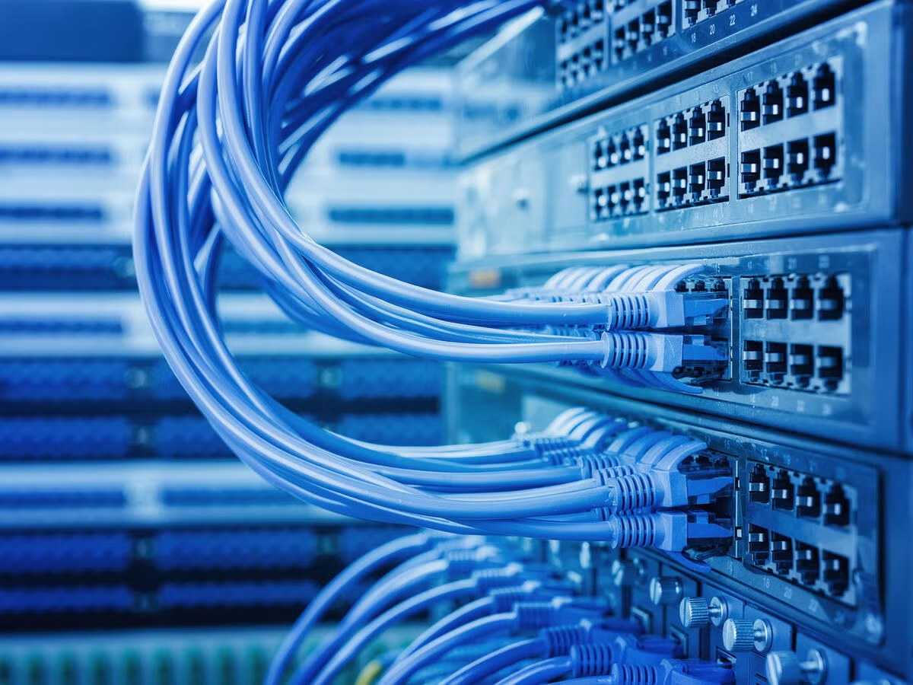
*A LAN's network cabinet: cables from every room meet at switches owned by the school.*

#### The speed in numbers

Copying a 1 GB video (8 000 megabits) to a classmate:

- over a 1 Gbps LAN: 8 000 ÷ 1 000 = **8 seconds**
- over a 50 Mbps Internet link: 8 000 ÷ 50 = **160 seconds**

Same file, twenty times longer: the second copy leaves the LAN and shares slower, longer links owned by other companies.

> **Pause & Try 4.2**
>
> A school copies a 2 GB video over its 1 Gbps LAN, then sends the same file to a partner school over a 40 Mbps Internet link. a) Estimate both transfer times. b) Give two reasons why the LAN copy is faster.

### Wide area networks (WAN)

A **wide area network (WAN)** connects devices, or whole LANs, that are far apart: in different towns, countries or continents. A supermarket chain that links the tills in 300 stores to its head office runs a WAN, and the **Internet** is the largest WAN of all.

#### What makes a network a WAN?

- **Ownership:** no single organisation owns all of a WAN. Companies lease (rent) capacity from telecom providers: fibre-optic and undersea cables, telephone lines, microwave, satellite and 4G/5G links.
- **Speed:** backbone links carry many gigabits per second, but each user's share is usually smaller than on a LAN, and data takes longer to arrive because it crosses thousands of kilometres and many routers.
- **Reliability:** long distances, more equipment and many different owners mean more things can fail, so WANs are built with routers and alternative routes that keep data moving when one link breaks.
- **Transmission media:** mostly fibre-optic cable, plus copper telephone lines, radio and satellite where cables cannot reach.

#### LAN and WAN side by side

| | LAN | WAN |
|---|---|---|
| Area | One building or site | Towns, countries, the world |
| Ownership | One organisation owns it all | Links leased from telecom companies |
| Speed | 100 Mbps – 10 Gbps per device | Smaller share per user; longer delays |
| Reliability | High; the owner fixes faults | More points of failure; backup routes |
| Main media | Twisted pair, Wi-Fi, some fibre | Fibre, undersea cable, satellite, mobile |

Because nobody owns all of a WAN, your data crosses equipment that belongs to other companies. That is one reason why encryption (4.9) matters so much once data leaves the LAN.

> **Pause & Try 4.3**
>
> A bank links 200 branches across a country; each branch has 30 computers in one building. Identify the LANs and the WAN in this system, then compare them on ownership, speed and reliability.

### Network topologies

A network's **topology** is its shape: the pattern of links that joins the nodes together. The topology decides how much cable is needed, how easily the network can grow and, most importantly, what happens when one link breaks. Most networks are built from three basic shapes.

#### Three basic shapes

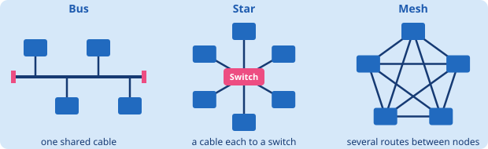

#### Bus

All nodes share **one cable** (the backbone), with a terminator at each end. It is cheap and needs little cable, but only one node can send at a time, two senders cause a **collision** (see 4.4), and a break in the backbone stops the whole network.

#### Star

Each node has **its own cable** to a central switch. A broken cable affects only one node, new nodes are easy to add, and the switch sends data only where it needs to go. If the switch fails, though, the whole star stops. Most LANs today are stars.

#### Mesh

Nodes have **several links** to each other, so data can take another route when a link fails. This makes a mesh very reliable but expensive to build. The routers of the Internet form a partial mesh.

Real networks are often **hybrids**: a school might wire each classroom as a star and join the classroom switches with a fibre-optic backbone.

> **Pause & Try 4.4**
>
> A school wants a network in which one broken cable cannot stop everyone working, at a reasonable cost. Which topology would you recommend? Give one reason for your choice and one weakness it still has.

### Client-server networks

Networks are also described by **how they organise their services**. In the **client-server** model, one or more powerful computers called **servers** provide services, and the other computers, the **clients**, request them. Every client connects to the servers, and the servers decide who may do what.

#### How a request is served

**Client** (sends a request) → **Server** (checks the user's rights) → **Server** (does the work) → **Client** (receives the response)

Common servers: a **file server** stores users' files centrally; a **print server** queues print jobs; an **email server** stores and forwards mail; a **web server** sends web pages.

#### Client-server in real life

- **Your school network:** you can log in at any computer and still see your own documents, because they live on the file server, not on the PC in front of you.
- **Online banking:** the app on your phone is the client; your account data stays on the bank's servers.
- **Streaming and online games:** video and game servers send content to millions of clients at once.

#### Cost

**High.** Servers, server software, backup systems and trained IT staff all cost money. In return, one team can manage hundreds of clients, and the network grows easily by adding clients or upgrading servers.

#### Security

**Central control.** Passwords, access rights, antivirus updates and backups are managed in one place. But the server is a **single point of failure** and a tempting target: if it goes down, clients cannot work unless there is a backup server.

> **Pause & Try 4.5**
>
> Your school's file server crashes on the morning of an exam. Explain what happens to students using the client-server network, and suggest how the school could reduce this risk in future.

### Peer-to-peer networks

In a **peer-to-peer (P2P)** network there is no central server. Every node, called a **peer**, keeps its own data and acts as **both a client and a server**: it can request files from other peers and supply files to them.

#### P2P in real life

- **A small home or office:** three laptops share each other's folders and one printer, with no server.
- **BitTorrent file sharing:** a large file is downloaded from many peers at once.
- **Cryptocurrency networks** such as Bitcoin: thousands of peers each keep a copy of the record of payments.

#### How BitTorrent shares a file

The file is split into small **pieces**. A **tracker** server keeps metadata, such as which computers are in the **swarm** (the peers sharing this torrent), but not the file itself. Each peer downloads pieces from several others while uploading the pieces it already has. A **seed** is a peer that has downloaded the file (usually all of it) and keeps uploading pieces to others; a **leech** downloads far more than it uploads and gets negative feedback; a **lurker** downloads but never adds new content.

#### Client-server or peer-to-peer?

| | Client-server | Peer-to-peer |
|---|---|---|
| Where data is stored | Centrally, on servers | On each peer |
| Cost | Higher: servers and IT staff | Low: no server needed |
| Security | Managed centrally by IT staff | Each user secures their own device |
| Backups | One central backup | Each peer backs up separately |
| If one computer fails | A server failure stops everyone | Only that peer's files are unavailable |
| Best for | Schools, banks, large firms | Homes, small offices, file sharing |

> **Pause & Try 4.6**
>
> An architecture firm with 40 staff works on large 3D rendering files and needs daily off-site backups and strict user permissions. Should it use a client-server or a peer-to-peer network? Justify your recommendation with three reasons.

## 4.2 Client Computations & Cloud Technologies

### Thin and thick clients

When a computer joins a network, its work can happen in two places: on the device itself or on a server. A **thin client** depends on a server; a **thick client** can do the work itself. The difference shows most clearly in **where data is processed** and **where it is stored**.

#### Thin client

A low-cost device, or a program such as a web app, that sends your input to a **server**, which runs the software and sends back the results.

- **Processing:** on the server.
- **Storage:** little or none; programs and your files live on the server.
- **Offline:** cannot do its main job.
- **Examples:** library terminals; a word processor in a web browser.
- **+** cheap; updated once, centrally. **−** useless without a connection; heavy server load.

#### Thick client

A full computer with its own processor, memory and **local storage**, which runs software itself.

- **Processing:** on its own CPU, GPU and RAM.
- **Storage:** its own SSD or hard disk holds the operating system, programs and files.
- **Offline:** keeps working.
- **Examples:** a gaming PC; a laptop with installed office software.
- **+** fast; works offline; less network traffic. **−** costly per user; software updated on every machine.

#### The game analogy

A thin client is like **cloud gaming**: your device sends key presses and shows video, while the game runs on a server far away. A thick client is like a game **installed on your own gaming PC**: your graphics card does all the work.

**Thin client** (your key press) → **Server far away** (runs the game) → **Your screen** (shows the video)

**Thick client** (your key press) → **Your own GPU** (runs the game) → **Your screen** (shows the result)

> **Pause & Try 4.7**
>
> Differentiate between a thick client and a thin client based on where data processing and storage take place. Then explain what happens to a thin-client user's work when the server fails.

### Public and private clouds

**Cloud computing** means using servers in a provider's data centre, reached over the Internet, to store files (**cloud storage**), run software or process data instead of owning all the hardware yourself. Providers build in **data redundancy**: every file is copied to several servers, often in different places, so one hardware failure does not lose it.

#### Public cloud

Owned and run by a provider and **shared by many customers**, who rent as much storage and computing power as they need.

- **Examples:** a school storing coursework in Google Drive or Microsoft OneDrive; Netflix running its streaming service on Amazon Web Services.
- **Cost:** low start-up cost; pay only for what you use.
- **Control:** limited. The provider chooses the hardware, and data may be stored in another country.

#### Private cloud

Cloud infrastructure **used by one organisation only**, in its own data centre or hosted for it elsewhere.

- **Examples:** a bank keeping customer accounts on its own cloud; a hospital storing patient scans; a government agency handling confidential records.
- **Cost:** high. The organisation buys the servers and employs the staff.
- **Control:** full control of hardware, location and security settings, which helps meet strict data laws.

#### The trade-offs

| | Public cloud | Private cloud |
|---|---|---|
| Cost | Low upfront; pay as you go | High upfront, plus staff |
| Security | Provider secures shared hardware | You secure it; data is isolated |
| Control | Little say over location and setup | Full control |
| Growth | Almost unlimited, within minutes | Limited by your own hardware |

Any cloud storage lets you reach your files from any device and acts as an off-site backup, but it needs an Internet connection, has ongoing fees and relies on the provider's security.

> **Pause & Try 4.8**
>
> A hospital wants to store patient scans, and a start-up expects its new app to become suddenly popular. Recommend a public or a private cloud for each and justify your choices using cost, security and control.

## 4.3 Hardware Required to Support a LAN

### The hardware in a LAN

To build a LAN you need a way for each device to send and receive signals, a medium to carry them, a central device that joins the nodes together and, usually, a way out to the Internet. Here is a small school LAN, part by part.

#### A small LAN

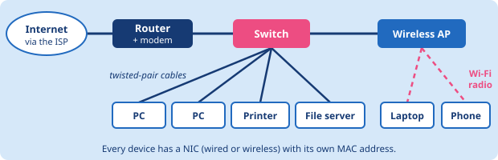

#### What each part does

| Hardware | Its job in the LAN |
|---|---|
| **NIC** (network interface card) | Built into every device; turns data into signals and back. Each NIC has a unique **MAC address** set at the factory. |
| **Cables** | Twisted-pair Ethernet cables connect each wired device to the switch. |
| **Switch** (or hub) | The centre of the star: joins all the wired nodes and passes data between them. |
| **Wireless access point** | Lets laptops, tablets and phones join the LAN by Wi-Fi radio instead of a cable. |
| **Router** (with a **modem**) | Connects the LAN to other networks; the modem carries signals over the line to the Internet service provider (ISP). |
| **Servers** (optional) | A file or print server provides shared services in a client-server LAN. |

At home, the router, modem, switch and access point usually come combined in **one box**.

> **Pause & Try 4.9**
>
> List the hardware needed to set up a LAN for a classroom with 25 desktop PCs, 5 tablets and one shared printer, all with Internet access. State the job of each item.

### Hubs, switches and more

Hubs and switches both join the nodes of a LAN, but a **hub** copies every incoming packet to all of its ports, while a **switch** reads the destination **MAC address** and sends the packet only to the right port.

#### Worked example: one file, two devices

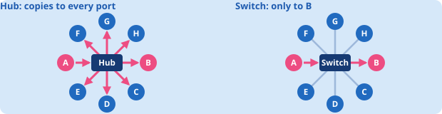

Node A sends a 10 MB file to node B, first on an **8-port hub**, then on an **8-port switch**.

- **Hub:** the 10 MB is copied to ports 2 to 8. Nodes C to H each receive 10 MB they did not need (60 MB wasted) and discard it. Meanwhile no other node can send.
- **Switch:** it looks up B's MAC address in its **MAC address table** and forwards the frames to B's port only, so C can talk to D at the same moment. The switch **learns** the table by noting the source address of every frame and the port it came in on.

#### Other connecting devices

- **Repeater:** regenerates a weak signal so it can travel further, e.g. a Wi-Fi extender. A **repeating hub** is a hub that also boosts the signals it copies.
- **Bridge:** joins two LANs that use the same protocols, e.g. the LANs of two classrooms.
- **Gateway:** joins networks that use different protocols, translating between them, e.g. a smart-home hub linking Zigbee light bulbs to Wi-Fi.
- **Modem:** converts digital data into analogue signals for a telephone line, and back again. A **softmodem** does this mainly in software, with minimal hardware.

> **Pause & Try 4.10**
>
> Node A sends a 6 MB file to node D on a 6-port hub. How much data reaches nodes that did not need it? Explain how a switch would change this, and why that makes the LAN faster for everyone.

### How routers choose a route

A switch moves data **within** one LAN. A **router** moves data **between** networks: from your home LAN to your Internet provider, or from one company site to another. Every packet carries a destination **IP address** (see 4.5), and the router passes it one step, or **hop**, closer to it.

#### The routing table

Each router keeps a **routing table**: the networks it knows about, the **next hop** towards each one, and a **cost**, a score where lower is better (fewer hops or faster links).

| Destination network | Next hop | Cost |
|---|---|---|
| 192.168.1.x (this LAN) | Port 1: deliver directly | 0 |
| 10.20.0.x (head office) | Router R3 | 6 |
| Anything else (default route) | The ISP's router | – |

For every packet, the router reads the destination address, finds the matching line and sends the packet to that next hop. A packet for 10.20.0.7 goes to R3; a packet for a web server the router has never heard of follows the **default route** to the ISP.

#### How the router decides

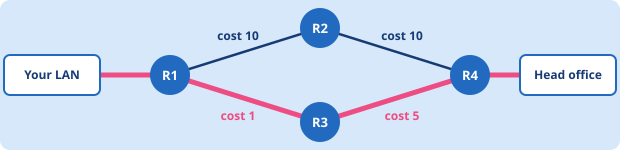

Routers regularly swap information with their neighbours about the networks they can reach and what it costs. From this, R1 works out that the route through R2 costs 10 + 10 = **20**, while the route through R3 costs 1 + 5 = **6**, so it sends head-office packets to R3. If the R3–R4 link fails, the routers tell each other, recalculate and switch to the R2 route within seconds. Routes **change** as the network changes.

> **Pause & Try 4.11**
>
> In the map above, the R1–R3 link becomes congested and its cost rises from 1 to 12. Which route will R1 now choose, and what is its total cost? Explain how R1 finds out about the change.

## 4.4 Transmission Media & Collision Handling

### Transmission media

The **transmission medium** is whatever carries the signal between nodes: copper wire, glass fibre or radio waves. Each medium has a different speed, range and cost, and a different resistance to **interference**: outside electrical noise that corrupts signals.

#### Cables

- **Twisted-pair cable:** pairs of copper wires twisted together to cancel interference from nearby cables. Cat5e and Cat6 carry 1–10 Gbps over up to 100 m: the standard for Ethernet LANs.
- **Coaxial cable:** a copper core inside a metal shield; used for cable TV and broadband.
- **Fibre-optic cable:** pulses of light in thin glass strands. Very fast over many kilometres and immune to electrical interference, but costly to install; used between buildings and for the Internet backbone.

#### Wireless

- **Wi-Fi** (IEEE 802.11) uses radio waves and microwaves to connect devices to a WLAN. It uses **spread spectrum technology**, spreading the signal over a wide band of frequencies, with a range of about 30–50 m.
- **Bluetooth** uses radio waves in the 2.45 GHz band for short-range WPANs, e.g. earbuds.
- **Spread spectrum frequency hopping** (used by Bluetooth): the device picks one of **79 channels** at random and hops to another if it is busy, avoiding interference; range up to 100 m.

#### Wired or wireless?

| | Wired (cable) | Wireless (radio) |
|---|---|---|
| Speed | Faster and steady | Usually slower; falls with distance |
| Interference | Low (none for fibre) | Higher: walls, other devices |
| Security | An intruder must plug in | Signals leak outside: encrypt them |
| Mobility | Fixed positions | Move around freely |
| Cost | Cabling is costly to install | New devices join easily |

> **Pause & Try 4.12**
>
> Recommend a transmission medium for each case and justify it: a) linking two school buildings 400 m apart; b) giving café customers Internet access on their phones; c) connecting wireless earbuds to a phone.

### Data collisions

On a **shared medium** (one cable used by several nodes, as in a bus or a hub, or the radio channel of a Wi-Fi network) only one node can send at a time. If two nodes send at the same moment, their signals overlap and corrupt each other: a **data collision**. Both frames are destroyed and must be sent again.

#### How a collision happens

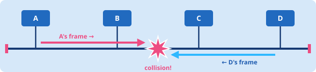

1. Nodes A and D both listen and hear a **quiet** cable, so both start sending.
2. Signals take time to travel, so neither has yet heard the other's frame.
3. The signals meet and add together: B and C receive a **garbled** mixture that nobody can read.

#### The dark-room party

*Two people talking at once: neither message gets through.*
Imagine a dinner party in a **dark room**: you cannot see who is about to speak, so you can only listen. If two guests start talking at exactly the same moment, nobody understands either of them.

**CSMA/CD** is like both guests stopping, waiting a random few seconds and trying again. **CSMA/CA** is like raising your hand and waiting for the host's signal before you speak.

Networks need rules to **detect** collisions (cables) or **avoid** them (radio). On a switched Ethernet LAN each cable is a private link to the switch, so collisions cannot happen there.

> **Pause & Try 4.13**
>
> Two nodes on a shared cable both sense that it is idle and start sending at the same moment. Describe what happens to their signals, and explain why they must not simply resend straight away.

### Detecting collisions: CSMA/CD

**CSMA/CD** is used on wired Ethernet when several nodes share one cable or a hub. Its name lists its three ideas: **carrier sense** (listen before you send), **multiple access** (many nodes share the cable) and **collision detection** (notice when two signals clash, and recover).

#### CSMA/CD step by step

1. **Listen** — is the cable idle? If not, wait
2. **Send** — start transmitting the frame
3. **Monitor** — keep checking the voltage on the cable
4. **Collision?** — voltage too high: stop, send a jam signal
5. **Back off** — wait a random time, then return to step 1

#### What each step is for

**Listening first** prevents most collisions: a node never interrupts a frame it can already hear.

**Monitoring** works because two overlapping signals add together, so the voltage on the cable rises above what one sender alone would produce.

The **jam signal** is a short burst that makes sure every node notices the collision, not just the two senders.

**Backing off** for a **random** time matters: if both nodes waited the same fixed time, they would simply collide again. After 16 failed attempts the frame is abandoned.

#### Why random waits work, in numbers

After a collision, A and B each pick a random wait of 0 or 1 time slots. They collide again only if they pick the **same** number: 2 chances in 4, so **1/2**. After a second collision each chooses from 0–3 slots, and the chance of another clash drops to 4 in 16 = **1/4**. Every further collision doubles the range, so one node soon wins the cable and the other waits its turn.

> **Pause & Try 4.14**
>
> After a third collision, nodes A and B each choose a random wait from 0–7 slots. What is the chance that they collide again? Explain why the range of waits keeps doubling, and why a jam signal is needed.

### Avoiding collisions: CSMA/CA

Wi-Fi devices also share one medium, the radio channel, but they cannot detect collisions as cables can. A radio cannot hear other signals while it is transmitting, and two devices on opposite sides of an access point may be too far apart to hear each other at all: the **hidden node** problem. So Wi-Fi uses **CSMA/CA**: it tries to **avoid** collisions, and relies on acknowledgements to find out whether a frame got through.

#### CSMA/CA step by step

1. **Listen** — is the channel clear? If not, wait
2. **Count down** — wait a random back-off time
3. **Reserve (optional)** — send RTS; the access point replies CTS
4. **Send** — transmit the frame
5. **ACK?** — no acknowledgement: assume a collision, back off and retry

#### The hidden node problem

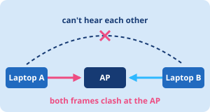

A and B each hear a clear channel and send. The **CTS** from the access point, which both laptops can hear, tells everyone else to stay quiet until the frame is done.

Sharing a medium also slows a network down. **Bandwidth** is how much data a link can carry per second; **latency** is how long data takes to arrive. Collisions, back-offs and resends add latency and shrink each device's share of the bandwidth: two of the network challenges explored in the video.

▶ **Video tutorial:** [Watch the tutorial: Network challenges (Video 03)](https://github.com/user-github-me/cs-ai-project-01/blob/main/assets/tutorials/stage2/videos/BlueImpulse_Video03_Network_Challenges.mp4)

> **Pause & Try 4.15**
>
> How do network systems handle data collisions when several devices try to transmit at the same time over a shared medium? Answer for a wired network using CSMA/CD and for Wi-Fi using CSMA/CA.

## 4.5 Internet Infrastructure, URLs & DNS

### The Internet and the Web

People often use "the Internet" and "the Web" as if they meant the same thing, but they are different. The **Internet** is the infrastructure: a worldwide network of networks. The **World Wide Web** is one service that runs on top of it, just as email, video calls and online games do.

#### Internet or World Wide Web?

| | Internet | World Wide Web (WWW) |
|---|---|---|
| What it is | A global network of networks | A collection of linked web pages |
| Made of | Cables, routers, servers | Pages, images, videos, hyperlinks |
| Works with | TCP/IP protocols, packets | Browsers, URLs, HTTP/HTTPS |
| Began | ARPAnet, 1969 | Tim Berners-Lee, 1989 |
| Carries | The Web, email, calls, games | Web pages only |

#### Hardware that supports the Internet

**Laptop** → **Router + modem** → **ISP** → **Backbone** → **Web server**

- The laptop's **NIC** (wired or Wi-Fi) sends the data to the router.
- A **modem** converts digital data into signals that travel along the telephone or cable line to your ISP, and converts incoming signals back.
- **Routers** at every junction forward packets towards their destination, hop by hop.
- **Internet service providers (ISPs)** connect homes and organisations to the Internet and to each other through the high-speed **backbone**: fibre-optic and undersea cables crossing countries and oceans.
- **Servers** in data centres store web pages, emails and videos, plus the DNS records that turn names into addresses.

> **Pause & Try 4.16**
>
> State two differences between the Internet and the World Wide Web. Then name, in order, the hardware a request passes through on its way from your laptop to a web server.

### IP addresses: IPv4 and IPv6

Every device on the Internet needs an **IP address**: a number that identifies it, so that routers can deliver packets to it. Two versions are in use today.

#### IPv4: 32 bits

Four **denary numbers** from 0 to 255, separated by dots; each number is one byte.

`192.168.1.20` in binary is:

`11000000.10101000.00000001.00010100`

32 bits give 232 ≈ **4.3 billion** addresses, fewer than the number of devices online today.

#### IPv6: 128 bits

Eight groups of four **hexadecimal digits**, separated by colons; each group is 16 bits.

`2001:0db8:0000:0000:0000:ff00:0042:8329`

128 bits give 2128 ≈ **3.4 × 1038** addresses: enough for every device for the foreseeable future.

#### Shortening an IPv6 address

1. Drop the **leading zeros** in each group: 0db8 → db8, 0042 → 42, 0000 → 0.
2. Replace **one** run of consecutive zero groups with `::` (once only, or it would be ambiguous).

`2001:0db8:0000:0000:0000:ff00:0042:8329`\
→ `2001:db8:0:0:0:ff00:42:8329` (rule 1)\
→ `2001:db8::ff00:42:8329` (rule 2)

#### Practical differences

- **Running out:** the central pool of free IPv4 addresses ran out in 2011. Homes and schools cope by giving devices **private addresses** (e.g. 192.168.x.x) that share one **public address** through the router. With IPv6, every device can have its own public address.
- **Set-up:** an IPv6 device can configure its own address automatically when it joins a network.
- **Efficiency:** IPv6 packet headers have a simpler, fixed layout, so routers can process them quickly.
- **Today:** both versions run side by side, and most devices and websites support both.

> **Pause & Try 4.17**
>
> a) Write the IPv4 address 10.0.255.7 in binary. b) Shorten the IPv6 address 2001:0db8:0000:0000:0000:0000:0000:0001. c) Give one practical reason why networks are moving to IPv6.

### Reading a URL

A **uniform resource locator (URL)** is the full address of one resource, such as a page, an image or a video, on the World Wide Web. Each part of a URL answers a different question for the browser: **how** to fetch the resource, from **which server**, and **where** on that server it is.

#### One URL, six parts

https://www.example.com:443/courses/computer-science/notes.html#section2

| Part | What it tells the browser |
|---|---|
| `https://` | **Protocol:** use HTTP Secure (HTTP protected by encryption) |
| `www.example.com` | **Domain name:** which server; DNS turns it into an IP address |
| `:443` | **Port:** the service on the server (443 = HTTPS, usually left out) |
| `/courses/computer-science/` | **Path:** which folder on the server |
| `notes.html` | **Resource:** which file to send back |
| `#section2` | **Fragment:** which part of the page to show; stays in the browser |

#### Inside the domain name

Read it from **right to left**, from general to specific:
- `.com`: the **top-level domain** (TLD), like .org or .uk
- `example`: the organisation's registered name
- `www`: one particular host (server) it runs

#### Extra information

Some URLs end with a **query** after a question mark, e.g. `?q=networks`, which passes extra information (here a search term) to a program on the server.

**Protocol** (use HTTPS) → **DNS lookup** (name → IP address) → **Request** (…/notes.html) → **Display** (jump to #section2)

> **Pause & Try 4.18**
>
> Break the URL https://shop.example.org/books/networking.html#reviews into its parts. For each part, explain how it helps the browser locate and display the resource.

### DNS: finding a website

Computers find each other by **IP address**, but people remember names such as www.example.org. The **Domain Name Service (DNS)** is a worldwide system of servers that translates domain names into IP addresses. No single server knows every name: the work is shared out in a hierarchy, and answers are **cached** (remembered for a while) to save time.

#### Following one lookup: www.example.org

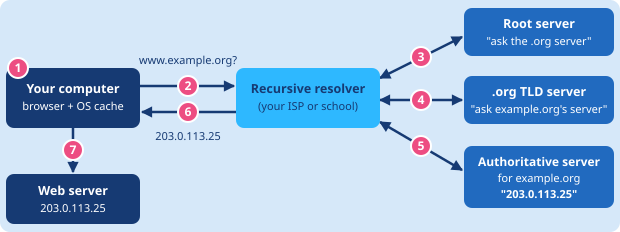

#### Step by step

1. You type www.example.org. The browser and operating system first check their own **cache**: if you visited recently, the IP address is already there and the lookup ends here.
2. If not, your computer asks a **recursive resolver**, a DNS server usually run by your ISP or school.
3. The resolver asks a **root server**, which does not know the answer but replies: "ask the **.org TLD server**".
4. The **TLD server** replies: "ask **example.org's authoritative server**".
5. The **authoritative server** holds the official record and returns the IP address: **203.0.113.25**.
6. The resolver **caches** the answer and passes it back to your computer, which caches it too.
7. Your browser connects to 203.0.113.25 and requests the page using HTTPS.

> **Pause & Try 4.19**
>
> Describe, step by step, how DNS finds the IP address of www.example.org the first time it is visited. Then explain why a second visit a few minutes later is faster.

## 4.6 Protocols & The TCP/IP Protocol Stack

### Protocols and the TCP/IP stack

A **protocol** is a set of rules for communication that the sender and the receiver both agree to follow. Without protocols, a receiver would get a stream of bits with no way to tell where a message starts, who it is for or whether it arrived intact. Protocols fix the **format** of the data, how it is **addressed**, how **errors** are detected, the **speed** of transmission and what to do when data goes missing.

#### Why a stack of layers?

Networking is too big a job for one protocol, so it is split into **layers**, each with one job. A group of layered protocols is called a **protocol stack**. Each layer uses the services of the layer below and serves the layer above, so one layer can change without affecting the others: your browser works the same whether the link underneath is Wi-Fi or a cable, and devices from different manufacturers can work together.

#### The four layers of TCP/IP

| Layer | Its job | Data unit | Protocols |
|---|---|---|---|
| **Application** | Gives applications network services: web pages, email, file transfer | Data (message) | HTTP, HTTPS, FTP, SMTP, POP3, IMAP, DNS |
| **Transport** | Splits data into numbered segments, adds port numbers (which application), checks that every segment arrives and puts them back in order | Segment | TCP, UDP |
| **Internet** | Adds the source and destination IP addresses and routes packets across networks | Packet | IP (IPv4, IPv6) |
| **Link** | Adds MAC addresses and sends the bits over the physical medium | Frame | Ethernet, Wi-Fi |

TCP is a **host-to-host** protocol: it manages the conversation between the two end devices (hosts), while routers in between only look as far as the internet layer. **UDP** is a lighter transport protocol that skips TCP's delivery checks; it is faster, so live video calls and online games often use it.

> **Pause & Try 4.20**
>
> Outline the four layers of the TCP/IP stack in order, from top to bottom, giving the core responsibility of each. Then explain one benefit of organising protocols as a stack.

### The layers in action

The layers never work alone. When you ask for a web page, your request travels **down** the layers of your computer, **across** the network through routers, and **up** the layers of the web server. Each layer only "talks" to the **same layer** on the other machine, using the header it adds.

#### One request, three machines

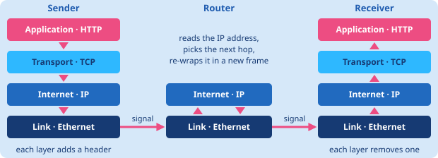

#### Following the request

1. **Application:** your browser creates an HTTP request, "GET /notes.html".
2. **Transport:** TCP splits it into segments, numbers them and adds the port number of the web service.
3. **Internet:** IP adds your IP address and the server's IP address, making a **packet**.
4. **Link:** Ethernet or Wi-Fi adds MAC addresses and an error check, making a **frame**, and sends it as signals.
5. **Router:** reads only as far as the internet layer. It checks the destination IP address, chooses the next hop and wraps the packet in a **new frame** for the next link.
6. **Server:** each layer checks and removes its own header, in reverse order, until the web server program receives exactly the request that was sent. The reply makes the same journey back.

> **Pause & Try 4.21**
>
> Your browser requests a web page. Describe what happens to the request at each layer of your computer, at a router on the way, and at the web server.

### Encapsulation

Each layer treats everything it receives from the layer above as **data** and wraps it in its own **header** (the link layer also adds a **trailer**). This is **encapsulation**; the receiver unwraps the layers in reverse order.

#### Wrapping the data

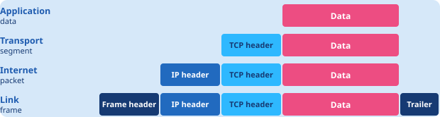

**TCP header:** port numbers and the segment's sequence number. **IP header:** source and destination IP addresses. **Frame header:** source and destination MAC addresses. **Trailer:** an error check.

**Worked example.** A 5 000-byte image is sent over Ethernet, where a segment carries at most **1 460 bytes** of data. TCP needs 4 segments: 1 460 + 1 460 + 1 460 + 620 = 5 000. Each frame adds a TCP header (20 bytes), an IP header (20), an Ethernet header (14) and a trailer (4): 58 bytes. So 5 000 + 4 × 58 = **5 232 bytes** travel, about 4% of them headers.

#### The postal analogy

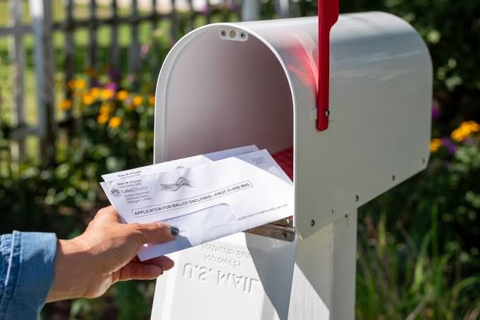
*Posting a letter: the envelope and its address wrap the message.*
1. **Application:** you write a letter (the data).
2. **Transport:** a long letter is split into numbered pages, each in its own envelope (segments).
3. **Internet:** every envelope gets the destination and return addresses (packets).
4. **Link:** postal workers load the envelopes into a mail truck for one stretch of road (frames). At the next sorting office they move to another truck, just as a packet gets a new frame at each router.

> **Pause & Try 4.22**
>
> A 3 000-byte web page is sent over Ethernet in segments of at most 1 460 bytes. How many segments are needed, and how much data does the last one carry? List the headers each frame carries, from the outside in.

### Web and file protocols

The application layer holds the protocols you meet every day. Each one is a set of rules for one kind of job: fetching web pages, moving files or handling email.

#### HTTP and HTTPS: the web

**Hypertext transfer protocol (HTTP)** sets the rules for requesting and sending web pages. It works by **request and response**:

**Browser** (sends a request) → **Web server** (finds the file) → **Response** (status code + the page) → **Browser** (displays it)

<b>Request:</b> GET /courses/notes.html HTTP/1.1 · Host: www.example.com <b>Response:</b> HTTP/1.1 200 OK · Content-Type: text/html · (then the page)

The browser then sends one more request for each image and style sheet on the page. If a file does not exist, the server replies **404 Not Found**. Submitting a form, such as a search or a login, sends your data to the server in a **POST** request. **HTTPS** is HTTP sent through an encrypted TLS connection (see 4.9): anyone who intercepts the packets sees only ciphertext. Every login, payment and form should use it.

#### FTP: moving files

**File transfer protocol (FTP)** is used to **upload and download files** between a client and a server: text files and **binary files** such as images, videos and programs. FTP opens one connection for commands and a separate one for the file data.
- A web designer uploads the new version of a website's files to the hosting server.
- A researcher downloads a 2 GB data set from a university archive.
- In a command-line terminal, `put report.pdf` uploads a file and `get data.zip` downloads one.

Plain FTP sends passwords without encryption, so secure versions such as **SFTP** and **FTPS** are used today.

> **Pause & Try 4.23**
>
> Briefly state the purpose of HTTP and of FTP, giving a practical example of each. Which protocol would you use to upload a 2 GB file to a remote website storage folder from a command-line terminal?

### Email protocols

Sending an email uses **two kinds** of protocol. **SMTP** pushes the message from the sender towards the recipient's mail server; **POP3** or **IMAP** lets the recipient pull it out of their mailbox.

#### Follow one email

Aisha (aisha@school.example) sends a photo to Ben (ben@mail.example).

**Aisha** (her email app) → **Her mail server** (SMTP) → **Ben's mail server** (SMTP; stores it) → **Ben's devices** (IMAP or POP3)

#### SMTP: the push protocol

**Simple mail transfer protocol (SMTP)** is used for **sending** email. It is a **push protocol**: the sender opens a connection to a server and pushes (uploads) the message to it.
1. Aisha's email app pushes the message to her school's outgoing mail server using SMTP.
2. That server uses DNS to look up which mail server handles addresses ending in mail.example.
3. It relays the message to Ben's mail server, server to server, again using SMTP.

SMTP only delivers: it cannot fetch mail out of a mailbox. It was designed for plain text, so attachments are packaged with **MIME** (multipurpose Internet mail extensions), which lets one email carry images, sound, video and other binary files alongside the text.

#### POP3: download it

**Post office protocol 3** is a **pull protocol**: the client connects to the server, downloads new emails to **one device** and, by default, deletes them from the server. It suits reading offline on a single computer, but Ben's phone would never see what his laptop downloaded.

#### IMAP: keep it on the server

**Internet message access protocol** is also a **pull protocol**, but the emails **stay on the server**. Every device shows the same inbox, folders and read or unread status, kept in sync. That is why most people use IMAP today.

> **Pause & Try 4.24**
>
> Which protocol is used in each case? a) Unread emails fetched on a laptop stay visible in the inbox on a smartphone. b) A PDF is attached to an email and sent. c) Explain why SMTP is called a push protocol.

## 4.7 Network Security, Privacy & Data Integrity

### Security, privacy and integrity

Once devices are connected, other people can reach their data, and not all of them mean well. Protecting data means three different things; here they are, using a hospital's patient records as the example.

#### Data security

Protecting data and systems from **unauthorised access**, theft, accidental loss, deliberate damage or corruption.

*Example:* only logged-in hospital staff can open the patient database, and it is backed up every night.

#### Data privacy

The right of people to **control how their personal data is collected, used and shared**. Laws such as the EU's GDPR protect it.

*Example:* a nurse may see a record only while treating that patient, and the hospital may not sell it to an insurer.

#### Data integrity

Keeping data **accurate, complete and unchanged** during entry, storage and transfer.

*Example:* a patient's recorded allergy must be exactly what the doctor entered; one wrong digit in a dose could do harm.

*Security guards control who gets in. User accounts, passwords and firewalls do the same job for data.*

#### How they fit together

**Security** is the set of tools; **privacy** and **integrity** are two of the things those tools protect. A system can be secure but still misuse personal data (a privacy failure), or keep data private but full of typing mistakes (an integrity failure).

The rest of 4.7 looks at the **threats** to data, the **protection** against them, and the checks, **validation** and **verification**, that keep data correct.

> **Pause & Try 4.25**
>
> Differentiate between data security, data privacy and data integrity. Give an example of a failure of each in a school's student-records system.

### Security threats

A **threat** is anything that could damage, steal or expose data. Some threats are programs, known as **malware** (malicious software); others trick people, or attack a network directly.

#### Five threats to know

| Threat | How it works | How to reduce the risk |
|---|---|---|
| **Virus** | A program that copies itself into other files and runs when they are opened; it can delete or corrupt data, fill up storage or crash the computer | Antivirus software; never open unknown attachments or run untrusted downloads |
| **Spyware** | Secretly records what you do, e.g. a **keylogger** records your key presses, and sends it to a third party | Anti-spyware software; on-screen keyboards or drop-down menus for passwords |
| **Hacking** | Gaining unauthorised access to a system, e.g. by guessing weak passwords or exploiting software bugs | Firewalls, strong passwords, software updates, encryption |
| **Phishing** | Fake emails or messages that look as if they come from a real bank or school, with a link to a fake website that asks for your details | Check the sender and the link before clicking; spam filters; staff training |
| **Pharming** | Malicious code on your computer, or a tampered DNS server, sends you to a fake website even when you type the correct address | Antivirus; check for the padlock and the site's certificate; keep software updated |

#### Phishing or pharming?

Both lead you to a fake website that steals your details. The difference is **how you get there**. **Phishing** needs you to act: to click a link in a message. **Pharming** needs no click: the redirection happens behind the scenes, so even typing the correct URL takes you to the fake site.

#### Spot the attack

You receive an email "from your bank": *"Unusual activity on your account. Confirm your password within 24 hours."* The link goes to bank-secure-login.example. Warning signs: the urgency, the request for a password (banks never ask for one) and a web address that is not the bank's real domain. This is **phishing**.

> **Pause & Try 4.26**
>
> Explain the difference between phishing and pharming, and suggest one way to protect against each. Why can antivirus software alone not protect you from phishing?

### Accounts and access rights

The first line of defence: only the right people get in, and each of them can do only what they need.

#### User accounts and passwords

A **user account** gives each person a username and password. The system uses it to decide what that person may do, gives them their own storage space and logs their activity, so it is clear which account did what. When someone leaves, their account is disabled.

A **strong password** is long (12 or more characters), mixes upper and lower case letters, digits and symbols, avoids words and personal details, and is different for every site. **Two-factor authentication** adds a second check, such as a code sent to your phone.

#### Why length matters, in numbers

An attacker's computer can test about **10 billion** passwords per second.

| Password | Possible combinations | Time to try them all |
|---|---|---|
| 8 lower-case letters | 268 ≈ 2.1 × 1011 | about 21 seconds |
| 12 characters, any of 94 symbols | 9412 ≈ 4.8 × 1023 | about 1.5 million years |

#### Access rights

**Access rights** (permissions) set what each account may do with a file or folder: **read**, **write**, **delete** or **no access**. Users get only the rights they need, so a stolen student password cannot change marks.

| Folder | Student | Teacher | Network manager |
|---|---|---|---|
| Own home folder | Read, write | Read, write | Full control |
| Class resources | Read only | Read, write | Full control |
| Exam marks | No access | Read, write (own classes) | Full control |

> **Pause & Try 4.27**
>
> A password uses 6 lower-case letters. How many combinations are possible, and how long would 10 billion guesses per second take to try them all? Suggest two ways to make it stronger.

### Firewalls and anti-malware

Accounts control who can log in. The tools on this page guard everything else: the network connection, the files on the disk and the messages that travel between computers.

#### Firewall

Hardware or software that sits **between a computer (or a whole LAN) and the Internet** and examines every packet going in or out. It compares each packet's IP addresses, port numbers and protocol with a set of **rules** and blocks anything not allowed: for example, incoming connections that nobody asked for, or traffic to known malicious websites. It also keeps a log of blocked attempts so that attacks can be investigated.

#### Antivirus software

Scans files when they are downloaded or opened, and on a regular schedule, comparing them with a database of known virus **signatures**. It also watches for virus-like behaviour. Infected files are **quarantined** (isolated) or deleted. It must be updated often to recognise new viruses.

#### Anti-spyware software

Detects and removes spyware and blocks keyloggers from recording what you type. Some banking sites add on-screen keyboards or drop-down menus for passwords, so that there are no key presses to record.

#### Encryption

Scrambles data so that anyone who intercepts or steals it sees only meaningless **ciphertext**. It protects Wi-Fi traffic, web sessions (HTTPS) and the disk of a lost laptop. Encryption does not stop data being stolen; it makes stolen data useless without the key (see 4.9).

#### Digital signatures

Attached to an email or a document, a digital signature proves **who sent it** and that **nobody changed it** on the way. A fake email claiming to be from your bank would fail the signature check (see 4.9).

> **Pause & Try 4.28**
>
> Which security mechanism best solves each problem? a) Stopping hackers from reading captured Wi-Fi traffic. b) Proving that an email contract really came from a supplier and was not changed. c) Stopping employees from opening malicious websites on office computers.

### Validation and verification

Integrity can be damaged without any attacker: someone mistypes a date, or electrical noise flips a bit as data crosses a network. Two kinds of check catch these errors.

#### Validation: is the data sensible?

**Validation** is an automatic check, made as data is entered, that it follows set rules.

| Check | Rule | Rejects |
|---|---|---|
| Range | Age must be 11–19 | 42 |
| Length | Phone number has 11 digits | 0791234 |
| Type | Age must be a whole number | fifteen |
| Format | Date as dd/mm/yyyy | 2024-02-12 |
| Presence | Surname must not be blank | (empty) |

Validation cannot prove that data is **correct**: a student aged 15 who types 16 still passes the range check. *Worked example:* 31/02/2024 passes the format check but fails a range (logic) check, because February never has 31 days.

#### Verification: was it copied correctly?

**Verification** checks that data entered or transferred **matches the original**.
- **During entry:** **double entry** means typing the data twice so the computer can compare the two (e.g. a new password); a **visual check** means a person compares the screen with the source document. Neither can catch the same mistake made twice.
- **During transfer:** a **parity check** adds one extra bit so that every byte has an even number of 1s (even parity). The receiver counts the 1s again: an odd count means an error. A **checksum** works the same way with a total calculated from a whole block of data.

*Worked example:* the data 1011001 has four 1s, so the parity bit is 0, giving **0**1011001. If noise flips one bit and 01011**1**01 arrives, its five 1s give an odd count: the error is detected and the byte is resent. If **two** bits flip, the count is even again and the error is missed.

> **Pause & Try 4.29**
>
> a) Add an even parity bit to the 7-bit data 1100101. b) The byte arrives as 01110101: has an error been detected? c) Contrast validation with verification, giving one example check of each.

## 4.8 Switching Mechanisms: Circuit vs. Packet Switching

### Circuit switching

To cross a large network, data passes through many switching points. There are two ways to organise the journey: reserve a whole path in advance (**circuit switching**), or send the data in independent pieces that each find their own way (**packet switching**).

#### How circuit switching works

A **dedicated path** is set up between the sender and the receiver **before** any data is sent. The path, and all of its capacity, belongs to that one conversation until it ends.

**1 · Set up** (reserve a path) → **2 · Transfer** (data follows it, in order) → **3 · Tear down** (release the path)

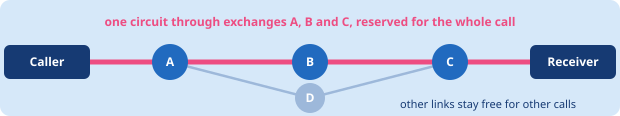

The classic example is a **landline telephone call**. Dialling sets up a circuit through the telephone exchanges; the circuit stays open while you talk, even during silences; hanging up releases it.

#### Benefits

- The **whole bandwidth** of the path is reserved, so the data rate never drops.
- Delay is **low and constant**, and data arrives **in order**: ideal for live voice and video.
- No sequence numbers or reassembly are needed.

#### Drawbacks

- Capacity is **wasted** whenever nobody is speaking or sending.
- The path must be **set up first**, which delays the start.
- If any link on the path fails, the connection **drops**.
- When every circuit is busy, new calls are blocked; dedicated lines are expensive.

> **Pause & Try 4.30**
>
> a) Explain what is meant by circuit switching. b) Video conferencing is one application in which circuit switching is often preferred. Explain why.

### Packet switching

In **packet switching**, a message is split into small blocks called **packets**. Each packet travels through the network **independently**, perhaps by a different route, and the receiver puts the message back together. The Internet works this way.

#### Inside a packet

| Header | Payload | Trailer |
|---|---|---|
| Source and destination IP addresses; sequence number; protocol; hop limit | A slice of the message, e.g. 1 500 bytes of a photo | An error check (such as a CRC) and an end-of-packet marker |

#### A photo crosses the network

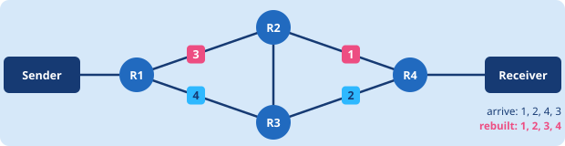

A 6 000-byte photo is split into **4 packets** of 1 500 bytes, numbered 1–4. At every **router**, the destination address in the header is read, the routing table is checked and the packet is sent to the best next hop **at that moment**: packets 1 and 3 travel via R2, while 2 and 4 go via R3. They arrive in the order 1, 2, 4, 3, and the receiver uses the **sequence numbers** to rebuild the photo. A lost or damaged packet is simply requested again. Each router also lowers the **hop limit** by 1 and discards any packet that reaches 0, so no packet can circle the network for ever.

> **Pause & Try 4.31**
>
> Describe what a router does with each packet it receives. Then explain how the receiver rebuilds a message whose packets arrive in the wrong order, or not at all.

### Packet or circuit?

Packet switching carries almost all Internet traffic because, for most data, its benefits outweigh its drawbacks. Here they are, explained one by one, followed by a side-by-side comparison with circuit switching.

#### Benefits of packet switching

- **Efficient:** links are shared. While you pause, other people's packets use the line, so no capacity is wasted on silences.
- **Robust:** if a link or router fails, the next packets are simply routed around it, and the message still arrives.
- **No set-up delay:** sending starts immediately, as there is no path to reserve first.
- **Cheaper recovery:** only lost or damaged packets are sent again, not the whole message.
- **Cheaper to run:** one shared network carries everyone's data, so nobody pays for a dedicated line.

#### Drawbacks of packet switching

- **Reassembly:** packets can arrive out of order, so the receiver must hold and reorder them using their sequence numbers.
- **Lost packets:** a busy router may drop packets, which must be noticed and resent, adding delay.
- **Variable delay (jitter):** queues at busy routers make packets arrive at uneven intervals, so live calls can stutter unless the receiver buffers them.
- **Overhead:** every packet carries a header: extra data to send and process.
- **No guarantee:** no user is promised a fixed share of the bandwidth.

#### Circuit or packet switching?

| | Circuit switching | Packet switching |
|---|---|---|
| Path | One dedicated path for the whole session | Each packet routed separately |
| Use of capacity | Low: reserved even when idle | High: links shared by many users |
| Delay | Low and constant | Varies with traffic (jitter) |
| If a link fails | The connection drops | Packets are re-routed |

> **Pause & Try 4.32**
>
> List two major benefits and one drawback of packet switching, explaining why each one happens. Which switching method would you choose for a live video call across a busy network, and why?

## 4.9 Cryptography, Quantum Security & Digital Certificates

### How encryption works

Data crossing a network can be intercepted by an **eavesdropper**. Encryption does not stop the interception; it makes what is intercepted **useless**. An **encryption algorithm** uses a **key** to turn readable **plaintext** into unreadable **ciphertext**. **Decryption** uses a key to turn the ciphertext back into plaintext.

**Plaintext** (MEET AT TEN) → **Encrypt** (key = 3) → **Ciphertext** (PHHW DW WHQ) → **Decrypt** (key = 3) → **Plaintext** (MEET AT TEN)

#### Worked example: a Caesar cipher

The algorithm: **shift every letter forward** through the alphabet, wrapping round from Z to A. The key: **how many places**. With key 3, each letter in the top row is replaced by the letter below it:

PlainABCDEFGHIJKLMNOPQRSTUVWXYZ CipherDEFGHIJKLMNOPQRSTUVWXYZABC

So M → P, E → H, T → W, A → D and N → Q: MEET AT TEN becomes **PHHW DW WHQ**. To decrypt, the receiver shifts every letter **back** 3 places. Anyone who intercepts PHHW DW WHQ without knowing the key sees nonsense.

#### Why real keys are long

A Caesar cipher has only 25 useful keys, so an eavesdropper can simply try them all in seconds: a **brute-force attack**. Modern algorithms such as AES use keys of 128 or 256 bits. A 128-bit key has 2128 ≈ 3.4 × 1038 possible values: even at a trillion (1012) guesses per second, trying them all would take about 1019 years, far longer than the age of the universe.

The algorithm itself is usually public; the secret is the **key**. That raises the real question of cryptography: how do the sender and receiver both get the key, without an eavesdropper getting it too? There are two answers: **symmetric** and **asymmetric** encryption.

> **Pause & Try 4.33**
>
> a) Encrypt the word CODE with a Caesar shift of 5. b) Decrypt KHOOR, which was encrypted with a shift of 3. c) Explain why a cipher with only 25 possible keys is not secure.

### Symmetric encryption

In **symmetric encryption**, the **same secret key** is used to encrypt and to decrypt. It is fast and efficient, so it is used for nearly all bulk data: Wi-Fi traffic, encrypted disks and the main part of every HTTPS session.

#### Encrypting bits with XOR

Computers encrypt bits, not letters. A simple symmetric method combines each bit of the plaintext with a bit of the key using **XOR**, which gives 1 when the two bits differ and 0 when they match.

| Step | Bits |
|---|---|
| Plaintext: the letter H | 0100 1000 |
| Key | 1011 0011 |
| Ciphertext = plaintext XOR key | 1111 1011 |
| Ciphertext XOR the **same** key | 0100 1000 = H again |

XOR with the same key twice gives back the original, so one key both locks and unlocks the data.

#### Stream and block ciphers

A **stream cipher** encrypts bits **one after another** as they arrive, like the XOR example: good for live audio and video. A **block cipher** encrypts a **fixed-size block**, e.g. 128 bits, in one go. If identical plaintext blocks gave identical ciphertext, patterns would show, so **block chaining** XORs each plaintext block with the **previous ciphertext block** before encrypting it.

#### The key distribution problem

Both sides need the same key. If the sender emails the key or sends it across the network, an **eavesdropper** can intercept it and read every message from then on. Meeting in person to swap keys is impossible with millions of websites. This **key distribution problem** is what asymmetric encryption solves.

> **Pause & Try 4.34**
>
> a) Encrypt the byte 0100 0001 (the letter A) with the key 1100 1100 using XOR, then decrypt your answer with the same key. b) Explain the key distribution problem.

### Asymmetric encryption

**Asymmetric encryption** uses a **pair** of keys created together: a **public key**, which is shared with everyone, and a **private key**, which its owner never reveals. The keys are mathematically linked: what one key encrypts, **only the other** can decrypt, and the private key cannot be worked out from the public one.

#### Sending Bob a secret message, with numbers

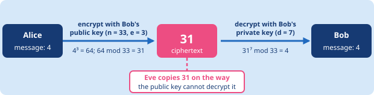

Bob creates the key pair, keeps the private key secret and publishes the public key, e.g. on his website or in his certificate. Alice encrypts with **Bob's public key**; only **Bob's private key** can decrypt. Real keys are hundreds of digits long; this toy pair uses **mod**, the remainder after dividing (64 mod 33 = 31). To find d, Eve would have to split n into its prime factors (33 = 3 × 11): easy here, but for a real n with over 600 digits no ordinary computer could do it in any useful time.

#### Symmetric or asymmetric?

| | Symmetric | Asymmetric |
|---|---|---|
| Keys | One shared secret key | Public key + private key |
| Key distribution | The key must be sent secretly | The public key can be sent openly |
| Speed | Fast: good for large amounts of data | Much slower |
| Typical use | Encrypting the data itself | Sharing a symmetric key; digital signatures |

In practice the two work together: asymmetric encryption shares a **symmetric session key** safely, and that fast key then encrypts the data.

> **Pause & Try 4.35**
>
> Using Bob's toy public key (n = 33, e = 3), encrypt the number 2. Then use his private key (d = 7) to decrypt your answer and check that you get 2 back. Why can Eve not decrypt it with the public key?

### Digital signatures

Encryption keeps a message **secret**. A **digital signature** answers two different questions: **who sent** the message, and has it been **changed** on the way? It uses a key pair **in reverse**: the sender signs with their **private** key, and anyone can check the signature with the sender's **public** key.

First, a **hash function** turns a message of any length into a short, fixed-length value called a **hash**. The same message always gives the same hash, but changing even one character gives a completely different hash, and the message cannot be rebuilt from its hash.

#### Alice signs

1. **Hash** — Alice hashes her message
2. **Sign** — she encrypts the hash with her private key: this is the digital signature
3. **Send** — the message + the signature (+ her certificate)

#### Bob verifies

1. **Decrypt** — Bob decrypts the signature with Alice's public key → hash A
2. **Hash** — he hashes the message he received → hash B
3. **Compare** — if A = B, Alice sent it and nothing was changed

#### Why it works, with the toy keys

Alice's toy key pair uses the same small numbers as Bob's, only to keep the arithmetic short (real key pairs are different for every person): public n = 33, e = 3; private d = 7. Her message hashes to **5**. She signs: 57 mod 33 = **14**, and sends the message with the signature 14. Bob checks: 143 mod 33 = **5**, which matches the hash he calculates himself, so the message is genuine. If Eve changes the message, its hash changes and no longer matches, and she cannot make a new signature without Alice's **private** key.

A signature does not hide the message. To keep it secret as well, Alice also encrypts it with **Bob's** public key.

> **Pause & Try 4.36**
>
> Explain how an asymmetric key pair can be used in reverse to create a digital signature. Show how the receiver uses it to verify the sender's identity and to check that the message has not been changed.

### Digital certificates

A public key is only useful if you know **whose** it is. If Eve could publish her own public key under Alice's name, she could forge Alice's signatures and read her messages. A **digital certificate** solves this: an electronic document in which a trusted **certificate authority (CA)** vouches that a public key belongs to a particular person, company or website.

#### Inside a certificate

- The owner's name or **domain name**, e.g. www.example.com
- The owner's **public key**
- The name of the issuing **CA**
- A serial number and the **dates** between which it is valid
- The CA's **digital signature** over all of the above

#### How a website gets one

1. **Key pair** — private key stays secret
2. **Apply** — public key + domain to a CA
3. **CA checks** — the applicant controls the domain
4. **CA signs** — with the CA's private key
5. **Install** — sent to every visitor

#### How certificates, public keys and signatures fit together

1. Browsers and operating systems come with the **public keys of trusted CAs** already installed.
2. A website presents its certificate. The browser checks the **CA's signature** on it with the CA's public key, and checks the domain name and dates.
3. If the checks pass, the browser trusts the **website's public key** inside the certificate and uses it to **verify the website's signatures** and set up an encrypted connection.

So the CA's signature vouches for the certificate, the certificate vouches for the public key, and the public key verifies the owner's signatures. A signed email carries the sender's certificate in the same way.

> **Pause & Try 4.37**
>
> List the steps an online shop takes to obtain a digital certificate. Then explain how a visitor's browser decides whether to trust the shop's public key.

### SSL and TLS

**Secure Sockets Layer (SSL)** and its successor, **Transport Layer Security (TLS)**, protect data travelling between two applications, such as your browser and a web server. SSL is out of date, though people still say "SSL certificate". When you see **https://** and a padlock, TLS is at work.

#### What TLS provides

- **Encryption:** an eavesdropper sees only ciphertext.
- **Authentication:** the server's certificate proves you are talking to the real website.
- **Integrity:** any change to the data on the way is detected.

#### Where SSL/TLS is used

- **Banking and shopping:** card and account details.
- **Logging in** to websites and school portals.
- **Email:** SMTP, IMAP or POP3 over TLS.
- **Video calls, messaging** and **cloud storage**.
- **Some VPNs** linking remote workers to an office.

#### The TLS handshake, simplified

1. **Hello** — the browser lists the TLS versions and ciphers it supports
2. **Certificate** — the server replies and sends its digital certificate
3. **Check** — the browser verifies the certificate with the CA's public key
4. **Session key** — using asymmetric cryptography, both sides agree a new symmetric key that only they know
5. **Secure session** — all data is encrypted with the session key, which is thrown away at the end

> **Pause & Try 4.38**
>
> What are SSL and TLS, and in what real-world situations are they used to secure network traffic? Describe what your browser does when it checks a website's certificate.

### Quantum key distribution

Asymmetric encryption is safe because some maths problems, such as splitting a huge number into its prime factors, would take ordinary computers billions of years; a large enough **quantum computer** could solve them quickly. **Quantum cryptography** relies on the laws of physics instead. Its best-known use is **quantum key distribution (QKD)**: sharing a secret key in a way that reveals whether anyone was listening.

#### Light as the key

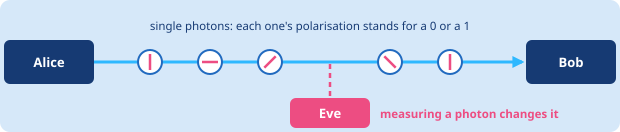

Alice sends the key as single **photons** (particles of light). Each photon's **polarisation**, the direction in which it vibrates, stands for a 0 or a 1, using one of two settings chosen at random. The key rule of quantum physics: **measuring a photon changes it**, and a photon cannot be copied.

#### Catching the eavesdropper

1. **Send:** Alice sends photons, choosing a random bit and a random setting for each.
2. **Measure:** Bob measures each photon with a setting he chooses at random.
3. **Compare settings:** over an ordinary channel they say which settings they used (not the bits) and keep only the bits where their settings matched.
4. **Test a sample:** they publicly compare some of the kept bits.
5. **Decide:** almost no errors: the rest is their secret key. Many errors: someone listened, so they discard it and start again.

If Eve intercepts the photons, she must measure them without knowing Alice's settings. She guesses wrongly half of the time, which disturbs those photons, so about **1 in 4** of the compared bits disagree; without Eve, almost none do. QKD needs special equipment, works over limited distances (up to a few hundred kilometres of fibre) and only shares keys; messages are then encrypted with a symmetric cipher.

> **Pause & Try 4.39**
>
> Explain how QKD lets Alice and Bob detect an eavesdropper. In a sample of 200 compared bits they find 49 that disagree: what should they conclude, and what should they do next?

## Practice

#### Practice · Chapter 4

1. Network fundamentals and architectures
    1. Contrast a local area network (LAN) and a wide area network (WAN) in terms of geographic scale, ownership and transmission speeds. [3 marks]
    2. Compare the client-server model with the peer-to-peer (P2P) model regarding resource management and scalability. [3 marks]
    3. Differentiate between a thick client and a thin client based on where data processing and storage take place. [2 marks]
    4. What are the primary trade-offs (in terms of cost, security and control) between using a public cloud and a private cloud? [3 marks]
    5. A small office is setting up a LAN for 15 computers, a printer and Internet access. Name four items of hardware it needs and state the purpose of each. [4 marks]
2. Medium access and collisions
    1. How do network systems handle data collisions when multiple devices attempt to transmit data simultaneously over a shared medium (e.g. using CSMA/CD or collision avoidance techniques)? [4 marks]
    2. Explain why Wi-Fi networks use collision avoidance (CSMA/CA) instead of collision detection. [2 marks]
3. Web infrastructure and addressing
    1. Break down the distinct parts of a uniform resource locator (URL) (e.g. protocol, domain, path) and explain how it locates a specific resource. [3 marks]
    2. Describe the step-by-step role of the Domain Name Service (DNS) when translating the domain name in a human-readable URL into an IP address. [4 marks]
    3. State two differences between an IPv4 address and an IPv6 address, and give an example of each. [4 marks]
    4. Explain the difference between the Internet and the World Wide Web. [2 marks]
4. Protocol stacks and applications
    1. Outline the four layers of the TCP/IP protocol stack in the correct order (from top to bottom or bottom to top), giving the core responsibility of each layer. [4 marks]
    2. Explain how encapsulation works as data moves down the TCP/IP stack, and what a router does with each packet it receives. [3 marks]
    3. Briefly state the specific purpose of each of these protocols: HTTP, FTP, POP3 and IMAP. [4 marks]
    4. Describe the role of SMTP when an email is sent from one person to another. [2 marks]

## Practice

#### Practice · Chapter 4 (continued)

5. Switching paradigms
    1. Explain what is meant by circuit switching. [2 marks]
    2. There are many applications in which digital data are transferred across a network. Video conferencing is one of these. For this application, circuit switching is preferred. Explain why this is so. [2 marks]
    3. List two major benefits and one drawback of packet switching. [3 marks]
6. Data security, validation and verification
    1. Differentiate between the concepts of data security, data privacy and data integrity. [3 marks]
    2. Contrast the use of validation (e.g. range checks, format checks) with verification (e.g. double entry, parity checks) in protecting data during entry and transfer. [4 marks]
    3. Name three mechanisms used to protect computer systems against threats. [3 marks]
    4. Explain the difference between phishing and pharming. [2 marks]
7. Encryption mechanics and certificates
    1. Compare symmetric key cryptography with asymmetric key cryptography in terms of key management, speed and how plaintext is converted to ciphertext. [4 marks]
    2. Explain how an asymmetric key pair can be used in reverse to generate a digital signature that verifies the sender's identity and ensures message integrity. [3 marks]
    3. A receiver gets a signed message. Describe the steps the receiver takes to verify the digital signature. [3 marks]
    4. What are SSL and TLS, and in what real-world scenarios are they typically deployed to secure network traffic? [3 marks]
    5. Describe how a company acquires a digital certificate from a certificate authority. [4 marks]
    6. Explain how a digital certificate allows a browser to trust a website's public key. [2 marks]
8. Quantum cryptography
    1. Explain why a powerful quantum computer could threaten today's asymmetric encryption. [2 marks]
    2. Describe how quantum key distribution (QKD) allows two users to detect an eavesdropper. [3 marks]
