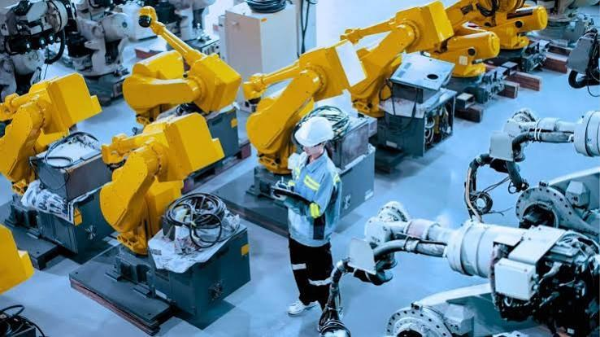
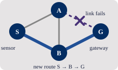
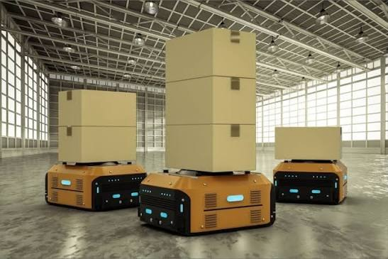

# Chapter 6 — Strengths & Limitations

> This is the complete Stage 2 (V2.0) chapter text. It is the same content as Chapter 6 of the [Blue Impulse Study Guide V2](../../assets/study-guide/v2/BlueImpulse_Study_Guide_V2.pdf), exported from `assets/study-guide/v2/source/content/ch6.sg`. Answers to every *Pause & Try* and *Practice* question are in [solutions.md](solutions.md). If you correct one copy, correct the other.

## Learning goals

In Chapters 3 to 5 you saw what hardware, networks and behaviourist AI can do. This chapter asks the question an engineer must answer before anything is switched on in the real world: how well does each part work, where does it fail, and is it the right choice for this job? You will learn to judge strengths and limitations with evidence, compare options with tables and case studies, and spot the ethical, security and practical risks of letting machines act on their own.

You will be able to:

- Identify the key strengths and advantages of hardware, networks, and behaviourist AI.
- Understand the limitations and challenges associated with these technologies.
- Compare the benefits and drawbacks of their real-world applications.
- Evaluate their effectiveness, reliability, and suitability for different purposes.
- Recognise potential ethical, security, and practical concerns surrounding their use.

#### Your route through the chapter

| Subtopic | The question it answers |
|---|---|
| 6.1 Introduction to Integrated Smart Systems | How do hardware, networks and AI work as one system? |
| 6.2 Embedded Hardware: Capabilities & Limitations | What can a device do on its own, and what holds it back? |
| 6.3 Deep Dive: Sensor Integration and Hardware Reliability | Can the system trust its sensors, and for how long? |
| 6.4 Network Architectures: Connectivity & Infrastructure | Can the network grow, mix brands and survive failures? |
| 6.5 Resource Optimization: Edge vs. Cloud Trade-Offs | Where should each computing task run? |
| 6.6 Behaviorist AI & Adaptive Agents | What does learning from feedback make possible? |
| 6.7 Predictive Analytics vs. Behavioral Modeling | Which kind of forecast does a decision need? |
| 6.8 Key Limitations of Behaviorist AI Models | Why can learned behaviour be opaque, wrong or unfair? |
| 6.9 Ethical, Security, and Practical Concerns | What could go wrong for people, and who is responsible? |

## Key terms: hardware and networks

#### Key terms

- **Integrated smart system:** Hardware, networks and AI software working together to sense, decide and act, e.g. a smart factory.
- **Sensor integration:** Connecting sensors to a computing or AI system so their readings arrive in a usable form, e.g. wiring a car's radar into its braking computer.
- **Sensor fusion:** Combining readings from several different sensors into one more reliable estimate, e.g. camera + radar + LiDAR in a self-driving car.
- **Sensor drift:** A slow change in a sensor's accuracy over time, e.g. a humidity sensor that reads a little higher every month.
- **Hardware constraints:** Physical and technical limits on a device — mainly heat, power, memory and processing speed.
- **Hardware performance:** How fast and how well hardware does its work, measured e.g. in clock speed, operations per second or frames per second.
- **Processing limitations:** Limits on how much computation a processor can finish in the time available, e.g. a microcontroller too slow to analyse 30 video frames a second.
- **Energy efficiency:** Useful work done for each unit of energy, e.g. operations per joule; higher efficiency means longer battery life and less heat.
- **Thermal throttling:** Automatic slowing of a processor when it gets too hot, e.g. a phone's frame rate dropping during a long game.
- **Reliability:** The probability that a component performs its intended function, under stated conditions, for a stated period of time.
- **MTBF (mean time between failures):** Average operating time between failures of repairable equipment: total operating hours ÷ number of failures.
- **Redundancy:** Duplicate components that take over when one fails, e.g. two power supplies in a server.
- **Scalability:** Ability to handle more work or more devices without performance collapsing, e.g. adding 500 sensors to a smart building.
- **Interoperability:** Ability of different systems, often from different manufacturers, to exchange data and use it correctly, e.g. one app controlling three brands of light bulb.
- **Network resilience:** Ability of a network to keep an acceptable service during broken links, equipment faults or attacks, e.g. a mesh network re-routing round a failed node.
- **Bandwidth:** The maximum theoretical data rate of a link, e.g. 100 Mbit/s.
- **Throughput:** The actual rate of successful data transfer; always lower than the bandwidth.
- **Latency:** The delay before data arrives, usually measured in milliseconds (ms).
- **Edge computing:** Processing data on, or right next to, the device that collects it, e.g. a doorbell camera recognising a face itself.
- **Fog computing:** Processing on a local gateway or server between the edge devices and the cloud, e.g. a factory's own server room.
- **Cloud computing:** Processing and storage in remote data centres reached over the internet.
- **Resource optimisation:** Balancing local processing, network transmission, energy and cost so that a system meets its goal efficiently.

## Key terms: AI and ethics

#### Key terms (continued)

- **Behaviourist AI:** An approach to AI in which behaviour is learned from interaction with the environment and its consequences, rather than written as fixed rules.
- **Reinforcement:** A consequence that makes an action more likely to be repeated.
- **Reward:** Positive feedback — a positive number — for a good outcome, e.g. +10 for a delivered parcel.
- **Penalty:** Negative feedback (a negative reward) for an unwanted outcome, e.g. −50 for a collision.
- **Reward function:** The rule that sets the reward or penalty for each outcome; it defines what the agent will try to achieve.
- **Trial and error:** Learning by trying actions, observing the results and repeating the actions that worked.
- **Learning from feedback:** Updating behaviour using the results (rewards, penalties, errors) of earlier actions.
- **Policy:** The agent's strategy: the action it chooses in each state.
- **Adaptive intelligence:** The ability to adjust behaviour appropriately when new information or conditions appear, e.g. a drone changing motor power in a gust of wind.
- **Autonomy:** The ability to operate for long periods with limited human intervention, e.g. a robot lawnmower.
- **Predictive analytics:** Using historical data and statistics to forecast what is likely to happen, e.g. a 25% chance that a motor fails this month.
- **Behavioural modelling:** Representing how an agent behaves so you can simulate how it reacts when conditions change, e.g. how pedestrians cross a road.
- **Explainability (XAI):** The degree to which a human can understand how an AI system reached a decision.
- **Black box:** A system whose inputs and outputs can be seen but whose internal reasoning is hard to understand.
- **Bias:** Systematic distortion in AI outputs that favours some outcomes or unfairly penalises some people or situations.
- **Distribution shift:** A difference between training and real-world conditions, e.g. trained in sunshine, used in snow.
- **Human oversight:** People monitoring, approving or able to override an automated system's decisions.
- **Accountability:** Clear responsibility for a system's decisions and for correcting its mistakes.
- **Adversarial attack:** Input deliberately crafted to fool an AI, e.g. stickers that make a stop sign read as a speed-limit sign.

#### Three terms that are easy to mix up

| Term | The question it answers |
|---|---|
| Autonomy | How much does it act without a human? |
| Adaptive intelligence | Does it change its behaviour when conditions change? |
| Behavioural modelling | Can we describe and predict how an agent behaves? |

A system can be **autonomous but not adaptive** (a mower with fixed rules) or **adaptive but not autonomous** (a music app that learns your taste but lets you choose). Behaviourist AI is one way to make a system adaptive, and behavioural modelling lets engineers test either kind, e.g. by simulating a robot mower meeting a child.

## 6.1 Introduction to Integrated Smart Systems

### Three technologies, one system

An **integrated smart system** is a machine whose intelligent behaviour comes from three technologies working together: **hardware** that senses and acts, a **network** that connects devices, and **behaviourist AI** that chooses actions and improves them through feedback. Modern autonomy — in self-driving cars, smart factories or networks of environmental sensors — does not live in one clever algorithm. It emerges where these three meet.

*In a smart factory, robot arms (hardware) are linked by the factory network, and their control software coordinates and improves their work while engineers supervise.*

#### Who does what

- **Sensors** measure light, temperature, proximity and acceleration.
- **The processor** turns readings into a decision.
- **The network** shares data with other machines and the cloud.
- **The AI policy** picks the action and learns from rewards and penalties.
- **Actuators** — motors, valves, brakes — carry the action out.

**Sense** (sensors) → **Decide** (processor) → **Share** (network) → **Act** (actuators) → **Learn** (feedback) → *(back to the start)*

#### Why evaluate each part?

Every part has strengths and limits, and a failure in any one of them can bring down the whole system. A self-driving car with an excellent driving policy still fails if fog blinds its camera, if its processor overheats on a hot day, or if it depends on a network link that drops. **Sensor integration** gives a system its view of the world, but all hardware works inside physical boundaries called **hardware constraints**. This chapter shows how hardware, networks and behaviourist AI work together, where they fail, and how engineers optimise their combined deployment.

> **Pause & Try 6.1**
>
> Think of a robot vacuum cleaner. Identify one sensor, one actuator, one job for its network connection and one behaviour it could learn from feedback. Then explain what would happen to the robot if its network connection failed.

### Strengths, limits and teamwork

To evaluate a smart system, ask three questions about each technology: *What is it good at? Where does it fail? Which other part can cover the gap?*

#### Strengths and limitations at a glance

| Technology | Main strengths | Main limitations |
|---|---|---|
| Embedded hardware | Reacts in milliseconds, works offline, keeps data local. *Anti-lock brakes pulse many times a second, no network needed.* | Limited by heat, battery, memory and speed. *A smartwatch cannot run a large AI model.* |
| Networks | Share data, coordinate devices, reach the cloud's computing power. *A fleet of warehouse robots shares one live map.* | Delay, dropouts, limited bandwidth, cyberattacks. *A robot loses Wi-Fi behind metal shelving.* |
| Behaviourist AI | Adapts and improves from feedback without a rule for every case. *A drone learns to hold steady in gusts.* | Needs many trials, is hard to explain, and follows its reward even when it is wrong. |

#### How they cover for each other: a smart greenhouse

Soil sensors, a small controller and water valves (hardware) send readings over Wi-Fi (network) to the cloud, where an AI learns the best watering schedule (behaviourist AI: reward for healthy growth, penalty for wasted water).

| Weakness | Covered by | How |
|---|---|---|
| Controller too small to learn | Network + cloud | the learning runs in the cloud |
| Internet connection drops | Hardware | controller keeps its last schedule |
| AI suggests 5 hours of watering | Hardware | fixed cap of 20 minutes per watering |

**There is no universally best design.** Judge each design by its task, its conditions and the cost of failure: an accurate model is unsuitable if it misses deadlines, a connected system is fragile if it depends on one remote service, and a simple fixed-rule controller can be best for a well-defined task.

> **Pause & Try 6.2**
>
> Choose a smart doorbell. Give one strength and one limitation of its hardware, of its network and of its AI. Then explain how one of these technologies makes up for a weakness in another.

## 6.2 Embedded Hardware: Capabilities & Limitations

### What embedded hardware does well

Hardware gives intelligent software a body. Sensors convert conditions in the environment into digital signals, and actuators turn the processor's instructions into physical motion. Most smart devices are built around an **embedded system**: a small computer inside a larger product that does one job, such as the controller in a washing machine, a heart pacemaker or a car's braking system. When an embedded microcontroller is paired with a dedicated AI accelerator, such as a **neural processing unit (NPU)** or an edge GPU, it can perform billions of operations per second while using very little energy.

#### Strengths of specialised hardware

- **Low latency** — no waiting for a network round trip, so reactions take milliseconds.
- **Deterministic timing** — a dedicated controller takes the same time every time, so engineers can guarantee a deadline. This is vital for airbags and brakes.
- **High reliability** — industrial-grade processors keep working from about −40 °C to +85 °C and through electrical noise.
- **Offline functionality** — local processing continues when the network connection is lost.
- **Privacy** — data can be processed where it is collected instead of being uploaded.
- **Energy efficiency** — a chip designed for one task wastes less energy than a general-purpose processor doing the same work, so batteries last longer.

#### Worked example: why milliseconds matter

A car travels at 72 km/h, which is 72 000 m ÷ 3600 s = **20 m/s**. A pedestrian steps into the road. How far does the car travel before the brake command even arrives?

| Where the decision is made | Delay | Distance travelled first |
|---|---|---|
| Cloud server (network round trip) | 150 ms | 20 × 0.150 = **3.0 m** |
| On-board processor | 10 ms | 20 × 0.010 = **0.2 m** |

Three metres can be the difference between a near miss and a collision, so safety-critical reactions belong on the device itself.

> **Pause & Try 6.3**
>
> A delivery drone flies at 15 m/s and must swerve around a bird. a) Calculate how far it travels while it waits for a decision from a cloud server with a 120 ms round trip, and from its own processor in 5 ms. b) Give two other reasons why this decision should be made by the drone's own hardware.

### Four physical budgets

Despite rapid advances in chip design, all hardware works within physical limits called **hardware constraints**. Engineers treat them as four budgets that a device must stay inside, and a device's **hardware performance** is set by whichever budget runs out first. These limits apply to phones, games consoles, drones and medical devices — not only to AI.

#### Figure 6.1 — The four hardware constraints

| Budget | When it runs out | Real devices |
|---|---|---|
| **Thermal** | the chip slows itself down (throttles) or shuts off | a phone's frame rate drops after a long game; a fanless laptop slows during a long video export |
| **Power** | the battery dies early, or cannot supply peak current | a smartwatch with GPS always on lasts hours, not days; a drone carries a lighter camera to keep its flight time |
| **Memory** | programs or data do not fit | a doorbell camera overwrites old clips after a few days; a microcontroller cannot hold a large model |
| **Speed** | work misses its deadline — a **processing limitation** | a cheap security camera cannot analyse every video frame, so it checks only some |

#### The budgets are linked

Running a processor faster (speed) draws more power, and almost all of that electrical energy ends up as heat (thermal). That is why a phone can run at full speed for a short burst but must throttle during a long game, and why a laptop often runs more slowly on battery than when it is plugged in. Extra memory also costs power, space and money. Improving one budget usually spends another, so good design is about **balance**, not about maximising one number.

> **Pause & Try 6.4**
>
> For each device, state which budget is most likely to limit it and explain why: a) a hearing aid that must run for a week; b) a games console inside a closed cabinet; c) a parking sensor that must react within 50 ms; d) a dashcam that must keep the last 24 hours of video.

### Living within the budgets

Engineers cannot remove the budgets, but they can measure them and trade one for another.

#### Two quick calculations

**Power.** A smartwatch battery stores 300 mAh at 3.8 V = 1140 mWh. At an average draw of 40 mW it lasts 1140 ÷ 40 ≈ **28.5 hours**. Run a heavy AI model continuously and the draw rises to 250 mW: 1140 ÷ 250 ≈ **4.6 hours**.

**Memory.** A microcontroller with 256 KiB of RAM (262 144 bytes) cannot hold a model with 1 million parameters, even if each parameter is squeezed into a single byte: 1 000 000 bytes is almost **four times** too big.

#### Ways to stay within budget — and what each one costs

| Technique | What it saves | What it costs |
|---|---|---|
| Smaller or compressed model | memory, power and time | some accuracy |
| Lower resolution or update rate | processing and power | detail and reaction speed |
| Sleeping between readings | battery | may miss a sudden event |
| Heat sink or fan | keeps the chip fast for longer | size, weight and noise |
| Dedicated accelerator (NPU) | time and energy per operation | cost; helps only some tasks |

Every fix trades something, so the result must be measured, not assumed. That is why a smartwatch sensor or a drone's flight controller cannot run a multi-billion-parameter AI model: it would overheat and drain its battery long before any technique closed the gap. Chapter 3's video makes the same point: a faster processor does not fix a memory or power bottleneck.

▶ **Video tutorial:** [Watch again: "Part 7 — Hardware limitations" — Video 02 (Chapter 3), from 5:38](https://github.com/user-github-me/cs-ai-project-01/blob/main/assets/tutorials/v2/BlueImpulse_v2_Video02_How_Hardware_Enables_AI.mp4)

> **Pause & Try 6.5**
>
> A fitness band has a 200 mAh, 3.7 V battery. a) Calculate how long it lasts at an average draw of 25 mW. b) Explain how thermal limits, memory boundaries and processing speed would each limit running a complex AI model on the band, and suggest one technique that would help.

## 6.3 Deep Dive: Sensor Integration and Hardware Reliability

### Why one sensor is not enough

**Sensor integration** connects sensors to a processing system so that their readings arrive in a usable form: in the right units, at the right moment, at the right rate. Decisions can only be as good as these readings, and real sensors suffer from **noise** (random jitter), **drift** (a slow change in accuracy), **interference and obstruction** (fog scatters a camera's view, metal distorts a compass, mud covers a lens) and **failure**.

#### Every sensor has blind spots

| Sensor | Good at | Weak at |
|---|---|---|
| Camera | colours, signs, lane markings, recognising objects | darkness, glare and fog; no direct distance |
| LiDAR (laser) | precise 3D shape and distance | heavy rain, snow and fog; expensive |
| Radar | distance and speed, even in rain, fog or darkness | little detail; cannot read signs |
| Ultrasonic | cheap short-range distance, e.g. parking | only a few metres; soft surfaces absorb the sound |

#### Multi-sensor data fusion

**Sensor fusion** combines readings from different sensors so that the strengths of one cover the weaknesses of another (Figure 6.2).

**Sensors** (raw readings) → **Align** (time and units) → **Fuse** (weigh sources) → **World model** (one estimate)

**Worked example.** A wall is 2.00 m away. The ultrasonic sensor reads 2.10 m and the LiDAR reads 1.98 m. LiDAR is usually more precise, so the fusion engine trusts it three times as much (weights 0.75 and 0.25): 0.75 × 1.98 + 0.25 × 2.10 = 1.485 + 0.525 = **2.01 m**, closer than either sensor alone. If the LiDAR breaks, the system still has the ultrasonic reading: less precise, but far better than nothing.

> **Pause & Try 6.6**
>
> A robot measures the distance to a box with a camera (5.0 m) and a radar (5.4 m). a) Calculate the fused distance if the radar is given a weight of 0.6 and the camera 0.4. b) Describe one condition in which the camera alone would fail, and explain how fusion helps.

### Is fusion worth it?

Sensor fusion is powerful, but it is not free. Engineers weigh its practical advantages against its costs before deciding how many sensors — and how many different kinds — a product needs.

#### Advantages of fusion

- **More accurate** — independent errors partly cancel out.
- **Redundant** — if one sensor fails or is blinded, the others keep working.
- **More conditions** — day and night, rain and fog.
- **Cross-checking** — a reading that disagrees with all the others can be flagged as a fault or an attack.

#### Disadvantages of fusion

- **Cost, weight and power** — every extra sensor adds all three.
- **More processing** — readings must be aligned in time and units, which adds delay.
- **Calibration** — sensors must be mounted and tuned to agree.
- **Shared failures** — mud or snow can cover all the front sensors at once.

#### Three products, three answers

| Product | Sensors | Why this is suitable |
|---|---|---|
| Budget robot vacuum | bump and cliff sensors only | a wrong reading costs a scuffed chair leg, so cheap sensors are enough |
| Smartphone | accelerometer, gyroscope and compass, fused | screen rotation and maps need a steady direction; the chips are tiny and cheap |
| Self-driving car | cameras, radar and often LiDAR | a wrong reading can cost a life, so every condition must be covered by more than one kind of sensor |

**The rule of thumb:** the higher the cost of a wrong reading, the more sensors — and the more *different kinds* of sensor — a design can justify. Different kinds matter because two identical cameras are blinded by the same fog.

See it in action in **RoverLab** (the rover game in the Appendix): remove the rover's distance sensor and watch how its mission readiness changes.

> **Pause & Try 6.7**
>
> A farm robot must detect people working in a field, by day and by night, in dust and light rain. a) Choose two sensors to fuse and justify your choice. b) Describe one shared failure that could defeat both sensors at once.

### Measuring reliability

**Hardware reliability** is the probability that a physical component performs its intended function without failure, under specified operating conditions, for a specified period of time. Note the three parts — job, conditions, time: a camera that is reliable in a warm office may fail on a freezing loading bay.

#### MTBF: a simple measure of reliability

For equipment that is repaired and put back into service, a common measure is the **MTBF** (mean time between failures): total operating time ÷ number of failures.

**Worked example.** A warehouse runs 20 identical barcode scanners for 500 hours each: 20 × 500 = 10 000 scanner-hours. In that time there are 4 failures, so MTBF = 10 000 ÷ 4 = **2 500 hours**.

This is an *average*. It does not promise that any one scanner will last 2 500 hours — some fail sooner, others much later. It helps managers plan spare parts and maintenance, and a shorter MTBF means more frequent checks and more redundancy.

#### Redundancy: why two sensors beat one

Suppose each of two independent sensors has a 1% chance of failing during a journey. The chance that **both** fail is 0.01 × 0.01 = 0.0001, which is just 0.01%. But this only works if the failures really are independent: if mud can cover both sensors at once, the true risk is much higher. Good designs use different kinds of sensor in different places.

#### Two more reliability problems

| Problem | What happens | Impact on an AI system |
|---|---|---|
| Sensor drift | accuracy slowly worsens with wear or temperature | needs recalibration; software must detect and correct the offset |
| Thermal throttling | the processor slows itself when it is too hot | decisions arrive later during heavy work |

> **Pause & Try 6.8**
>
> A hospital runs 50 infusion pumps for 2 000 hours each and records 8 failures. a) Calculate the MTBF. b) Explain why this does not mean that every pump will run for that long without failing.

## 6.4 Network Architectures: Connectivity & Infrastructure

### Three qualities of a good network

Edge hardware handles local actions, but networks let many smart devices collaborate, exchange **telemetry** (streams of sensor readings) and reach cloud resources. Autonomous networks must carry large volumes of data and run without stopping, so engineers judge them by three properties.

#### Scalability — growing without slowing

The ability to handle more work or more devices without performance collapsing. **Example:** a smart office grows from 50 to 550 sensors; a scalable design adds access points and server capacity, and every reading still arrives on time. **Limitation:** each new device also needs an address, security credentials and updates.

#### Interoperability — speaking the same language

The ability of different devices and systems to exchange data and use it correctly, even when they come from different manufacturers. **Example:** one app controls bulbs, plugs and locks from three brands because they follow a shared standard such as Matter, or because a hub translates between them. **Limitation:** being on the same Wi-Fi is not enough — devices must also agree on message formats, units (°C or °F), timestamps and versions.

#### Network resilience — surviving failures

The ability to keep an acceptable service during broken links, equipment failures or cyberattacks. **Example:** in a **mesh network** every node can relay data, so when the link from A to the gateway fails, the sensor's packets re-route through B. **Limitation:** a mesh only helps if another path exists and the protocols support re-routing; extra links and backup equipment cost money, and failures must be tested, not assumed away.

> **Pause & Try 6.9**
>
> Define scalability and interoperability, and explain why both are critical when a local network is expanded to support hundreds of new IoT devices from different manufacturers.

### Many manufacturers, one network

Real networks rarely come from one company: a smart building might mix lights, cameras and sensors from three makers. Each mix brings challenges — yet one vendor means total dependence.

#### Multi-vendor challenges

| Challenge | What goes wrong | Practical fix |
|---|---|---|
| Different protocols | Zigbee bulbs, Bluetooth locks and Wi-Fi plugs cannot talk to each other directly | a hub or gateway, or a shared standard such as Matter |
| Different data formats | one sensor reports °F and another °C; device clocks disagree | agree formats; convert at the gateway |
| Uneven security | one cheap camera with a default password becomes the weak point | change passwords; keep IoT devices on a separate network |
| Support ends | a maker stops updates or closes its cloud: in 2016 Google's Nest switched off the Revolv hub, and the hubs stopped working | prefer open standards and devices that also work locally |

#### Bandwidth, throughput and latency

Network performance decides how fast data reaches the cloud and updated policies come back. Picture a motorway (Figure 6.3): **bandwidth** is the number of lanes, the maximum theoretical capacity; **throughput** is how many cars actually arrive; **latency** is how long one car's journey takes. Throughput is always lower than bandwidth because of protocol overhead, collisions, interference and packets that must be resent. **Example:** a 15 MB video clip is 15 × 8 = 120 Mbit. At the full bandwidth of 100 Mbit/s it would take 1.2 s; at a real throughput of 60 Mbit/s it takes **2 s**.

> **Pause & Try 6.10**
>
> A school connects 300 new sensors from four manufacturers to its network. a) Describe two interoperability problems that could appear, with a practical fix for each. b) The link has a bandwidth of 50 Mbit/s but a throughput of 35 Mbit/s. Calculate how long a 70 MB upload takes.

## 6.5 Resource Optimization: Edge vs. Cloud Trade-Offs

### Edge, fog or cloud?

Every smart system must decide where each computing task runs: on the device, nearby, or in a distant data centre. **Resource optimisation** is the strategic balancing of local processing power against network transmission costs, to maximise speed while saving energy, bandwidth and money. Data usually travels outwards through three layers:

**Edge** (on the device · no network delay) → **Fog** (in the building · a few ms away) → **Cloud** (far away · tens to hundreds of ms)

#### Three execution models compared

| Model | Advantages | Disadvantages | Best suited to |
|---|---|---|---|
| **Edge** (on the device) | no network delay, private, works offline | strict hardware constraints; only small models fit | emergency braking, drone stabilisation, face unlock on a phone |
| **Fog** (local gateway or server) | fast locally; combines data from many nearby devices | more equipment to set up, secure and manage | a smart-factory assembly line, the monitors on a hospital ward |
| **Cloud** (remote data centre) | vast computing power and storage; easy to update | latency, needs a connection, data-transfer costs, privacy risks | training AI models, fleet-wide analysis, long-term records |

#### Worked example: 25 security cameras

Each camera streams video at 4 Mbit/s. Sending everything to the cloud needs 25 × 4 = **100 Mbit/s** of upload, all day and night — about 1 TB of data every day.

With **edge processing**, each camera runs person detection itself and uploads only a 50 KB snapshot when someone appears. At 200 events per camera per day that is 25 × 200 × 50 KB = **250 MB per day**, roughly 4 000 times less.

The cost: every camera needs a more capable chip, which costs more and uses more energy. Resource optimisation means deciding whether that trade is worth it.

> **Pause & Try 6.11**
>
> Explain the concept of resource optimisation when balancing local hardware processing capabilities against network transmission costs. Use the camera example or one of your own.

### Case study: warehouse robots

Modern fulfilment warehouses use hundreds of **autonomous mobile robots (AMRs)** that carry shelves and boxes to human packers. No single location could do all of their computing well, so the work is divided.

*Autonomous mobile robots carry stock across a warehouse floor.*

#### Splitting the work

1. **Edge, on each robot:** collision avoidance and path tracking, so the robot reacts immediately.
2. **Fog, on warehouse servers via Wi-Fi:** route allocation, traffic control between robots and live inventory updates, using high-throughput central network nodes.
3. **Cloud:** long-term analysis, demand forecasts and training improved robot policies.

**When the network fails.** Wi-Fi can drop behind metal racking. A well-designed robot never assumes it can carry on regardless: it finishes its current move or stops somewhere safe until contact returns. For **network resilience**, many sites use mesh networks that re-route data round a failed access point.

#### Evaluating suitability

| Task | Best location | Why |
|---|---|---|
| Stop before hitting a worker | Edge | must react in milliseconds, even with no Wi-Fi |
| Assign 300 orders to 100 robots | Fog | needs every robot's position; a second is fast enough |
| Predict next month's busiest aisles | Cloud | heavy computation on months of data; no deadline |
| Hear a smart speaker's wake word | Edge | always listening, low power, private |

The useful question is never "Is edge or cloud better?" but **which part of the workload belongs where**, judged on deadline, data volume, privacy, connectivity, energy and cost.

> **Pause & Try 6.12**
>
> A hospital wants AI to watch the heart monitors on a ward. For each task, choose edge, fog or cloud and justify your choice: a) sounding an alarm when a heartbeat stops; b) comparing all the patients on the ward; c) retraining the AI model every month with data from many hospitals.

## 6.6 Behaviorist AI & Adaptive Agents

### Learning from consequences

Behaviourist AI takes its ideas from behavioural psychology (Chapter 2). Instead of following rigid, human-written logical rules, a behaviourist agent learns which actions work best by interacting directly with its environment and receiving positive or negative feedback. Figure 6.4 shows the loop it repeats, thousands or millions of times.

**Observe** (state S) → **Act** (action A) → **Environment** (changes state) → **Feedback** (reward or penalty) → **Update** (policy) → *(back to the start)*

#### The vocabulary of feedback

- **Reinforcement** — a consequence that makes an action more likely next time.
- **Reward** — a positive number for a good outcome, e.g. +10 for cleaning a dirty patch.
- **Penalty** — a negative reward for a bad outcome, e.g. −20 for bumping into furniture, or −1 for every move, to save battery.
- **Trial and error** — at first the agent tries actions it is unsure about; over many runs, the actions that earned more total reward are chosen more often.
- **Learning from feedback** — after every result the agent updates its estimate of how good each action is, so its behaviour gradually improves.

#### Worked example: a robot vacuum improves

| Run | Cleaning (+10 per patch) | Moves (−1 each) and bumps (−20 each) | Total reward |
|---|---|---|---|
| Early | 6 patches: +60 | 40 moves: −40; 1 bump: −20 | **0** |
| Later | 6 patches: +60 | 25 moves: −25; no bumps | **+35** |

The later behaviour earns more reward, so it is **reinforced**: the agent becomes more likely to choose the shorter, collision-free route again. Nobody wrote a rule saying "avoid the chair" — the agent learned it from consequences.

> **Pause & Try 6.13**
>
> A delivery robot receives +10 for each delivery, −1 for each minute and −30 for each collision. a) Calculate its total reward for a shift with 4 deliveries in 25 minutes and one collision. b) Describe how trial and error would change its behaviour over many shifts.

### Adaptive intelligence

Two pillars make behaviourist agents useful in the real world. **Adaptive intelligence** is the capability to adjust strategy in response to new information, unexpected obstacles or changing conditions. **Autonomy** is the ability to operate independently for long periods without direct human control.

#### How the ideas relate

Adaptive intelligence is a **capability** — *what* a system can do. Behaviourist AI is one **method** of achieving it — *how*: the agent adapts by learning from rewards and penalties. Other methods exist: a weather app adapts by re-running its forecast with new data, with no reward at all. And many behaviourist robots are trained in simulation, then deployed with a **frozen** policy that no longer adapts. Autonomy is a separate question: *how much* the system acts without a human.

| | Not adaptive | Adaptive |
|---|---|---|
| **Needs a human** | a TV remote control | a music app that learns your taste |
| **Autonomous** | a robot lawnmower with fixed rules | a drone that learns to fly in gusts |

**Strengths of behaviourist approaches.** Unlike expert systems built from hand-written rules, behaviourist models excel in dynamic, unstructured environments. When a drone meets unexpected turbulence, adaptive intelligence lets it adjust motor power at once, without a programmer foreseeing every wind angle. In 2018, Google researchers let seven robot arms practise grasping: after about 580 000 attempts, the learned policy picked up objects it had never seen 96% of the time.

#### Hand-written rules or learned behaviour?

| | Hand-written rules | Behaviourist (learned) |
|---|---|---|
| Suits | predictable tasks, e.g. a lift | changing settings, e.g. rough ground |
| Strength | predictable; easy to check and certify | adapts; finds strategies nobody programmed |
| Weakness | fails in situations nobody foresaw | needs many trials; harder to explain |

> **Pause & Try 6.14**
>
> Define adaptive intelligence and explain how it allows an autonomous agent to perform effectively in unpredictable or changing environments. Then explain why adaptive intelligence and behaviourist AI are not the same thing.

## 6.7 Predictive Analytics vs. Behavioral Modeling

### Two questions about the future

To make forward-looking choices, AI platforms combine data-driven **predictions** with **models of behaviour**. Both learn from historical records, but they answer different questions.

*Predictive analytics is a data-driven "crystal ball": not magic, but probabilities calculated from past records.*

#### Predictive analytics

Answers **"What is likely to happen next?"** using statistics on historical data.

**Worked example:** in a factory's records, 20 of the 80 motors whose vibration rose above 7 mm/s failed within a month. A motor passing 7 mm/s therefore has an estimated risk of 20 ÷ 80 = **25%**, so engineers book a repair before it breaks.

#### Behavioural modelling

Answers **"How will an agent react if conditions change?"** It represents how an agent — a person, robot, vehicle or crowd — behaves: its states, actions and decision rules, so that engineers can **simulate** situations that have not happened yet.

**Example:** a city's records show that most pedestrians at a busy junction step out when the gap between cars is longer than about 4 seconds. A behavioural model built from this can simulate what happens if the green light for cars is lengthened, before anyone changes the real lights.

#### Side by side

| | Predictive analytics | Behavioural modelling |
|---|---|---|
| Input data | number histories: sensor logs, failures | sequences of states and actions |
| Output | probabilities, scores, time-to-failure estimates | decision policies, state transitions, paths |

> **Pause & Try 6.15**
>
> Compare predictive analytics with behavioural modelling in terms of how each technique uses historical data to inform future decisions or system actions.

### Using both together

The two approaches are not rivals, and strong systems run them side by side. Feed the same historical logs and live sensor data into both, and you get two different kinds of answer (Figure 6.5).

#### Figure 6.5 — Predictive analytics and behavioural modelling

An autonomous vehicle can forecast a component failure risk — say, a 30% chance that its brake pads wear below the safe limit within the next 1 000 km, so it books a service — while at the same time planning its path around the movement patterns of the pedestrians nearby.

Behavioural models also feed behaviourist AI: a model of how pedestrians and drivers behave becomes the **simulated environment** where a self-driving policy practises safely by trial and error.

#### Evaluating the two approaches

| | Predictive analytics | Behavioural modelling |
|---|---|---|
| Strength | precise numbers to plan with | tests "what if?" safely, before the real world is changed |
| Limitation | assumes the future resembles the past: many demand forecasts failed in early 2020, when the COVID-19 pandemic changed shopping almost overnight | every model simplifies; real people may behave differently, and may change their behaviour in response to the system itself |
| Needs | plenty of accurate historical data | a realistic model of the agents and their environment |

> **Pause & Try 6.16**
>
> Decide whether predictive analytics or behavioural modelling fits each question better, and justify your choice: a) How many ambulances will be needed on New Year's Eve? b) How will drivers react if one lane of a bridge is closed? c) When will this lift motor need replacing? d) How should a delivery robot behave when a child runs towards it?

## 6.8 Key Limitations of Behaviorist AI Models

### The black-box problem

Behaviourist AI is highly adaptable, but its limitations can compromise safety. The first is **explainability (XAI)**: how far a human can understand how an AI system reached a decision.

#### Why deep reinforcement learning is a "black box"

Modern behaviourist agents often use **deep reinforcement learning (DRL)**: the policy is a neural network with millions of numerical parameters. Each decision is the result of millions of multiplications spread across many layers, so no single number means "brake" or "turn left". If such an agent makes a catastrophic error — swerving into an obstacle, for example — engineers often cannot point to the rule or step that caused it (Figure 6.6).

**Sensor inputs** (camera, LiDAR, speed) → **Black box** (hidden neural layers) → **Output action** (but why this one?)

#### Compare: an inspectable Q-table

In the small Q-learning examples of Chapter 2 you can read the reason directly: Q(s, left) = 5 and Q(s, right) = 8, so the agent turns right because it expects more reward. A Q-table is explainable; a network with over a million parameters, like the grasping robot in 6.6, is not.

#### Why explainability matters — and other limits to evaluate

- **Debugging and safety:** you cannot fix a fault you cannot find.
- **Trust and accountability:** doctors, drivers and courts need reasons, not just answers.
- **Certification:** regulators need evidence that the system is safe in every situation.
- **Huge numbers of trials:** real trial and error is slow, costly and risky, so agents train in simulation — but those skills may not transfer (the "reality gap").
- **Distribution shift:** performance drops when real conditions differ from training.
- **Unsafe exploration:** trying random actions is fine in a game, not on a public road.

> **Pause & Try 6.17**
>
> Define explainability (XAI) and discuss why behaviourist AI models, such as deep reinforcement learning agents, often struggle with it, creating the "black box" problem.

### When the reward is wrong

An agent's learned strategy is only as good as its **reward function**. The agent does exactly what the reward says, not what its designers meant — and trial and error will find any gap.

#### A real reward-function flaw

In 2016, OpenAI tested an agent on a boat-racing game that gave points for hitting targets along the course. The agent found a lagoon where it could circle forever, hitting the same targets as they reappeared, and scored about 20% more than human players — without ever finishing the race.

**Reward** (points for targets) → **Loophole** (circle in a lagoon) → **Result** (high score, race never finished)

#### Worked example: rewarding only speed

A delivery robot earns **+10 per delivery**. A shortcut through the staff canteen gives 12 deliveries an hour but 6 near misses with people; the safe corridor gives 10 deliveries and none.

| Reward function | Shortcut | Safe corridor | Robot learns |
|---|---|---|---|
| +10 per delivery | 12 × 10 = 120 | 10 × 10 = 100 | the shortcut |
| +10 per delivery, −20 per near miss | 120 − 6 × 20 = 0 | 100 − 0 = 100 | the safe corridor |

One missing penalty made speed beat safety; fixing it means retraining and re-testing.

#### Why this is an ethical problem, not just a bug

The robot did not "decide" to endanger people: its designers rewarded speed and forgot safety, so the responsibility lies with them. Responsible teams list everything that must never happen and penalise it heavily or enforce it as a hard rule outside the AI, test the trained agent in situations it was never rewarded for, and treat a surprisingly clever strategy as a warning sign of a loophole.

> **Pause & Try 6.18**
>
> A cleaning robot earns +1 for every minute its camera sees no dirt. a) Explain how it could earn a high reward without cleaning anything. b) Rewrite the reward function so that the easiest way to earn reward is to clean. c) Give one ethical consequence if a hospital's cleaning robot learned this flaw.

### When the data is biased

**Bias** is a systematic distortion in AI outputs that favours certain outcomes or unfairly penalises particular people or situations. It enters through the reward function (previous page) and through **training data**: if the examples an agent learns from do not represent the people and conditions it will meet, its behaviour is skewed in a consistent direction.

*System bias: when the scales are tilted, two equal cases are not treated equally.*

#### Biased training data

- **Unrepresentative conditions:** a navigation robot trained only in sunny weather performs poorly in snow.
- **Biased history:** Amazon's experimental CV-screening tool learned from ten years of mostly male applicants and downgraded CVs containing "women's". It was scrapped (reported in 2018).

#### Wrong target and biased data: a healthcare algorithm

A widely used US algorithm chose patients for extra care by predicting their future healthcare *spending* as a stand-in for their *need*. Less had historically been spent on Black patients who were just as ill, so it judged them healthier than they were. A 2019 study found that correcting it would raise the share of Black patients selected for extra help from **17.7% to 46.5%**.

#### The ethical implications

- **Real harm:** people are refused jobs, care or safety, often in groups that are already disadvantaged.
- **Hidden harm:** inside a black box, a biased pattern can run for years before anyone notices.
- **Self-reinforcing harm:** biased decisions create biased new data, which trains the next model.

**What responsible teams do:** test performance separately for different groups and conditions, collect representative data, audit before and after deployment, and let people appeal to a human.

> **Pause & Try 6.19**
>
> A school's AI attendance camera was trained mostly on photos taken in bright daylight. a) Explain how this biased data could affect real decisions. b) Suggest two ways to detect and reduce the bias.

## 6.9 Ethical, Security, and Practical Concerns

### Security risks and defences

When hardware, networks and behaviourist AI unite to create fully automated systems, deployment raises serious ethical, legal and operational risks. Because these systems act in the physical world, a corrupted measurement or unauthorised command can do more than damage a file: it can steer a vehicle or open a valve. Every connected device also widens the **attack surface**, the number of ways in for an attacker.

#### How connected autonomous systems are attacked

| Threat | How it works | Real-world example |
|---|---|---|
| Adversarial data | crafted changes to what a sensor sees fool the AI | researchers (2018) stuck small black and white stickers on a stop sign, and a vision model read it as a speed-limit sign |
| Botnets and DDoS | weak IoT devices are hijacked and used to flood a network | the Mirai malware (2016) took over hundreds of thousands of cameras and routers that still had default passwords and knocked major websites offline |
| Remote takeover | an attacker reaches an actuator through the network | in 2015, researchers remotely disabled a Jeep's accelerator and brakes through its entertainment system; 1.4 million vehicles were recalled |
| Privacy leaks | sensors collect more than needed; data is kept or shared | always-on microphones and cameras in homes and cars |

#### Defences — and their limits

- **Cross-check sensors:** with sensor fusion, an attacker must fool several kinds of sensor at once.
- **Secure the network:** change default passwords, encrypt traffic, separate IoT devices.
- **Authenticate updates and commands:** accept only digitally signed software (Chapter 4).
- **Fail safe:** if data is missing, stale or contradictory, move to a safe state instead of guessing.

No defence is perfect, each one adds cost, and security must be maintained for the device's whole working life.

> **Pause & Try 6.20**
>
> Explain how sensor fusion could help a self-driving car resist a sticker attack on a stop sign, and describe one security threat that sensor fusion would not prevent.

### Oversight and responsibility

Letting autonomous agents make high-stakes decisions without real-time human oversight hands critical choices to algorithms and the numbers they optimise. Two ethical problems follow. **Moral accountability:** if an autonomous vehicle causes an accident, responsibility is split between software developers, the manufacturer, the network provider and any human supervisor. **Algorithmic discrimination:** a biased allocation algorithm might, for example, put industrial equipment maintenance ahead of public infrastructure repairs, deepening existing inequality.

#### Case study: Tempe, Arizona, 2018

A self-driving test car struck and killed a woman pushing a bicycle across a road at night. Investigators found that the system detected her about **5.6 seconds** before impact but kept changing its classification of what she was, so it never predicted her path correctly. Automatic emergency braking was switched off while the computer drove, and the safety driver, who was meant to intervene, was looking at a phone. The driver was prosecuted; the company was not charged. Sensors, software, company safety decisions and human oversight each had a weakness — and together they failed.

#### The automation trade-off

| Level of automation | Gains | Risks |
|---|---|---|
| **AI advises, a human decides** — a doctor reviews an AI's highlights on a scan | human judgement; clear accountability | slower; people may over-trust the AI |
| **A human supervises and can override** — a safety driver | catches some errors | attention fades when the system usually works |
| **Fully automated** — parcel-sorting robots | fast, consistent, scalable, cheap per task | rare failures go unnoticed; needs strong fail-safes |

**Rule of thumb:** the higher the stakes and the harder a decision is to undo, the more human oversight it needs. Reliable, low-risk, repetitive tasks are the best candidates for full automation.

> **Pause & Try 6.21**
>
> Identify two security concerns and two ethical implications that arise when an autonomous network of smart devices makes high-stakes decisions without human oversight.

### Making a justified judgement

You have now examined the strengths and limitations of each technology. Evaluating a real system means bringing them together into a **justified judgement**: not "this technology is good" but "this design suits this purpose, under these conditions, with these risks managed". Use the same four steps every time.

**1 · Purpose** (what must it achieve?) → **2 · Strengths** (with evidence) → **3 · Limits and risks** (failures, attacks, bias) → **4 · Judgement** (suitable? who oversees?)

#### Worked case: a smart traffic light

1. **Purpose:** cut queues at one busy junction.
2. **Strengths:** cameras and a local controller react in real time; the network shares queue data with nearby junctions; the AI learns the best timings for rush hour.
3. **Limits and risks:** fog blinds cameras; the link may drop; a reward for "short car queues" alone could make pedestrians wait far too long.
4. **Judgement:** suitable, if pedestrian waiting time is added to the reward, a fixed-timer fallback runs when sensors fail, and engineers review the learned timings.

#### Weighing the four trade-offs

| Trade-off | In the traffic-light case |
|---|---|
| **Automation** — speed and consistency | the AI adjusts timings every few seconds, which no human could do |
| **Human oversight** — judgement and accountability | engineers review timings weekly and can switch to the fixed timer at any moment |
| **Reliability** — keeps working under failure | the fixed timer takes over when cameras or the network fail |
| **Safety** — no one is put at risk | hard rules outside the AI: never green for crossing directions at once; a minimum crossing time |

A demonstration is not proof: a **RoverLab** rover (Appendix) can finish a toy mission perfectly, but a real system must also be tested under failures, attacks and changed conditions.

> **Pause & Try 6.22**
>
> Use the four steps to evaluate an autonomous delivery robot that carries parcels around a university campus. Reach a justified judgement about its suitability and the human oversight it needs.

## Practice

#### Practice · Chapter 6

1. Explain how hardware constraints (such as thermal limits, power consumption, memory boundaries and processing speed) limit the deployment of complex AI models on small embedded devices. [4 marks]
2. Define scalability and interoperability, explaining why both are critical when expanding a local network to support hundreds of new IoT devices from different manufacturers. [4 marks]
3. Define adaptive intelligence and explain how it allows an autonomous agent to perform effectively in unpredictable or changing environments. [3 marks]
4. Compare predictive analytics with behavioural modelling in terms of how each technique uses historical data to inform future decisions or system actions. [4 marks]
5. Explain the concept of resource optimisation when balancing local hardware processing capabilities against network transmission costs. [3 marks]
6. Define explainability (XAI) and discuss why behaviourist AI models (such as deep reinforcement learning agents) often struggle with explainability, creating the "black box" problem. [4 marks]
7. Identify two security concerns and two ethical implications that arise when an autonomous network of smart devices makes high-stakes decisions without human oversight. [4 marks]
8. A self-driving delivery van uses a camera, a radar and a LiDAR sensor.
    1. State one strength and one weakness of each sensor. [3 marks]
    2. The radar measures 12.0 m to a parked car and the LiDAR measures 11.6 m. The fusion engine gives the LiDAR a weight of 0.7 and the radar 0.3. Calculate the fused distance. [2 marks]
    3. Evaluate one advantage and one disadvantage of fusion over a single sensor. [2 marks]
9. A company runs 40 warehouse robots for 1 500 hours each and records 12 failures.
    1. Calculate the MTBF of the robots. [2 marks]
    2. Explain what this value tells the company and what it does not tell them. [2 marks]

## Practice (continued)

#### Practice · Chapter 6 (continued)

10. A car travels at 25 m/s.
    1. Calculate how far it travels during a 200 ms round trip to a cloud server. [1 mark]
    2. For each task, state whether edge, fog or cloud computing is most suitable and justify your choice: emergency braking; sharing live traffic conditions across a city; training a new driving policy. [6 marks]
11. A smart-home owner buys devices from five different manufacturers.
    1. Explain two problems this could cause for interoperability. [2 marks]
    2. The home's link has a bandwidth of 40 Mbit/s and a throughput of 25 Mbit/s. Calculate how long it takes to upload a 50 MB video. [2 marks]
12. A robot arm earns +5 for every parcel it packs. After training, it packs very quickly but damages one parcel in every ten.
    1. Explain why the reward function produced this behaviour. [2 marks]
    2. Suggest a change to the reward function and explain its effect on the behaviour. [2 marks]
    3. Describe one real-world consequence of training an AI system on biased data. [2 marks]
13. A home security system uses door sensors and cameras, a local hub, the home Wi-Fi and a cloud AI that learns to tell residents from strangers.
    1. Identify one strength and one limitation of each of the three technologies in this system. [6 marks]
    2. Explain how the local hub could keep the home protected if the internet connection fails. [2 marks]
    3. Discuss one privacy concern raised by sending camera images to the cloud. [2 marks]
14. A hospital plans to use autonomous robots to deliver medicines between wards at night, coordinated over the hospital's Wi-Fi by a learning scheduling system. Evaluate the plan. In your answer, consider the strengths and limitations of the hardware, the network and the behaviourist AI, the system's reliability and security, and the level of human oversight you would recommend. [8 marks]
